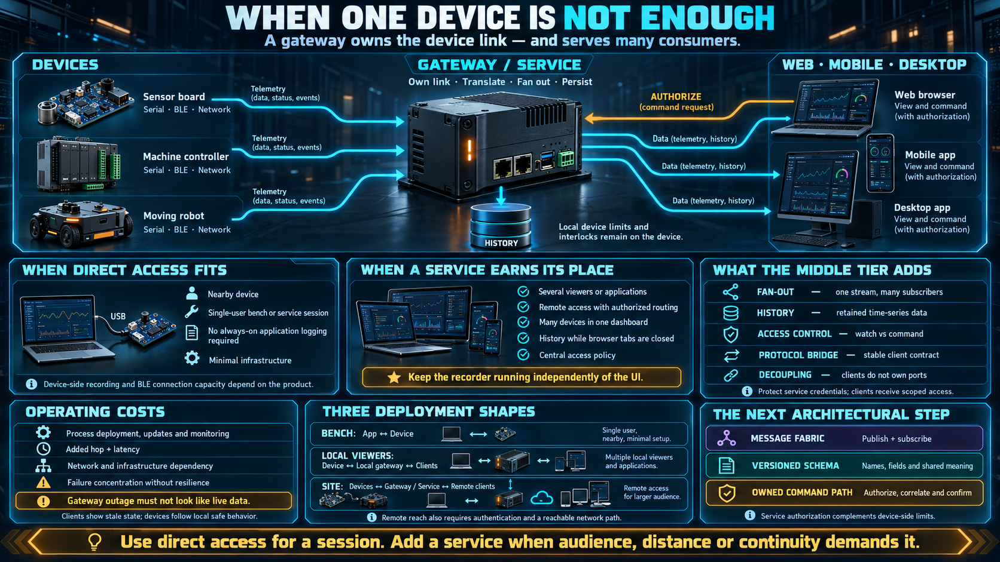

# When One Device Is Not Enough



Every lesson so far has been **point to point**: one application, one nearby device. That shape is simple, and it is the right shape for a large class of tools. It stops being the right shape as soon as a second person needs to watch, or the device needs to keep recording after the tab is closed.

This lesson names the limit and the next piece of architecture. It does not build the service. It tells you when you have outgrown the cable and the radio.

## Where point to point runs out

| You want                                                  | Can point to point do it?                                                  |
| --------------------------------------------------------- | -------------------------------------------------------------------------- |
| Several applications watching one device at the same time | No. A serial port has one owner. A BLE peripheral usually has one central. |
| Reach from anywhere                                       | No. You have to be near the device.                                        |
| A page, a phone, and a desktop tool at once               | No. One client at a time.                                                  |
| History while nobody is looking                           | No. Close the tab and the samples stop being recorded.                     |
| Many devices in one view                                  | Poorly. You would open a link per device, on one machine, by hand.         |
| The system keeps working while the user is offline        | No. Close the application and the conversation stops.                      |

Both limits reduce to two facts: **one owner per connection**, and **the client has to be nearby**.

Those facts are virtues on the bench. Exclusive ownership is what makes the cable predictable. Proximity is what makes the permission model meaningful — the user can see the device they are granting. They become obstacles the moment the product is a site rather than a session.

## A gateway is the owner that fans out

The remedy is to insert a process that **owns the device connection and serves many consumers**:

```
point to point:     app ────── device

through a gateway:  device ──► gateway ──► application A
                    (one owner)    │       application B
                                   └──────► other services
```

A gateway, or more generally a **service in the middle**, is a program that:

- **Owns the device link.** It holds the serial port, the BLE central role, or the Wi-Fi session coming from the device. Pages no longer open the raw pipe.
- **Fans out.** One telemetry stream from the device is delivered to every current subscriber.
- **Stays up.** It does not die when a browser tab closes, so history can be recorded whether or not a person is watching.
- **Translates.** Applications speak a network protocol that suits them. The gateway translates to and from the device protocol. The page never frames serial bytes.
- **Holds the credentials.** Wi-Fi secrets and device keys live with the service. A page that can command a motor should not also be a page that can read the network password out of a script.

Every application talks to the gateway. **None of them sees the device's raw channel.** That is the idea this week has been building toward: the end user does not need to know which wire is in use. The service does.

## Topologies you will actually deploy

```
one person, one device:   app ── serial ──► device                 this week

several local viewers:    device ──► gateway on the same machine ──► several viewers

a real site:              device(s) ──► gateway or cloud service ──► web and mobile
                          (Wi-Fi or a cable)   (a network)            from anywhere
```

The scale changes. The concept does not. The device publishes a capability surface. Consumers reach it through whichever middle tier the distance and the audience require. A gateway on the technician's laptop and a service in a plant are the same role at two sizes: own the link, translate, fan out.

## What the middle tier adds besides fan-out

- **History.** Telemetry is stored as a time series. A dashboard can answer "what happened at 03:00" without having been open at 03:00.
- **Access control.** Who may watch, and who may command, is a policy in one place. You do not implement that policy separately in every page that managed to open a port.
- **A protocol bridge.** The device speaks its framed protocol. The applications speak JSON over a WebSocket, or whatever the clients already share. The middle translates. Neither side adopts the other's dialect.
- **Decoupling.** Devices appear and disappear. Applications know the service, not the port layout of each board. You can add a device without shipping a new client, as long as the contract the service publishes stays stable.
- **Remote reach.** The network replaces the cable and the ten-meter radio. The page can run in an office. The device can run in a building the page has never been in.

Command, in this topology, is no longer a write on a stream the page holds. It is a request the service authorizes and then forwards. That extra hop is also the place where you can reject a command the device would otherwise have obeyed.

## What you pay for a middle tier

Nothing in the diagram is free:

- **Another component to run.** The gateway has to stay up, get updated, and be monitored. A dead gateway looks, to every client, like a dead device.
- **Another hop of latency.** The path is no longer page to device. For monitor-and-control work the added delay is usually acceptable. For a local safety interlock it is not, which is why the interlock stayed on the device in the cooperation lesson.
- **A network dependency.** Remote reach requires infrastructure. You have given up "plug in and use it."
- **A single point of failure.** If one gateway owns every device in a cell, that process is the cell. Design for the outage: clients show stale, devices keep their local safe behavior, and the gateway comes back without requiring a firmware change.

Point to point fails closed in a way operators understand: the cable is unplugged, the tool stops. A gateway fails in a way that can look like data. The last sample is still on screen, the device is fine, and the process in between is not. The stale-versus-live distinction from the shadow-state lesson is the UI half of surviving that failure.

## Choosing, with one more question

Take the three questions from the channel lesson and add the audience:

```
nearby, one device, one application, no need to record while away
    → point to point (Serial or BLE)

many viewers, remote reach, or many devices
    → a service in the middle

must keep working while nobody is watching
    → something that stays up, which means the middle, not the tab
```

Point to point remains the right answer for a bench tool, a firmware helper, and a one-person diagnostic. Reaching for a service on day one, for a single board on a desk, adds a process you will spend the week operating instead of learning the device. The discipline is to notice the moment the answer flips — usually the first time someone asks to watch from another room, or to see last night's data.

## The door this opens

This week ends on a complete idea: a device is a service with a surface, and a browser can reach one nearby device directly. When the system grows past that, three further ideas show up immediately, and they are the next stage of the course rather than the rest of this week:

- **A message fabric.** Many devices and many applications meet through a shared publish-and-subscribe system. A device publishes. An application subscribes. Neither knows the other's address.
- **A schema as the contract.** Bytes were enough inside one cable. A message that crosses a service needs a name, a version, and a definition every side has agreed to. "A JSON object, probably" is not a contract.
- **A command path with an owner.** A command issued from a page, far from the actuator, crosses the service, is authorized there, and only then reaches the device. The device still applies its local limits. The service decides whether this caller was allowed to ask.

That is later work. The standing point of this week is smaller and finished: **a device is a kind of service, a browser can talk to it directly while the job is one nearby machine, and a middle tier is the step you take when that stops being true.**

## Checklist

| Question                               | You should be able to answer                                                                                           |
| -------------------------------------- | ---------------------------------------------------------------------------------------------------------------------- |
| What can point to point not do?        | Many simultaneous viewers, remote reach, and recording while nobody is watching.                                       |
| What is a gateway?                     | The process that owns the device link and serves many applications.                                                    |
| What else does a middle tier give you? | Fan-out, history, access control, protocol translation, and decoupling.                                                |
| What does it cost?                     | Another component, another latency hop, a network dependency, and a process whose failure looks like a device failure. |
| When is point to point enough?         | Nearby, one device, one application, and no need to keep recording after the client leaves.                            |
| What is the next step after that?      | A shared fabric: devices publish, applications subscribe, and a schema is the contract between them.                   |
