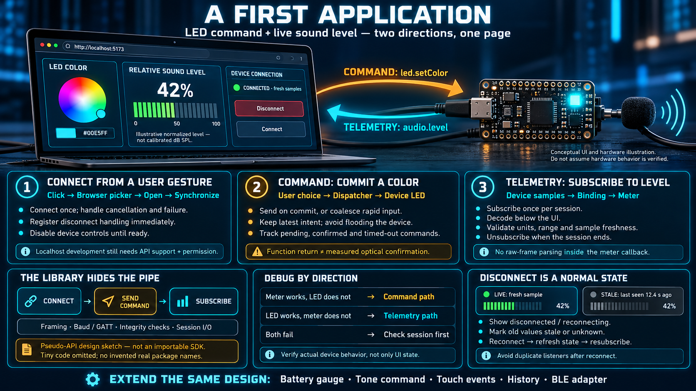

# A First Application — LED Command and a Sound Level



This is the first time the week looks like an application. The page does two things at once: **send a command that sets the LED color**, and **show a live level of nearby sound**. One path leaves the page. The other path enters it. Everything else — framing, baud, GATT — stays under an API the page does not implement.

> The code in this lesson is a **design sketch**, not an SDK. The calls are a pseudo-API chosen so the shape is visible. When the real library is in place, using it should feel like this. Do not import these names and expect them to resolve.

## Map the page onto the anatomy before writing it

The previous lesson named four layers. This demo uses all of them:

```
┌───────────────┐    ┌─────────────┐    ┌─────────┐
│ color control │    │ sound meter │    │ status  │
│ LED command   │    │ audio level │    │ connect │
└───────┬───────┘    └──────┬──────┘    └────┬────┘
        │                   │                │
        └─────────────────┬──────────────────┘
                          ▼
               ┌────────────────────┐
               │ connection manager │
               └──────────┬─────────┘
                          ▼
                   ┌────────────┐
                   │ Web Serial │
                   └──────┬─────┘
                          ▼
                     ┌────────┐
                     │ device │
                     └────────┘
```

- **Command path.** The user picks a color. The dispatcher sends one command. The board changes the LED.
- **Telemetry path.** The page subscribes to audio level. The device pushes samples. The binding moves the meter.
- **Connection.** One control connects and disconnects. The status is always visible.

Serial is the transport in the sketch because the bench is where you want the fewest extra failure modes. The calls that sit above `connect` do not mention serial. That is intentional.

## The runtime is a Vite page on localhost

The Vite dev server serves the page from `localhost`, which is a secure context. Web Serial is available without a certificate for as long as you are developing on that machine. The production problem — HTTPS on a real host, Chromium only — still exists. It is not today's problem.

The entire session begins as one conceptual call:

```ts
// pseudo-API — a design sketch, not a real SDK
const device = await deviceLib.connectSerial();
```

`connectSerial` hides the picker, the baud rate, and the exclusive open. The page receives a session. The layers underneath are still there. You are just not writing them in the click handler.

## Part 1 — Connect, and only from a gesture

```ts
// pseudo-API
connectBtn.onclick = async () => {
  status.text = "connecting…";
  device = await deviceLib.connectSerial(); // the user picks a port in the browser chooser
  status.text = "connected";
  device.onDisconnect(() => {
    status.text = "disconnected — readings on screen may no longer be live";
  });
};
```

What matters is not the syntax:

- The call sits inside **`onclick`**. Web Serial will reject `requestPort()` without a user activation. Calling it from `load`, from a timer, or from a promise that resolved long after the click, fails. The button is not a style choice. It is the consent signal.
- Subscribe and send **after** the session exists. That is the serial lifecycle: grant, open, then converse.
- Register `onDisconnect` immediately. A drop is normal — unplug, revoke, close — and the copy has to demote the shadow. "Connected" is the only state in which the meter is a live instrument.

A second click while a session is already up should disconnect, or it should be ignored. It should not open a second session against a port that still has one owner.

## Part 2 — Set the LED, the command path

```ts
// pseudo-API
colorPicker.onchange = (color) => {
  device.command.send("led.setColor", color); // one command, one color
};
```

Behind that single call:

- The user commits to a color. One command goes to the device. The device changes the LED on its own. The page does not PWM the LED and does not know which pin it is.
- **The command is fire-and-forget at the UI level.** It does not stream back. If the protocol has an acknowledgement, the dispatcher waits for it under this call. Confirmation of the resulting state, if you show it, comes back later as telemetry or as an event. Do not treat "the function returned" as "I can see the color on the board" unless an ack actually said so.
- The dispatcher owes the device a rate limit. A color input emits far more often while the user is dragging than the board should receive. Send when the choice is committed, not on every intermediate frame. That is the constrained-side rule, applied to one control:

```ts
// pseudo-API — on change (commit), not on every input event while dragging
colorPicker.onchange = (color) => {
  device.command.send("led.setColor", color);
};
```

If the control you have only offers `input`, coalesce in the dispatcher: keep the latest color, and send it once the user pauses. The device should see a handful of commands per gesture, not one per animation frame.

## Part 3 — Read the sound level, the telemetry path

```ts
// pseudo-API
device.telemetry.subscribe("audio.level", (level) => {
  meter.value = level; // 0–100, already in meaningful units
  meterText.text = `${level}%`;
});
```

The conceptual points:

- **Subscribe once.** This is not a loop that asks the board for a sample. The device pushes when the level updates. The callback is an event listener, the same shape as a DOM listener, with a device as the source.
- The callback receives **a value that already means something** — a level, not a frame of bytes. Decoding lives in the binding or in the library. If you are slicing an `ArrayBuffer` inside this arrow function, the layer is in the wrong place.
- Samples keep arriving, and the meter keeps moving. The user is looking at a physical quantity, not at a replay. When the session drops, stop painting these samples as live. The last number can stay, with a timestamp, under the disconnected status from part 1.

Unsubscribe when the session ends. A callback that writes into a meter after the page has torn the session down is how a stale closure pretends to be a sensor.

## Both directions, one page

The page now has one path each way:

```
user commits a color ── command ──► device changes the LED     (application → device)
device hears sound    ── telemetry ► the meter moves           (device → application)
```

Play a loud piece of music. The LED stays on the color you set, and the meter jumps. You are watching an input and an output of the physical world on the same screen, which is the whole sense-and-act point of the week in one demo.

The split is also how you debug:

- The LED does not change, and the meter still moves. The command path is the broken one. Look at the dispatcher, the grant, and whether the command is being sent on commit.
- The meter sits still, and the LED does change. The telemetry path is the broken one. Look at the subscription, and at whether the session is actually connected or only looks it.
- Neither moves. Suspect the session before you suspect either feature. A port that never opened will fail both directions together.

You can separate the faults because the directions were never folded into one function.

## What this lesson deliberately does not show

An application developer does not need the following, and the sketch keeps them out on purpose:

- **How the bytes look on the wire.** The library converts a meaningful value to a frame and back.
- **Which port it is.** The user picked it. The browser remembers the grant. The library reopens it.
- **Framing and damage detection.** A protocol that can reject a bad frame sits under the API. A bad frame must not arrive as a level of `NaN` that you then plot.
- **How the firmware implements the command.** You know that you sent `led.setColor` and that the device accepted that verb. The pin, the PWM peripheral, and the LED driver are the device's side of the cooperation.

The page sees a surface of three operations: **connect, send a command, subscribe.** That is the whole capability surface this application needs. Adding a feature means using the surface again, not opening the pipe.

## What you can add without a new design

- A battery gauge: another telemetry subscription, same callback shape, slower rate.
- A "play a tone" button: another command, same dispatcher.
- Touch input: an event subscription. A touch is one occurrence, not a stream of levels. Log it. Do not graph it as a waveform.
- BLE instead of serial: replace the connect function. The color control and the meter stay. That is the transport abstraction, checked against a real second adapter.
- A short history of the level: the binding retains samples, and a chart reads the retention. The subscription itself does not change.

Each of those is a new use of the same three operations. If an idea requires the page to know a baud rate or a UUID, it has fallen through a layer.

## Checklist

| Question                                    | You should be able to answer                                                                  |
| ------------------------------------------- | --------------------------------------------------------------------------------------------- |
| Why does connect live in a click handler?   | Web APIs require a user gesture before they will open a device.                               |
| How do command and telemetry differ here?   | A command is sent and finished. Telemetry is a subscription that receives a stream of values. |
| Why not send the color on every drag frame? | The pipe and the device are the constrained side. Send when the user commits.                 |
| Where are the bytes?                        | Inside the library. The page sees connect, send, and subscribe.                               |
| How do you debug a failure?                 | The two directions fail independently. If both fail, suspect the session.                     |
| How do you add another capability?          | Another subscription or another command, in the same shape.                                   |
