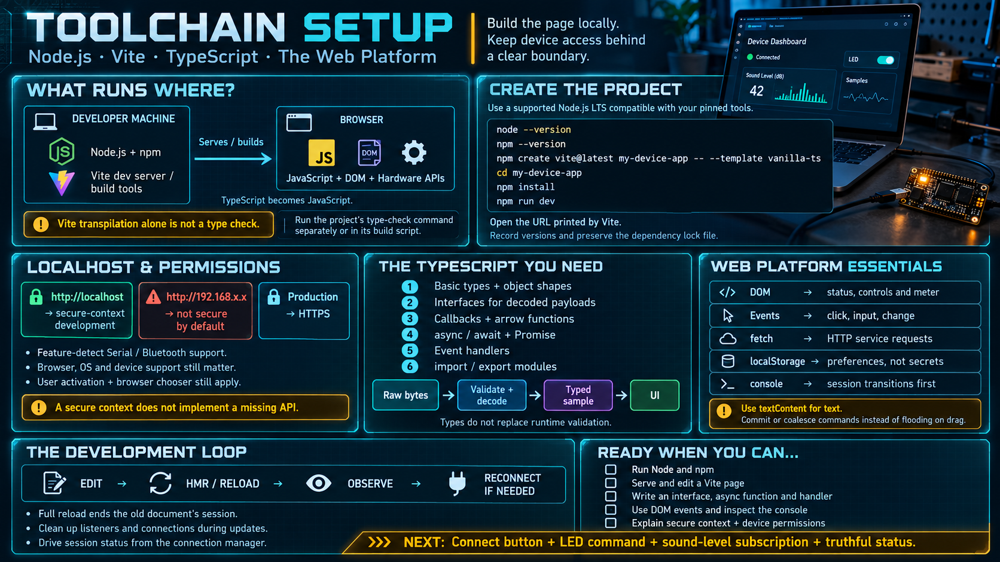

# Toolchain Setup — Node.js, Vite, TypeScript, and the Web Platform



The previous lesson showed the shape of a device page. This lesson is the gate in front of building it: install the toolchain, and know which slice of the web platform the page actually uses. You do not need to be a front-end specialist. You need a current Node.js, a Vite project that serves a secure context, and enough TypeScript and DOM to read the sketch you just saw.

## What you install, and why

| Piece            | What it does                                                 | Why it is here                                                                                       |
| ---------------- | ------------------------------------------------------------ | ---------------------------------------------------------------------------------------------------- |
| **Node.js**      | A JavaScript runtime on the machine, plus npm                | The toolchain runs on it. You are not shipping Node to the user. The user receives a page.           |
| **Vite**         | Development server, production build, and the project runner | Create the page, serve it on localhost, and build static files later.                                |
| **TypeScript**   | Types on top of JavaScript                                   | Make telemetry, commands, and handlers explicit. The browser still runs JavaScript. Vite transpiles. |
| **Web platform** | DOM, events, `fetch`, and the hardware APIs                  | The language the browser gives you. The device page is built on it, not beside it.                   |

Vite+ is the unified toolchain from the VoidZero team — the same group behind Vite — aimed at folding the dev server, the test runner, and the linter into one tool instead of a pile of separate CLIs. The scaffold below uses the current Vite create command, which is the path this course standardizes on. If your environment already provides the Vite+ runner, the workflow you care about is unchanged: a dev server on localhost, TypeScript understood without a hand-written compiler pipeline, and a production build that is static files.

## Step 1 — Install Node.js

Prefer a version manager over a single global install. The next project you touch may need a different major version, and a manager makes that a switch instead of a reinstall.

- **macOS and Linux:** `nvm` or `fnm`. Install the current LTS, then select it (`nvm install --lts`, then `nvm use --lts`, or the `fnm` equivalent).
- **Windows:** `fnm`, or the LTS installer from [nodejs.org](https://nodejs.org/). If you use the installer, still check that `node` resolves in the terminal you will actually use.

Confirm the install:

```bash
node --version     # an LTS release, currently in the v22 line or newer
npm --version      # ships with Node
```

Do not stay on an old Node just because a previous course used it. Current Vite and TypeScript releases set a minimum Node version, and an old runtime fails with an error that looks like a project bug. If `node --version` is surprising, fix that before you debug a config file.

## Step 2 — Create a Vite project and trust localhost

Create a project the way the current Vite documentation describes:

```bash
npm create vite@latest my-device-app
cd my-device-app
npm install
npm run dev
```

Choose a TypeScript template when the scaffolder asks. Open the URL the dev server prints, typically `http://localhost:5173`. If you see the starter page, the toolchain is working.

The detail that connects this step to the rest of the week: **`localhost` is a secure context.** Web Serial and Web Bluetooth are available on this origin during development. You do not mint a certificate to try the first application. Two limits sit next to that convenience:

- Another host name is not localhost. `http://192.168.x.x` is not a secure context, even when the server is your laptop. A phone on the same Wi-Fi will load the page and then find `navigator.serial` missing.
- The browser still has to be Chromium-based. The secure context unlocks the API in Chrome or Edge. It does not make Firefox implement it.

Edit a file under the project source and confirm the page updates without a manual reload. That hot replacement is the loop you will live in: change a handler, look at the device, change the handler again. If a full reload is required, the session with the device will drop, because the streams belonged to the old document. Expect that, and reconnect. Do not be surprised by it.

## Step 3 — The TypeScript you actually need

You need the subset that shows up in a device page. You do not need the type-system catalogue.

- **Basic types.** `string`, `number`, `boolean`, arrays, and object literals, with annotations where a value crosses a boundary (`let level: number`).
- **Interfaces.** A named shape for a payload. A telemetry sample is a natural one:

```ts
interface AudioLevelSample {
  level: number; // 0–100, already decoded
  receivedAt: number; // Date.now() when the page observed it
}
```

- **Functions, including arrow functions.** Subscriptions are callbacks. You will write more arrows than classes.
- **`async` / `await` and `Promise`.** Opening a port, connecting GATT, and waiting for an acknowledgement are all asynchronous. If you do not know the difference between "the function returned" and "the operation finished," the connect button will lie to you.
- **Event handlers.** `element.onclick = ...` and `addEventListener`. User actions enter the page this way, and device subscriptions are the same shape with a different source.
- **Modules.** `import` and `export` between files. The transport, the connection manager, and the UI should not end up in one file by accident. Modules are how the anatomy survives contact with a repository.

Explicitly out of scope for now: deep generics, decorators, and conditional types. They do not appear in an application at this level. Learn them when a signature you must call forces the issue.

The discipline that matters more than any single type: **decode at the boundary, then pass a typed value inward.** A `Uint8Array` may exist inside the transport. A component should see `AudioLevelSample`. If the array reaches the component, the layers from the anatomy lesson have already collapsed.

## Step 4 — The web platform underneath the hardware APIs

A device page is still a web page. These are the pieces it is built from:

- **DOM.** `document`, `querySelector`, `createElement`, `textContent`, `addEventListener`. This is how you build and update the status line, the meter, and the connect button. Write text with `textContent`. Reserve `innerHTML` for markup you fully control.
- **Events.** `click`, `input`, `change`. A user action becomes a handler. Remember the distinction the LED sketch depends on: `input` fires while a control is moving, `change` fires when the user commits. Put commands on `change`, or coalesce them.
- **`fetch`.** The ordinary HTTP client. You do not need it for serial or BLE. You will need it the moment the page talks to a service in the middle instead of to a port.
- **`localStorage`.** A small place for preferences — last-selected unit, a panel the user left open. It is not a place for device secrets, and it is not the shadow. The shadow is memory, refreshed from the device, and it must be allowed to go stale on screen.
- **`console`.** `console.log` is the first debugger you have. Log session transitions (connecting, connected, disconnected) before you log every sample. A telemetry callback that logs at full rate will bury the one line that said the port failed to open.

Web Serial and Web Bluetooth are web APIs in the same family. The rhythm is the one you already use elsewhere on the platform: ask, get a permission, do asynchronous work, receive events. The hardware is new. The shape of the call is not.

One DOM habit is worth more than a component library this week. Keep a single element that reports session state, and drive it only from the connection manager. If any other function writes "connected" into that element, you will eventually show a live meter with a dead port.

## A short path if the web platform is new

If you can already write this kind of page, skip to the done criteria. If you cannot, this is enough to be dangerous in the right direction:

1. **TypeScript for JavaScript programmers.** The handbook page of that name is a few hours, and it covers the subset above. Stop when interfaces, unions you can read, and `async` functions feel ordinary.
2. **DOM and events.** A button that changes a sentence. An input that copies its value into a paragraph. Half a day. Wire `change` and `input` both, so you can see which one fires during a drag.
3. **`async` / `await`.** Fetch a small public JSON document and render one field. The point is to feel an operation that does not finish when the function is called.
4. **The Vite loop.** Change the starter page and watch it update. Then add a button whose handler logs to the console. You now have the skeleton the device sketch hangs on.

The goal is to read and modify the application sketch, not to build a framework. Stop when the done criteria below are true. More tutorial after that is procrastination in front of a device you could already be talking to.

## Done when all of these are true

- [ ] `node --version` and `npm --version` both run, and Node is a current LTS.
- [ ] A new Vite project serves its starter page on localhost with `npm run dev`.
- [ ] Editing a source file updates the page without a manual restart of the server.
- [ ] You can write a small TypeScript module: an interface, an `async` function, and an event handler that calls it.
- [ ] You can point at the DOM, events, `fetch`, and `console`, and use each of them at a basic level.
- [ ] You can explain why `http://localhost` may call Web Serial and `http://192.168.x.x` may not.
- [ ] You are in a Chromium-based browser when you try the device, and you know where site settings live if you need to revoke a port grant.

When that list is true, build the page from the previous lesson: a connect button, one LED command, one audio-level subscription, and a status line that tells the truth when the cable comes out.

## Week checklist

| Question                                     | You should be able to answer                                                                          |
| -------------------------------------------- | ----------------------------------------------------------------------------------------------------- |
| What do you install?                         | Current Node.js LTS, then a Vite project that serves the page.                                        |
| Why does localhost matter?                   | It is a secure context, so Web Serial and Web Bluetooth work during development.                      |
| How much TypeScript?                         | Types, interfaces, `async` / `await`, callbacks, and modules. Not the advanced type system.           |
| Which web APIs is the page made of?          | DOM, events, `fetch`, and `console` — and, on top of the same platform, Web Serial and Web Bluetooth. |
| When are you ready to write the application? | When the done criteria are checked. The LED and sound-level page is the first thing you build.        |
