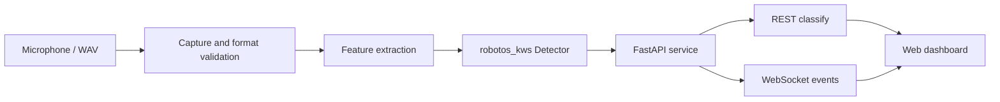

# ND02 — Week 07: From Sensor Data to AI Applications (Theory)

**Track:** Application Developers. Week 07 is the concept-first preparation for [Week 08 AI web services and dashboard labs](../week08/labs/README.md). This module is designed for software developers; it does not require microcontroller firmware compilation.

## Shared concepts first

Read the [common foundations](../../../shared/week07/foundations/README.md): sensors, ADC and sampling, DSP, machine learning, data quality, evaluation and deployment. Understand what the model consumes even if your application accesses data through an SDK.

## ND02-specific chapters

1. [Sensor data, audio formats, and model contracts](theory/01-sensor-data-contracts.md)
2. [Inference SDKs and API architecture](theory/02-sdk-and-apis.md)
3. [Real-time streaming and reactive interfaces](theory/03-realtime-streaming.md)
4. [Model lifecycle, MLOps, security, and operations](theory/04-model-lifecycle.md)

## What software developers need to understand

- A microphone or IMU exposes *measurements*, not semantic events.
- Preprocessing transforms measurements into model inputs; an API must respect the model contract.
- Confidence, rejection, and temporal smoothing are application logic.
- REST works well for file or single-window requests; WebSockets suit real-time event delivery.
- Models are versioned dependencies, with operational failure modes, not magic functions.
- The backend, browser and sensor may have different clock domains and privacy responsibilities.

## Reference architecture

**Recommended discussion:** what can go wrong if a browser sends 48 kHz float audio to a model expecting a 16 kHz mono signed-PCM stream? Design a contract that rejects, converts, or clearly reports incompatible data.

## Continue to practicals

- [ND02 Week 08 labs](../week08/labs/README.md)
- [ND02 Week 08 checkpoint](../week08/checkpoint.md)

A prepared model is enough for ND02 to start API work; students do not need to complete all ND01 training exercises before understanding application architecture.
