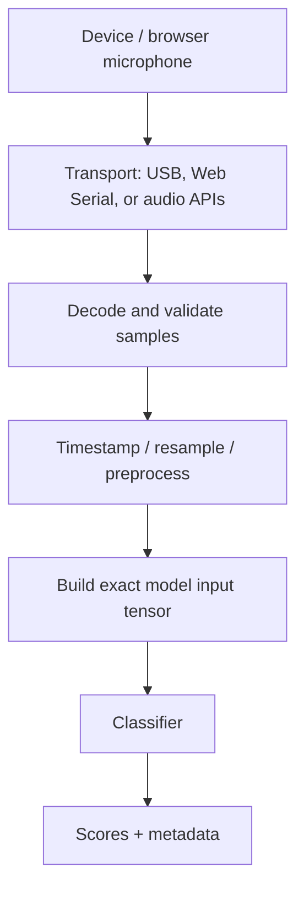

# ND02.1 — Sensor Data, Audio Formats, and Model Contracts

[ND02 Week 07](../README.md) | [Shared ADC/sampling](../../../../shared/week07/foundations/02-adc-and-sampling.md) | [Next: SDK and APIs](02-sdk-and-apis.md)

## Developers receive measurements, not meaning

When a microphone records a word, the software receives a waveform: a sequence of amplitude numbers. When a board streams IMU data, the application receives timestamped vectors. A UI displaying `red` or `shake` is showing a *model interpretation*, not the sensor's raw output.

Keep distinct software layers:



## Data types are part of the contract

Examples of possible incoming representations:
- WAV file containing mono signed 16-bit PCM.
- Raw signed 16-bit little-endian PCM chunks.
- Browser Web Audio `Float32Array` samples, often at a device-selected sampling rate.
- JSON measurements with six numeric IMU channels.
- Binary framed serial packets containing sequence numbers and checksums.

**Do not treat these representations as interchangeable.** A WAV file includes a container header; raw PCM does not. Browser microphone input might be 44.1 kHz or 48 kHz even when the model expects 16 kHz. Conversion requires proper resampling, channel mixing and numerical scaling.

## Example: normalization for audio

Suppose an API receives signed 16-bit PCM. A simple conversion to floating-point amplitude is:

```python
import numpy as np

pcm = np.array([-32768, -16000, 0, 16000, 32767], dtype=np.int16)
x = pcm.astype(np.float32) / 32768.0
print(x)
```

The normalized values are approximately in [-1, 1). This numeric conversion alone is **not** log-mel extraction and does not guarantee the model accepts this input.

## A useful model-input contract

Record:
- Model identifier and version.
- Input medium (WAV / PCM / model features).
- Audio sample rate, channels, sample format and clipping policy.
- Frame/window duration and hop.
- Feature extraction pipeline identifier and parameters.
- Input tensor shape and dtype.
- Output labels in their exact index order.
- Score interpretation, threshold and unknown policy.

For example:

```json
{
  "model_id": "colors-kws",
  "version": "1.0.0",
  "sample_rate_hz": 16000,
  "channels": 1,
  "pcm_dtype": "int16",
  "window_samples": 16000,
  "feature_shape": [49, 40],
  "feature_pipeline": "logmel-v1",
  "labels": ["red", "green", "blue", "off", "_silence_", "_unknown_"]
}
```

This is an **illustrative API contract**. Verify actual SDK configuration and label order rather than assuming the example is the exact artifact.

## Validation before inference

A service should reject or explicitly convert:
1. Wrong or unsupported input MIME/container formats.
2. Excessively large uploads and malformed files.
3. Incorrect sample rate or channel layout.
4. Empty or implausibly short input.
5. NaN/infinite input and incompatible tensor shapes.
6. Model not loaded, unavailable or mismatched to the pipeline.

Return useful error descriptions instead of allowing an obscure model runtime error to reach users.

## Timestamp and transport semantics

If you stream audio in chunks, chunk arrival and sensor sampling are not the same clocks. A browser may batch callbacks, the server may buffer, and packets may be delayed. Use sequence numbers or sample counts to reconstruct continuous-time position where possible.

Serial frames need framing, corruption checks and out-of-order/dropped-frame policies. A stream that silently loses samples can change a word or gesture feature without causing any obvious parsing error.

## Exercise

Design the request and response schemas for an audio classifier. Decide whether you will support a WAV upload only or raw PCM chunks. Write explicit rules for incorrect sampling rate, empty input, unavailable model and overlong recordings.

## Questions

1. Why does an API need to know sample rate and dtype?
2. What is the difference between WAV and PCM?
3. Can you rename model labels without retraining or updating the contract?
4. What is lost if you assume packet arrival time equals capture time?
5. How should a service handle audio that is correctly encoded but too quiet?

[Next: SDK and APIs](02-sdk-and-apis.md)
