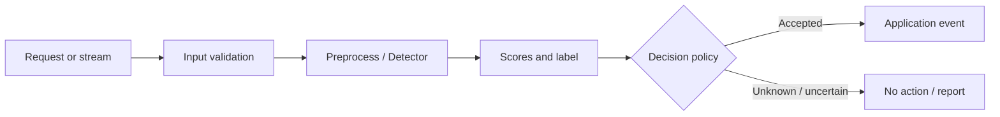

# ND02.2 — Model SDKs, Service Boundaries, and REST APIs

[ND02 Week 07](../README.md) | [Previous: Data contracts](01-sensor-data-contracts.md) | [Next: Real-time streaming](03-realtime-streaming.md)

## A trained model is a software dependency

A model cannot meaningfully classify an uploaded sound unless the system also supplies:
- Compatible preprocessing.
- A model runtime or interpreter.
- The correct model artifact.
- An output-label mapping.
- A decision policy.
- Error handling and observability.

It is useful to wrap these details behind a **Detector** abstraction. The Week 08 `robotos_kws` SDK exposes a `Detector` that can load a trained model and return labels and probabilities.

## SDK call versus application action

Conceptually:

```python
import robotos_kws as rk

detector = rk.Detector("artifacts/model_int8.tflite", threshold=0.80)
top_label, confidence = detector.predict("test.wav")
probabilities = detector.predict_proba("test.wav")
```

This illustrates the SDK pattern used in the existing lab. A model result should not automatically become a hardware command. Add a **decision policy**, such as confidence threshold, ignored negative classes, allowed commands and operating state.



## REST API design

REST-style endpoints suit stateless classification requests and model metadata. The Week 08 app demonstrates:
- `GET /api/v1/model/info`: readiness and model metadata.
- `POST /api/v1/classify`: accept a WAV upload and return structured scores.

A representative response:

```json
{
  "top_class": "blue",
  "confidence": 0.94,
  "probabilities": {
    "red": 0.01,
    "green": 0.02,
    "blue": 0.94,
    "off": 0.01,
    "_silence_": 0.01,
    "_unknown_": 0.01
  }
}
```

Real software should include a model version and request identifier for traceability. A score is not necessarily a calibrated probability.

## HTTP errors and quality

Examples:
- **400 Bad Request:** invalid sample rate or unsupported fields.
- **413 Content Too Large:** upload exceeds limits.
- **422 Unprocessable Content:** request shape is invalid; use consistent framework conventions.
- **503 Service Unavailable:** model not loaded or not ready.
- **500 Internal Server Error:** unexpected server failure, logged without exposing sensitive internals.

The exact status strategy depends on your API; do not mask every problem as `200 OK`.

## Asynchronous services are not magic

A Python `async def` endpoint is not automatically non-blocking when it performs CPU-intensive inference synchronously. Heavy preprocessing or model invocation can block an event loop. Options include thread pools, worker processes or an inference service, with appropriate synchronization around shared interpreter state.

If a model runtime is not thread-safe, multiple concurrent requests must not call one interpreter without protection. Plan model lifetimes and concurrency intentionally.

## Separation of concerns

An easy-to-maintain service design:

```text
transport / endpoints
  -> validation and format conversion
  -> inference service
  -> detector / model adapter
  -> decision policy
  -> event or response
```

Use explicit dependency boundaries. Application code should not reach into private model interpreter internals unless the API contract requires it.

## Testing layers

1. **Unit:** validate audio metadata, input shape and decision policies.
2. **Contract:** verify JSON keys, types, model version, error behavior.
3. **Integration:** run detector on a known WAV and check plausible outputs.
4. **Load/concurrency:** test simultaneous clients and model switching.
5. **Operational:** test disconnected microphone, unavailable model and corrupt files.

## Exercise

Design `POST /api/v1/classify` with a clear input specification, response schema, errors and model version. Provide one normal response, one rejection response and one “model unavailable” response.

[Next: Real-time streaming](03-realtime-streaming.md)
