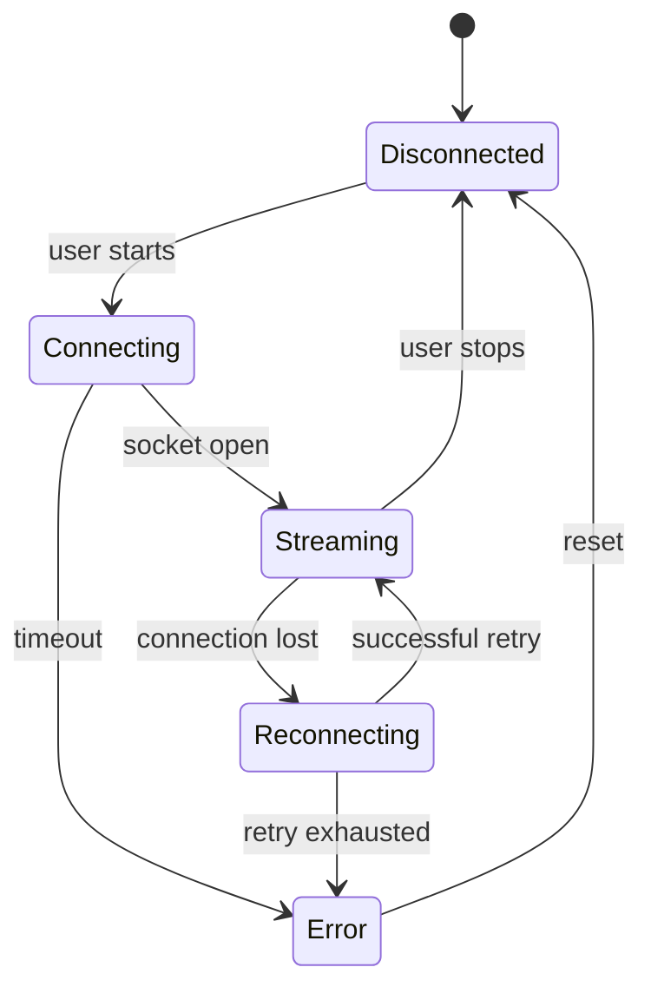

# ND02.3 — Real-Time Inference Events and Reactive Web Applications

[ND02 Week 07](../README.md) | [Previous: SDK and APIs](02-sdk-and-apis.md) | [Next: Model lifecycle](04-model-lifecycle.md)

## Why “real time” changes application design

Sending one WAV file via HTTP is simple. Continuous monitoring instead produces a stream of samples, partial classifications and accepted events. A stream needs timing information, connection management, bounded buffers, backpressure handling and a clear separation between *current scores* and *triggered actions*.

## HTTP request versus WebSocket

| Criterion | REST upload | WebSocket |
|---|---|---|
| Pattern | One request, one response | Persistent bidirectional connection |
| Good for | WAV files, health checks, metadata | Streaming samples and server-pushed predictions |
| Network behavior | Per-request overhead | Lower repeated-message overhead |
| Failure mode | Request timeout | Connection drop, reconnect, stale state |
| Main concern | Payload validation | Ordering, backpressure, buffering, lifetime |

WebSocket communication does not guarantee sub-50 ms end-to-end event latency; audio windowing, inference, scheduling and networks all contribute. Measure latency under the expected deployment conditions.

## A streaming state machine



The UI must show whether a model is actually connected and receiving current data. “WebSocket connected” is not synonymous with “sensor producing valid audio” or “model ready.”

## Sliding windows and duplicate detections

Suppose inference operates on 1-second audio windows with a 200 ms hop. Adjacent windows overlap strongly. One spoken word can appear in several consecutive windows and repeatedly exceed a confidence threshold.

A **refractory period** suppresses repeated triggers for a chosen interval. A smoothing filter can average recent outputs to reduce short spikes. These postprocessing policies increase reliability but may increase delay or miss rapid consecutive words.

## Message design

Separate **continuous telemetry** from **accepted semantic events**.

```json
{
  "type": "inference_scores",
  "sequence": 105,
  "model_version": "1.0.0",
  "timestamp_ms": 23400,
  "scores": {"red": 0.03, "green": 0.05, "blue": 0.88, "off": 0.04},
  "signal_rms_dbfs": -22.7
}
```

```json
{
  "type": "keyword_detected",
  "sequence": 105,
  "model_version": "1.0.0",
  "keyword": "blue",
  "confidence": 0.88,
  "accepted": true
}
```

These are **proposed teaching schemas**, not a promise that the current application implements all these fields. Real applications should also document clock type and whether timestamps come from capture or server receipt.

## Browser audio considerations

The browser may sample microphone audio at its own hardware/OS-selected rate. A 16 kHz model cannot interpret arbitrary-rate PCM as if it were already 16 kHz. A browser-to-server pipeline must resample appropriately, handle audio channels, packetize samples consistently, and decide which side owns DSP processing.

Microphone permission and mute status are part of the user experience. The application must not give a misleading “listening” indicator when permission is absent.

## Reactivity and UI states

A useful monitoring interface distinguishes:
- Microphone: permission denied / idle / capturing / too quiet / clipping.
- Connection: disconnected / connecting / connected / reconnecting.
- Model: loading / ready / failed / updating.
- Prediction: top label, confidence and distribution.
- Action: pending / accepted / rejected / blocked by safety policy.

Never turn low-confidence predictions into definitive state without explanatory UI.

## Network and privacy

- Use authenticated access for protected inference/control APIs.
- Prefer secure transports (HTTPS/WSS) in deployed environments.
- Limit upload size and collection retention.
- Avoid sharing raw voice recordings without consent.
- Rate-limit or otherwise bound streaming resource use.
- Keep logs useful but avoid storing unnecessary personal audio.

## Exercise

Draw the lifecycle of a user pressing “Record mic,” saying “green,” receiving scores, seeing one accepted event, losing network connectivity and reconnecting. Define how the UI knows which state it is in.

## Questions

1. Why can overlapping windows cause duplicate triggers?
2. Why is persistent connection latency not the same as prediction latency?
3. What does a sequence counter help detect?
4. How should the UI behave if the WebSocket is connected but the detector is unavailable?
5. Where should audio resampling occur, and how will you test it?

[Next: Model lifecycle](04-model-lifecycle.md)
