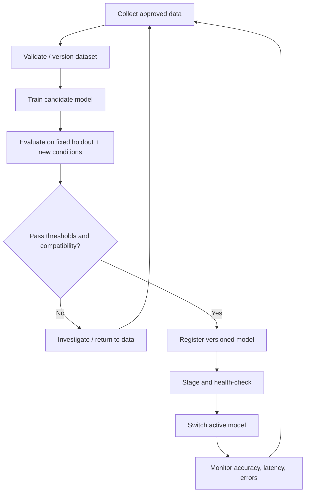

# ND02.4 — Model Lifecycle, MLOps, Security, and Operations

[ND02 Week 07](../README.md) | [Previous: Real-time streaming](03-realtime-streaming.md) | [Week 08 practical](../../week08/labs/README.md)

## AI services need lifecycle management

A deployed model changes over time as better datasets and requirements emerge. Retraining is not simply “run the training script again.” Production quality depends on reproducibility, artifact validation, controlled rollout and observing whether new data remain representative.

## Dataset and model provenance

For each model release, retain:
- Training dataset identifier, label definitions and approved use.
- Sensor/preprocessing configuration.
- Model architecture and software/runtime versions.
- Training parameters and random seed.
- Split policy, held-out metrics and known limitations.
- Compatible input/output contract.
- Artifact checksum or signature when applicable.

Reproducibility reduces confusion when one release works on a laptop but fails in the lab.

## Hot-reloading without downtime

A safe replacement sequence:
1. Train the candidate separately from the running service.
2. Evaluate it and validate its label order and tensor input/output signatures.
3. Load a **new detector instance** away from live requests.
4. Run health checks using known fixtures.
5. Atomically change the service's active detector reference.
6. Preserve or close old sessions according to a documented version policy.
7. Keep rollback to the previous known-good artifact.

Updating a local variable inside an external Python script does **not** automatically change the object in an already-running FastAPI process. A service needs an explicit reload endpoint, background watcher, IPC, or another controlled mechanism. Inspect the exact Week 08 implementation before assuming that hot-reload is already functional.

## Concurrency

Microphone capture, WebSocket fan-out, HTTP requests and model invocation can occur simultaneously. A production design should:
- Control concurrent access to a shared model interpreter.
- Avoid blocking the main event loop on CPU-bound inference.
- Use queues with size limits and explicit drop policies.
- Attach model version to responses.
- Ensure clean shutdown of audio threads and connections.

## Drift and monitoring

Drift can appear as a different microphone, quieter speakers, background noise or previously unseen phrases. Track:
- Input quality and missing-data rate.
- Accepted vs rejected classification events.
- Confidence distributions over time.
- False triggers evaluated on approved feedback samples.
- End-to-end response latency.
- Error rates and model loading failures.

A change in predicted label frequencies is a signal for investigation, not automatic proof of model degradation.

## Security and privacy

A public inference endpoint can be misused or overwhelmed. Apply input size limits, authentication where appropriate, rate limiting, structured logging and least-privilege service execution. For audio, retain samples only when needed and with consent. For robot-control actions, never let untrusted model outputs bypass a deterministic authorization or safety policy.

The Week 08 FastAPI example is a teaching application. It may use permissive development defaults such as broad CORS configuration; these are not automatically suitable for Internet deployment.

## Design exercise

A trained INT8 model with labels `red/green/blue/off` is replaced by a model with a different label order. The new model still loads. Explain why a UI could act incorrectly even when each score array has the expected length. Specify the compatibility checks needed before activation.

## Review questions

1. What is the difference between retraining and live model reloading?
2. How should an active API handle a model replacement while clients remain connected?
3. What does versioning of preprocessing accomplish?
4. What is the minimum rollback strategy?
5. Why can an apparently successful `train()` call still produce an unacceptable model?

Continue to [ND02 Week 08 practical labs](../../week08/labs/README.md).
