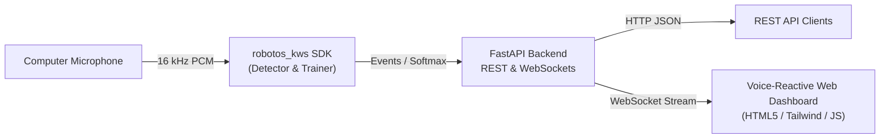

# ND02 — Week 08: Edge AI as a Service (Backend & Frontend Track)

> **Before the practical:** [ND02 — Week 07 Edge AI theory](../week07/README.md). Week 07 explains the foundational concepts; this Week 08 section applies them in labs.


**Session:** Saturday 21 November 2026 · Online · 09:00–12:00  
**Topic:** *Integrating Edge AI Models into APIs, Real-Time Streams, and Web Applications*  
**Track Focus for ND2:** **Backend & Frontend (Full-Stack) — SDK Integration using Computer Microphone (No Board Required)**

In this session, you learn how software engineers consume edge AI models programmatically. Using the **`robotos_kws` Python SDK**, you will load quantized deep learning models, build high-performance REST APIs with FastAPI, stream real-time speech events over WebSockets, build an interactive voice-reactive web dashboard, and establish an automated background MLOps retraining service.

> [!NOTE]
> - **ND01 (Embedded Track):** Embedded Systems & IoT — Focus on CLI-only pipeline, MCU resource limits, and C firmware export.
> - **ND02 (This Track):** Backend & Frontend — Focus on Python SDK (`import robotos_kws`), FastAPI inference APIs, WebSockets, and reactive web dashboards.
> - **ND03 (Robotics Track):** Automation & Robotics — Focus on real board hardware and 50 Hz IMU motion gestures.

---

## Table of Contents

- [Labs Guide](labs/README.md)
- [Pre-Flight Readiness Quiz (10 Questions)](preflight.md)
- [Checkpoint Quiz](checkpoint.md)
- [Track Index](../../README.md)

---

## Learning Outcomes

- **Consume Machine Learning via SDK**: Use `robotos_kws.Detector` to run single-clip predictions, extract softmax probability distributions, and consume continuous audio generators.
- **Microservice API Architecture**: Build asynchronous REST endpoints (`POST /api/v1/classify`, `GET /api/v1/model/info`) with FastAPI, Pydantic validation, and OpenAPI documentation.
- **Real-Time Event Streaming**: Stream continuous speech classification events over WebSockets (`ws://localhost:8000/ws/kws`) with latency under $50\text{ ms}$.
- **Reactive Voice Dashboard**: Build a modern web interface that updates UI theme, displays live probability bars, and dispatches UI actions on target keywords (`red`, `green`, `blue`, `off`).
- **MLOps Automation**: Programmatically trigger model retraining with `robotos_kws.Trainer` and hot-reload active model instances without server restarts.

---

## Schedule (09:00–12:00)

| Time | Block | Topic | Hands-On Activity |
| :--- | :--- | :--- | :--- |
| **09:00–09:30** | Block 1 | Python SDK Fundamentals & Audio Batch Inference | `Detector.predict()`, `Detector.predict_proba()` |
| **09:30–10:15** | Block 2 | Building an Audio Inference Microservice | FastAPI REST API (`/api/v1/classify`) |
| **10:15–11:00** | Block 3 | Real-Time Speech Streaming with WebSockets | WebSocket Endpoint (`/ws/kws`) |
| **11:00–11:35** | Block 4 | Voice-Controlled Web Application (Dashboard) | Single-Page Reactive Web UI |
| **11:35–12:00** | Block 5 | Automated MLOps & Retraining Pipeline | `robotos_kws.Trainer` Webhook |

---

## Architecture Overview



---

## Hardware & Firmware Flashing (Optional for ND2)

While ND2 builds backend services and web dashboards using your computer microphone and Web Audio API by default, you can also stream live sensor data directly from an ESP32-S3 board to your FastAPI service.

If using physical hardware, ensure it is flashed with the workshop firmware first:

```bash
# Audio / Microphone board (ES3C28P):
robotos flash-firmware --board es3c28p

# IMU / Motion Gesture board (WS28P):
robotos flash-firmware --board ws28p
```
*(Or use `robotos-flash --board es3c28p`)*.
The flasher automatically detects your USB serial port (`COM*` or `/dev/cu.usbmodem*`), downloads the binaries, flashes with live progress, and performs an automated handshake verification.
