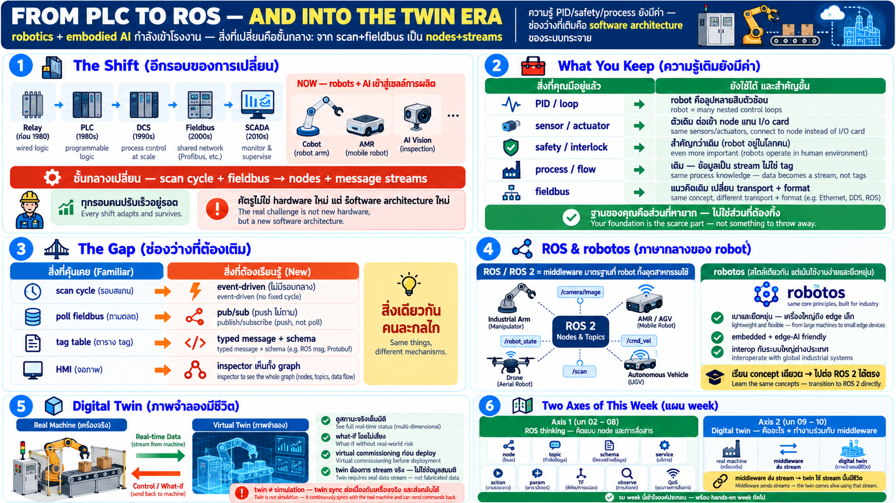

# ทำไม automation ต้องไปยุค ROS และ Digital Twin



## โลกกำลังเปลี่ยน — อีกครั้ง

คน automation ผ่านการเปลี่ยนแปลงมาแล้วรอบหนึ่ง: relay logic → PLC
→ DCS → fieldbus → SCADA — ทุกรอบผู้ที่ปรับตัวเร็วคือผู้ที่อยู่
รอดและเติบโต

รอบนี้คือ **robotics + embodied AI** — หุ่นยนต์และระบบอัจฉริยะไม่ได้
อยู่แค่ใน cell ที่ cage ไว้อีกต่อไป: AMR เดินในโกดัง, cobot ทำงาน
ข้างคน, AI ตัดสินใจจากภาพและ sensor — ต่างจากรอบก่อนตรงที่
คราวนี้ **ศัตรูไม่ใช่ hardware ใหม่ แต่เป็นสถาปัตยกรรม software
ใหม่**

## สิ่งที่คุณรู้อยู่แล้วยังมีค่า — และยังเป็นส่วนที่หายาก

ก่อนอื่นชัดเจน: **ความรู้เดิมไม่ได้หมดอายุ**

| ที่คุณรู้แล้ว | ในโลกใหม่มันคือ |
|---|---|
| PID / control loop | ยังเป็นแกนของทุก actuator — robot ก็คือลูปหลายสิบตัวซ้อนกัน |
| sensor/actuator | ตัวเดียวกัน แค่ต่อเข้า "node" แทน I/O card |
| safety/interlock thinking | สำคัญกว่าเดิม — robot เคลื่อนที่ในโลกคน |
| อ่าน process/flow | เหมือนเดิม — เพียงแต่ตอนนี้ "ข้อมูล" คือ stream ไม่ใช่ tag |
| fieldbus/Modbus/Profibus | แนวคิดเดียวกัน — เปลี่ยน transport และรูปแบบข้อมูล |

สิ่งที่เปลี่ยนคือ **ชั้นตรงกลาง**: ระหว่าง sensor กับการตัดสินใจ
เคยเป็น scan cycle + fieldbus + ladder — ตอนนี้เป็น **distributed
software nodes ที่คุยกันด้วย message**

## ช่องว่างที่ต้องเติม

สิ่งที่เปลี่ยนคือชั้นกลาง:

```
┌─────────────┐      ┌────────────────┐
│ scan cycle  │ ───► │ nodes + topics │
│ one program │      │ publish        │
└─────────────┘      └────────────────┘
```

| คุ้นเคย | ใหม่ที่ต้องเรียน | ต่างกันตรง |
|---|---|---|
| scan cycle — วนตรวจทุกอย่างตามจังหวะ | **event-driven** — ของเกิดเมื่อมีเรื่อง | ไม่มี "รอบสแกน" กลาง — node ทำงานอิสระ |
| fieldbus — poll ถามทีละจุด | **pub/sub** — ผู้ผลิตข้อมูล push ให้ผู้สนใจ | ไม่ต้องถาม — subscribe แล้วของมาเอง |
| tag table แบน ๆ | **typed message + schema** | ข้อมูลมีโครงสร้างและ version เป็นสัญญา |
| PLC หนึ่งคุมทั้ง cell | **graph ของหลาย node** บนหลายเครื่อง | กระจาย — ส่วนหนึ่งอาจอยู่ edge, ส่วนหนึ่งบน cloud |
| HMI ดู tag | **inspector ดูทั้ง graph** | เห็นโครงสร้างระบบ+ข้อมูลไหล ไม่ใช่แค่ค่า |

## ROS คือภาษากลางของโลก robot — และ robotos คือทางเข้าที่เบากว่า

ROS (Robot Operating System) — และรุ่นปัจจุบัน ROS 2 — คือ
middleware มาตรฐานที่ robot เกือบทั้งอุตสาหกรรมวิจัยและผลิตภัณฑ์
ใช้: หุ่นยนต์แขน, AMR, drone, autonomous vehicle — ทุกตัววางบน
แนวคิดเดียวกัน: **node ทำงานอิสระ คุยกันผ่าน topic**

**robotos** คือ middleware ที่ใช้หลักการเดียวกับ ROS/ROS 2 — node,
topic, pub/sub, service, action, parameter — แต่ออกแบบให้:

- **เบาและยืดหยุ่น** — ใช้ได้ทั้งเครื่องใหญ่และ edge ตัวเล็ก
- **embedded + edge-AI friendly** — device จิ๋วเข้าระบบเดียวกันได้
- **ทำงานร่วมกับระบบใหญ่ของต่างประเทศ** — ไม่ใช่เกาะแยก
- **ภาษาแนวคิดเดียวกับ ROS 2** — เรียนตรงนี้แล้วไปต่อ ROS 2 ได้
  ตรง ๆ ทุกแนวคิดมีคู่ตรง

เหตุที่เรียนผ่าน robotos: แนวคิดเดียวกันแต่ติดตั้งและเข้าใจง่าย
กว่า — เรียน mental model ให้ถูกก่อน แล้วค่อยขยายไป stack ใหญ่

## Digital Twin — ภาพจำลองที่มีชีวิต

อีกสิ่งที่กำลังกลายเป็นมาตรฐานในโรงงานยุคใหม่:

- **twin คือ replica ดิจิทัลของเครื่องจริงเครื่องเดียว** — ไม่ใช่
  แค่ simulation ที่จำลองทั่วไป แต่ **sync กับของจริงต่อเนื่อง**
  ผ่านข้อมูลสด
- ใช้ twin: ดูสถานะจริงแบบเต็มมิติ, ทดลอง what-if โดยไม่เสี่ยง,
  **virtual commissioning** — เทส logic/robot program บน twin
  ก่อน deploy ลงเครื่องจริง = ลด downtime มหาศาล
- **twin ต้องการ stream ของข้อมูลจริง** — และนั่นคือสิ่งที่
  middleware อย่าง robotos ส่งมอบ: topic คือสายเลือดของ twin

สองเรื่องนี้ไม่ใช่ของแยกกัน: **middleware ส่งข้อมูล → twin ใช้
ข้อมูลนั้นมีชีวิต** — เข้าใจทั้งคู่คือเข้าใจวงจรของโรงงานยุคใหม่

## ทำไมตำแหน่งนี้โดดเด่น

ตลาดกำลังต้องการคนที่:

- เข้าใจโลกกายภาพจริง — safety, actuator, process — (คุณมีแล้ว)
- **และ** เข้าใจสถาปัตยกรรม software ของระบบกระจาย — pub/sub,
  typed message, node graph — (สิ่งที่ week นี้ให้)
- **และ** ใช้ digital twin เป็น เพื่อเพิ่มประสิทธิภาพ — virtual
  commissioning, what-if, monitor รูปแบบใหม่

คนที่ทำได้ทั้งสามอย่างหายาก — engineer ที่คุมเครื่องจริงเป็นและ
คุยภาษาของ robot middleware ได้คือสะพานที่ทั้งสองฝั่งต้องการ

## แผนของ week นี้ — สองแกน

**แกนแรก — ROS thinking ผ่าน robotos** (บท 02–08):
node/topic, message+schema, service/action, parameter+lifecycle,
TF, observe/debug, QoS — ทั้งหมดแปลจากสิ่งที่คุณรู้อยู่แล้ว

**แกนสอง — Digital Twin** (บท 09–10):
twin คืออะไรจริง ๆ + ทำงานร่วมกับ middleware อย่างมีประสิทธิภาพ

จบ week นี้ไม่ได้ให้เขียนโค้ด — ให้เข้าใจองค์ประกอบและหลักการ
เพื่อปูทางสู่ hands-on ในสัปดาห์ถัดไป

## Checklist

| คำถาม | ควรตอบได้ |
|---|---|
| อะไรเปลี่ยนในรอบนี้ | ชั้นกลางเปลี่ยน: scan+fieldbus → distributed nodes+pub/sub |
| ความรู้เดิมหมดอายุไหม | ไม่ — PID/safety/process เข้าใจโลกกายภาพคือฐานที่หายาก |
| ROS คืออะไร | middleware มาตรฐานของ robot — node+topic+service เป็นภาษากลาง |
| robotos คืออะไร | middleware หลักการเดียวกับ ROS 2 แต่เบา เหมาะ edge/embedded |
| Digital twin ต่างจาก simulation | twin sync กับเครื่องจริงต่อเนื่อง ไม่ใช่แค่จำลองทั่วไป |
| ทำไมต้องเรียนทั้งคู่ | middleware ส่ง stream → twin ใช้ stream นั้นมีชีวิต |
