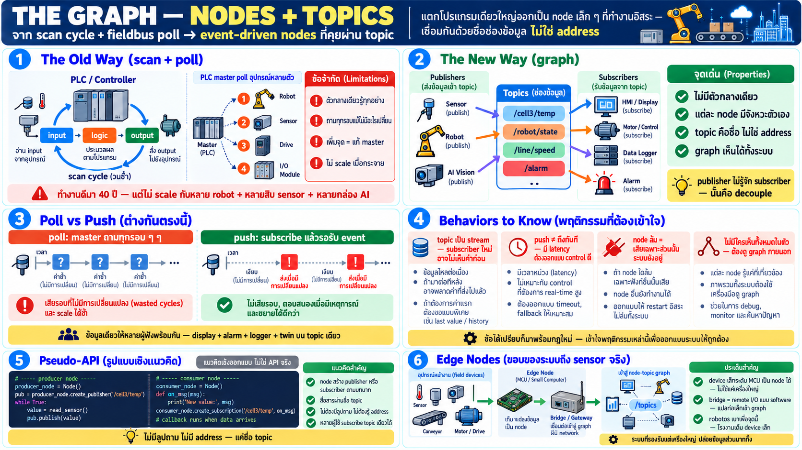

# The graph — node + topic: จาก scan cycle สู่ event-driven



บทนี้คือหัวใจของการเปลี่ยน mental model — เข้าใจสองสิ่งนี้แล้ว
ที่เหลือของ week ตามมาเอง

## ของเดิม: scan cycle + fieldbus

ในโลก PLC ที่คุ้นเคย:

- มี **ตัวกลางเดียว** (PLC) วน loop เดิมซ้ำ: อ่าน input → รัน
  logic → เขียน output — ทุกอย่างอยู่ใน scan เดียว
- เวลาคุยกับอุปกรณ์ภายนอกผ่าน fieldbus (Modbus/Profibus) เป็น
  **master poll ทีละจุด**: master ถาม slave ตอบ — ทุกรอบต้องถาม
  แม้ไม่มีอะไรเปลี่ยน
- ระบบมี "ศูนย์กลาง" เดียว — โปรแกรมเดียวรู้ทุกอย่าง

ทำงานได้ดีมา 40 ปี — แต่มีขอบเขต: เมื่อระบบใหญ่เป็น robot หลายตัว
+ sensor หลายสิบ + AI หลายกล่อง **"ตัวกลางเดียววนถามทุกจุด" ไม่
scale**

## ของใหม่: node + topic = graph

โลก ROS/robotos แตกโปรแกรมเดียวใหญ่นั้นออกเป็น **node เล็ก ๆ
จำนวนมากที่ทำงานอิสระ** แล้วคุยกันผ่าน **topic**:

```
┌──────────┐  publish     ┌──────────────┐   subscribe   ┌──────────┐
│  sensor  │ ───────────► │ /temperature │ ────────────► │ display  │
│   node   │              │    (topic)   │               │   node   │
└──────────┘              └──────┬───────┘               └──────────┘
                                 │
                                 │ subscribe
                                 ▼
                          ┌────────────┐
                          │   alarm    │
                          │    node    │
                          └────────────┘
```

- **node** = โปรแกรมเล็ก ๆ ทำงานอย่างเดียว (อ่าน sensor, คำนวณ
  control, ขับ motor, แสดงผล) — วิ่งอิสระไม่มีใครสั่งจังหวะ
- **topic** = ชื่อช่องข้อมูล — เป็น "กลาง" ไม่ใช่การชี้กันตรง:
  node ที่ผลิตข้อมูล **publish** เข้า topic; node ที่สนใจ
  **subscribe** ออกมา
- **graph** = ภาพรวมของ node ทั้งหมด + topic ที่เชื่อม — ดูได้
  ทั้งระบบ

ความต่างสำคัญจาก fieldbus:

| fieldbus (poll) | topic (pub/sub) |
|---|---|
| master ถามทีละจุดทุกรอบ | publisher push เมื่อมีข้อมูล — subscriber รับเอง |
| master รู้จัก slave ทุกตัว | publisher ไม่รู้จัก subscriber เลย — decouple |
| เพิ่มอุปกรณ์ = แก้โปรแกรม master | เพิ่ม node = แค่ publish/subscribe topic ที่มีอยู่ |
| cycle time จำกัดทุกอย่าง | แต่ละ node มีจังหวะของตัวเอง |

## เหตุผลที่มันดีกว่า (สำหรับงาน robot)

- **แยกส่วนจริง** — เปลี่ยน node หนึ่งไม่กระทบที่เหลือ: เปลี่ยน
  display node ไม่แตะ sensor node
- **scale ตามธรรมชาติ** — เพิ่ม node ใหม่ = ต่อเข้า graph ไม่ต้อง
  แก้ของเก่า
- **หลายผู้บริโภคฟรี** — ข้อมูลเดียวให้หลาย node ฟัง (display +
  alarm + logger + twin พร้อมกัน)
- **กระจายข้ามเครื่อง** — node อยู่บน computer หลัก, edge box,
  หรือ MCU ตัวเล็ก — graph เดียวกันครอบทุกจุด
- **event-driven โดยนิยม** — ไม่มี "loop กลาง" — ของเกิดเมื่อมี
  เหตุ = ตอบสนองเร็วและไม่เสียงานบนรอบว่าง

## พฤติกรรมที่ต้องเข้าใจให้ถูก

- **ไม่มี "อ่านล่าสุด" ฟรี** — topic เป็น stream: subscriber ที่
  เพิ่งเข้ามาอาจไม่เห็นค่าก่อนหน้า (เว้นแต่ publisher ออกแบบให้ —
  เรื่องของบท QoS)
- **push ≠ ถึงทันที** — มี latency ของเครือข่าย/คิว — control loop
  ที่ต้องแน่นอนยังต้องออกแบบ (บท 08)
- **node ล้มได้โดยระบบยังอยู่** — ต่างจาก PLC ตาย=ทั้ง cell ตาย —
  graph สูญเสียเฉพาะส่วนที่พึ่ง node นั้น
- **ไม่มีใคร "เห็นทั้งหมด" ในตัวเอง** — ภาพรวมมาจากการดู graph
  ภายนอก (บท 07) ไม่ใช่จากในโปรแกรม

## Pseudo-API — รูปแบบการใช้ในเชิงแนวคิด

เมื่อถึงเวลาเขียนจริง รูปแบบโค้ดหน้าตาประมาณนี้ (Python-style —
**แนวคิดเชิงออกแบบ ไม่ใช่ API จริง**):

```python
# node ฝั่งผู้ผลิต — อ่าน sensor แล้ว publish
node = create_node("temp_sensor")
pub  = node.create_publisher("/cell3/temperature")
while running:
    pub.publish(read_sensor())      # push ออกไป — ใครฟังก็ได้

# node ฝั่งผู้บริโภค — subscribe รอรับ
node2 = create_node("monitor")
node2.create_subscription("/cell3/temperature", on_temp)

def on_temp(value):                 # ถูกเรียกเมื่อมีค่าใหม่เข้ามา
    if value > LIMIT: alarm()
```

สังเกต: ไม่มีลูปถาม ไม่มี address ของกันและกัน — แค่ชื่อ topic

## Edge & embedded เข้า graph เดียวกันได้

จุดที่ robotos ต่างจาก middleware หนัก: node ไม่จำเป็นต้องเป็น
process ใหญ่บน Linux —

- **device เล็กระดับ MCU/board เป็น node ได้** — sensor/เครื่อง
  เล็กในโรงงานเข้า graph เดียวกับ server โดยตรง
- แนวคิด bridge: device เล็กที่พูดภาษาเบา ๆ (serial/BLE/WiFi) มี
  ตัวกลางแปลเข้า graph — เหมือน remote I/O แต่เป็น software
- ผล: **ขอบของระบบลงไปถึง sensor จริง** — ไม่ใช่หยุดที่
  controller ใหญ่

นี่คือเหตุที่ middleware เบาสำคัญ: โรงงานจริงเต็มไปด้วยอุปกรณ์
เล็ก ๆ — ระบบที่รองรับเฉพาะเครื่องใหญ่ปล่อยข้อมูลส่วนมากทิ้ง

## Checklist

| คำถาม | ควรตอบได้ |
|---|---|
| node คืออะไร | โปรแกรมเล็กทำงานเดียว วิ่งอิสระใน graph |
| topic คืออะไร | ชื่อช่องข้อมูล — publish เข้า / subscribe ออก |
| ต่างจาก fieldbus poll ยังไง | push เมื่อมีของ ไม่ใช่ถามทุกรอบ; decouple ผู้ผลิต-ผู้บริโภค |
| เพิ่ม device ใหม่ทำยังไง | เพิ่ม node + เชื่อม topic ที่มี — ไม่แก้โปรแกรมเดิม |
| node ล้มแล้ว | ระบบยังอยู่ — เสียเฉพาะส่วนที่พึ่ง node นั้น |
| device เล็กเข้า graph ได้ไหม | ได้ — robotos เบาพอ; bridge pattern สำหรับท่อเล็ก |
