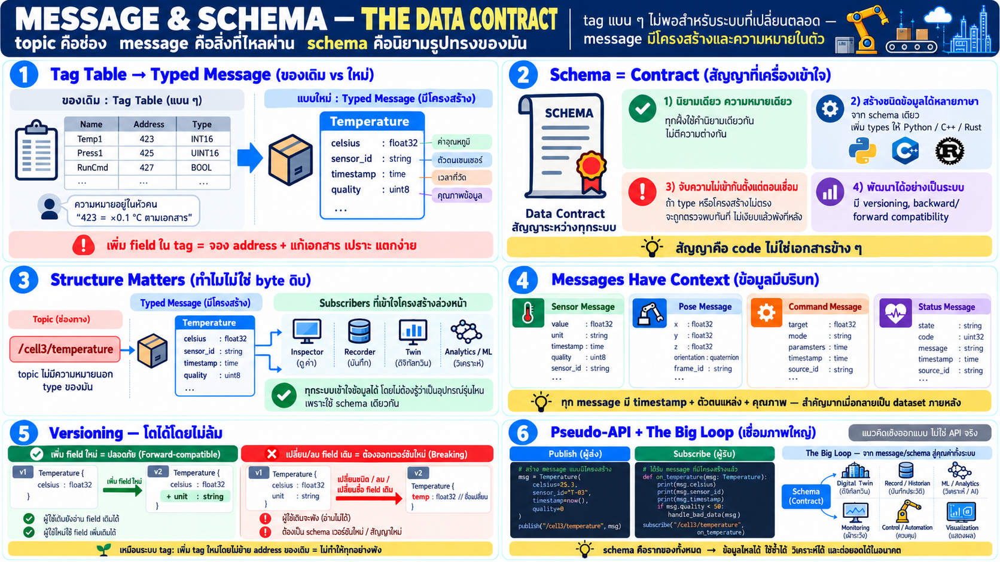

# Message & schema — สัญญาข้อมูลของระบบ



เมื่อ topic คือช่องทาง **message คือสิ่งที่ไหลผ่าน** และ schema คือ
นิยามรูปทรงของมัน — บทนี้อธิบายว่าทำไม "tag แบน ๆ" ของระบบเดิม
ไม่พอสำหรับระบบที่เปลี่ยนตลอด

## จาก tag table เป็น typed message

ระบบ automation เดิมจัดเก็บข้อมูลเป็น **tag**:

```
TAG        ADDRESS    TYPE     VALUE
TEMP_01    %MW100     INT      423
PUMP_RUN   %M50       BOOL     1
```

- tag คือชื่อ + ตำแหน่ง + ชนิดดิบ — แบนและเป็นของกลาง
- ความหมายอยู่ในหัวคน/เอกสาร — "423 คือ ×0.1 องศา" ไม่มีในระบบ
- เพิ่ม field = จอง address ใหม่ + อัปเดตเอกสาร — เปราะและแตกง่าย

ในโลก message:

```text
message Temperature {
    float32 celsius
    string  sensor_id
    uint64  timestamp
    Quality quality     // good / stale / fault
}
```

- **ข้อมูลมีโครงสร้าง** — field มีชื่อและชนิดชัดเจน นิยามอยู่ใน
  ตัวข้อมูลเอง
- **มี context ในตัว** — timestamp, id ของแหล่ง, คุณภาพ — ไม่ใช่
  ตัวเลขดิบลอย ๆ
- **เป็นสัญญา** — publisher และ subscriber ต่างรู้รูปทรงเดียวกัน
  ผิด schema = ไม่เชื่อมกันได้ (ตรวจตั้งแต่ต้นไม่ใช่ตอนล้ม)

## Schema คือสัญญา — ทำไมสำคัญ

ทั้งสองฝั่งต้องถือสัญญาชุดเดียวกัน:

```
┌────────────┐      ┌─────────┐      ┌─────────────┐
│ publisher  │ ───► │ message │ ───► │ subscriber  │
│ one schema │      └─────────┘      │ same schema │
└────────────┘                       └─────────────┘
```

เมื่อ node หลายสิบตัว เขียนคนละภาษา โดยคนละทีม คนละเวลา:

- **นิยามเดียว ทุกฝั่งเข้าใจเดียวกัน** — field `celsius` เป็น
  float32 ตรงนั้นแหละ ไม่ใช่ "น่าจะเป็น 0.1 หน่วยมั้ง" ตามเอกสาร
- **generate code ได้ทุกภาษา** — schema เดียวกัน compile เป็น type
  ใน Python/C++/Rust — ทุก node เห็นโครงสร้างเดียวกันเป๊ะ
- **เปลี่ยนแปลงอย่างเป็นระบบ** — เพิ่ม field ใหม่โดยไม่แตกของเก่า
  (versioning) — ระบบโตได้โดยไม่ล้มทั้งก้อน
- **ตรวจตั้งแต่ต้น** — schema mismatch ถูกจับตอนเชื่อม/dev ไม่ใช่
  ตอน runtime เงียบ ๆ

> สำหรับคน automation: schema คือ "ชุด tag + data type + หน่วย +
> ความหมาย" ที่ผูกไว้ในเอกสารเดียวที่เครื่องเข้าใจ — ไม่ใช่ตาราง
> ที่คนเขียนแยกไว้ข้าง ๆ

## Message ≠ stream ดิบ — ทำไมต้องมีโครงสร้าง

ข้อมูลที่ไหลใน topic ไม่ใช่ byte ไร้ความหมาย:

- ทุก message มี **type** — topic `/cell3/temperature` คือ
  `Temperature` ไม่ใช่ "อะไรก็ได้"
- subscriber รู้ว่าจะได้อะไร **ก่อน** ข้อมูลมา — decode ได้ถูกต้อง
  เสมอ
- เครื่องมือ (inspector, recorder, twin) อ่าน message ได้โดยไม่
  ต้องรู้จัก device นั้น — เพราะ schema เดียวกัน

นี่คือเหตุที่ระบบใหญ่รวมข้อมูลได้ง่าย: twin หรือ historian ไม่ต้อง
เขียน parser เฉพาะเครื่อง — ถ้า schema เดียวกัน ทุกเครื่องพูด
ภาษาเดียวกันโดยนิยาม

## ตัวอย่าง message ที่พบในงาน robot

| หมวด | ตัวอย่าง field |
|---|---|
| sensor reading | value, unit, timestamp, quality |
| pose/position | x, y, z, orientation, frame_id |
| command | target, mode, parameters |
| status/event | state, code, message, timestamp |
| health | battery, temperature, error flags |

สังเกตว่าทุกตัวมี **timestamp และตัวตนของแหล่ง** — ข้อมูลมีบริบท
ในตัวเสมอ (สำคัญมากเมื่อนำไปเป็น dataset ภายหลัง)

## Schema versioning — ระบบที่โตได้

ระบบจริงเปลี่ยนตลอด — sensor เพิ่ม field, command เพิ่ม option:

- **เพิ่ม field ใหม่** — subscriber เก่ายังอ่าน field เดิมได้
  (forward-compatible)
- **ลบ/เปลี่ยน field เดิม** — เป็นสัญญาใหม่ = version ใหม่ ต้อง
  ประกาศ
- **กฎง่าย**: เพิ่มได้เสมอ เปลี่ยนของเดิม = breaking — เหมือน
  เพิ่ม tag ใหม่โดยไม่ย้าย tag เก่า

นี่แก้ปัญหาที่ fieldbus/tag table เจอตลอด: "แก้ address ทีเดียว
ทั้งระบบพัง" — schema ทำให้เปลี่ยนอย่างค่อยเป็นค่อยไป

## เชื่อมกับภาพใหญ่

- topic เป็นชื่อช่อง + type — **topic ไม่มีความหมายนอก schema**
- node ตกลงกันผ่าน type ไม่ใช่ผ่านเอกสาร — สัญญาคือ code
- twin/record/ML ทั้งหมดกิน message — ถ้า schema ดี ทุกชั้นบนได้
  ประโยชน์ฟรี

## Pseudo-API — เชิงแนวคิด

```python
# pseudo-API — แนวคิดเชิงออกแบบ ไม่ใช่ API จริง

# นิยามรูปทรง (concept) — ทุก node เห็นเหมือนกัน
class Temperature:
    celsius: float
    sensor_id: str
    timestamp: int
    quality: str

# publish — ต้องเป็น type ที่ประกาศ
pub.publish(Temperature(celsius=42.3, sensor_id="TC-07",
                        timestamp=now(), quality="good"))

# subscribe — callback ได้ object ที่มีโครงสร้าง ไม่ใช่ byte ดิบ
def on_temp(msg: Temperature):
    if msg.celsius > LIMIT and msg.quality == "good": ...
```

## Checklist

| คำถาม | ควรตอบได้ |
|---|---|
| tag table ต่างจาก message ยังไง | tag = ชื่อ+address+type แบน / message = โครงสร้าง+ความหมาย+context ในตัว |
| schema คืออะไร | นิยามรูปทรงข้อมูล — สัญญาเดียวกันทุก node ทุกภาษา |
| เพิ่ม field ได้ไหม | ได้ — forward-compatible; เปลี่ยนของเดิม = version ใหม่ |
| ทำไม twin/record ใช้ง่าย | schema เดียวกัน — ไม่ต้องเขียน parser เฉพาะเครื่อง |
| message ควรมีอะไรเสมอ | timestamp + ตัวตนแหล่ง + คุณภาพ — ข้อมูลมีบริบท |
