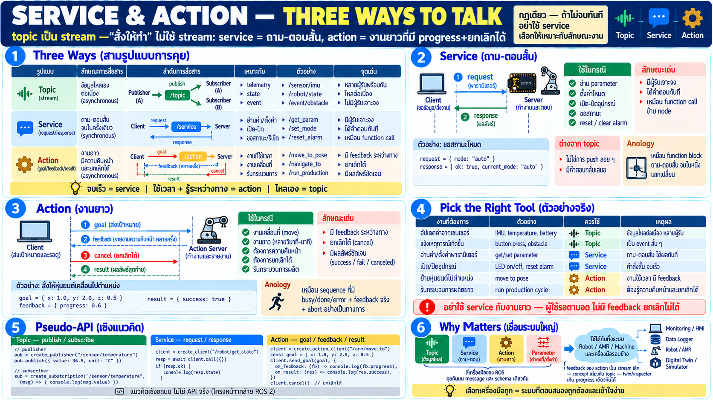

# Service & Action — คำสั่งสั้น vs งานยาวที่ยกเลิกได้



topic เป็น stream ข้อมูล — แต่ "สั่งให้ทำ" ไม่ใช่ stream บทนี้คือ
อีกสองเครื่องมือของการคุย: **service** (ขอ-ตอบ) และ **action**
(งานยาวที่มี progress และยกเลิกได้)

## สามรูปแบบการคุย — ใช้ให้ถูก

| รูปแบบ | ลักษณะ | เหมาะกับ |
|---|---|---|
| **topic** | stream — ไหลเองเรื่อย ๆ | telemetry, sensor, state updates |
| **service** | request→response — จบเร็ว | อ่านค่า, ตั้งค่า, trigger เร็ว ๆ |
| **action** | goal→feedback→result — นาน | งานที่ใช้เวลา: เคลื่อนที่, cycle ใหญ่ |

กฎเดียว: **ถ้ามันไม่จบทันที อย่าใช้ service** — นั่นคือเหตุผลที่
action มีอยู่

## Service — request/response อย่างเรียบง่าย

เหมือน function call ข้าม node:

```
┌─────────────┐                ┌──────────────┐
│ client node │ ── request ──► │ service node │
└──────┬──────┘                └───────┬──────┘
       ▲ response                      │
       └───────────────────────────────┘
```

- client ถาม server ตอบ — synchronous ในเชิงตรรกะ (แม้ระบบจะ async
  ข้างใน)
- เหมาะกับงาน **ที่จบเร็วและมีผลชัด**: อ่าน parameter, สั่งเปิด/
  ปิด, ขอสถานะ, reset counter
- ต่างจาก topic ตรง **มีผู้รับเจาะจงและมีคำตอบ** — topic ไม่มีใคร
  "ตอบ"

จากมุม automation: service คล้าย **function block ที่ถาม-ตอบสั้น**
— เช่น "อ่านค่า setpoint ปัจจุบัน" หรือ "reset alarm" — จบในหนึ่ง
แลกเปลี่ยน

```python
# pseudo-API — แนวคิดเชิงออกแบบ ไม่ใช่ API จริง
resp = client.call("/robot/set_mode", mode="auto")
if resp.ok: ...          # มีคำตอบกลับ — รู้ว่าสำเร็จหรือไม่
```

## Action — งานที่ใช้เวลาและยกเลิกได้

ปัญหาจริงของ robot: คำสั่งหลายอย่าง **ไม่จบทันที** — "เคลื่อนไปตำแหน่ง
X" ใช้เวลาเป็นวินาทีหรือนาที ระหว่างนั้น:

- เราอยากรู้ว่าไปถึงไหนแล้ว (**feedback**)
- เราอาจอยากหยุดกลางคัน (**cancel**)
- เมื่อจบเราอยากรู้ผล (**result** — สำเร็จ/ล้ม/ถูกยกเลิก)

action คือ pattern ที่ทำสามอย่างนี้ให้เป็นระบบ:

```
┌────────┐                                ┌───────────────┐
│        │ ── goal ──────────────────────►│               │
│        │◄────────────────── feedback ── │               │
│ client │ ── cancel ────────────────────►│ action server │
│        │◄──────────────────── result ── │               │
└────────┘                                └───────────────┘
```

- **goal** — ส่ง "เป้าหมาย" ไป (เช่น ไปที่จุดนี้, ทำ cycle นี้)
- **feedback** — server report ความคืบหน้ากลับมาตลอด (เป็น stream
  เล็ก ๆ ภายใน)
- **cancel** — client ยกเลิกได้ทุกเมื่อ — server ต้องรองรับการหยุด
  อย่างปลอดภัย
- **result** — เมื่อจบมีผลลัพธ์ชัด

จากมุม automation: เหมือนสั่ง sequence ใหญ่ที่มี "busy/done/error"
bits — แต่มี feedback ต่อเนื่องและ cancel อย่างเป็นทางการแทนที่จะ
แค่หวังว่า done จะมา

```python
# pseudo-API — แนวคิดเชิงออกแบบ
goal = action_client.send_goal("/arm/move_to", target=pose)
goal.on_feedback(lambda f: update_progress(f.percent))
goal.on_result(lambda r: log(r.status))   # success / fail / canceled
# goal.cancel()  — ยกเลิกได้ทุกเมื่อ
```

## เลือกเครื่องมือให้ถูก — ตัวอย่างจริง

| งาน | เครื่องมือ | เพราะ |
|---|---|---|
| sensor อัปเดตต่อเนื่อง | topic | stream — ไม่มีใครถาม |
| สั่งเปิด/ปิด LED, reset alarm | service | จบทันที มี ack |
| อ่าน parameter/config | service | ถาม-ตอบสั้น |
| ย้าย robot ไปตำแหน่ง | action | ใช้เวลา ต้อง feedback+cancel |
| รัน cycle ผลิตยาว | action | progress ต่อเนื่อง + abort ได้ |
| แจ้ง event ที่เกิด | topic | เหตุการณ์ push ออกมา |

กฎนิ้วโป้ง: **จบเร็วและตอบสั้น → service; ใช้เวลาและต้องรู้ระหว่าง
ทาง → action; ไหลเองไม่ต้องถาม → topic**

## เชื่อมกับบทก่อนและหน้า

- สามอย่างนี้ + parameter (บท 05) = เครื่องมือการคุยครบชุดของ
  node
- feedback ของ action เองก็เป็น stream เล็ก ๆ — concept เดียวกับ
  topic
- เมื่อ twin อยู่ในระบบ คำสั่งใหญ่มักผ่าน action — twin เห็น
  feedback เดียวกันได้เพราะมันเป็น stream ธรรมดา

## Checklist

| คำถาม | ควรตอบได้ |
|---|---|
| topic vs service ต่างกัน | topic = stream ไม่มีผู้รับเจาะจง / service = ถาม-ตอบมีผลตอบแทน |
| เมื่อไหร่ต้อง action | งานที่ใช้เวลาและต้องรู้ progress/ยกเลิกได้ |
| action มีอะไร | goal + feedback ต่อเนื่อง + cancel + result |
| service เหมือนอะไรที่คุ้น | function call ข้าม node — ถามตอบสั้นจบ |
| ทำไมอย่าใช้ service สำหรับงานยาว | ไม่มี feedback ระหว่างทาง ยกเลิกไม่ได้ — ผู้ใช้ต้องรอตาบอด |
