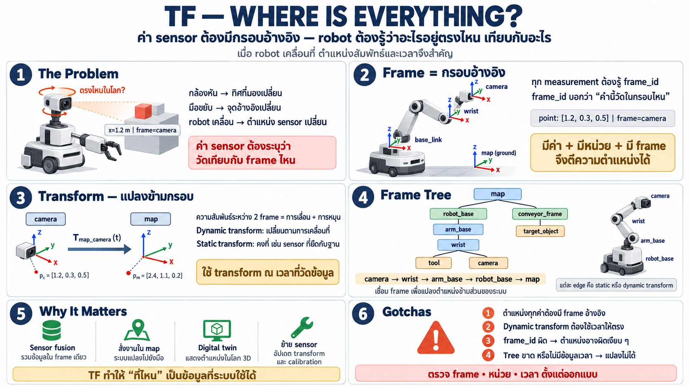

# TF — frames & coordinate transforms: robot ต้องรู้ว่าอะไรอยู่ตรงไหน



บทนี้แตกต่างจากที่ผ่านมา — ไม่ใช่เรื่องการสื่อสาร แต่เป็นแนวคิด
ที่ทำให้ robot "เข้าใจพื้นที่" — สิ่งที่ไม่มีในโลก PLC เพราะ
เครื่องจักรอยู่กับที่

## ปัญหาที่ PLC world ไม่เคยเจอ

ใน cell เดิมทุกอย่างนิ่ง: sensor ติดที่จุดเดียว actuator อยู่ตำแหน่ง
เดียว — "ค่า" คือ "ค่า" ไม่ต้องถามว่าวัดจากที่ไหน

robot ต่างออกไปอย่างสิ้นเชิง:

- กล้องอยู่บนหัวที่หันซ้ายขวาได้ — "เห็นวัตถุตรงกลางภาพ" หมายถึง
  ตำแหน่งไหนในโลก? ขึ้นกับว่าหัวหันไปทางไหนตอนนั้น
- gripper อยู่ปลายแขนที่ขยับตลอด — "วัตถุอยู่ที่ x=1.2" วัดจากฐาน
  หรือจากมือ?
- mobile robot เคลื่อนที่ — sensor ตัวเดิมวัดจุดใหม่ตลอดเวลา

**ค่าของ sensor ไม่มีความหมายนอกเฟรมที่มันวัด** — นี่คือเหตุที่
ระบบ robot ต้องมี "กรอบอ้างอิง" เป็นส่วนหนึ่งของข้อมูลเสมอ

## Frame — กรอบอ้างอิง

- **frame** = ระบบพิกัดที่ผูกกับส่วนหนึ่งของหุ่นยนต์หรือโลก —
  `base_link` (ฐาน), `wrist` (ข้อมือ), `camera` (กล้อง), `map`
  (โลก/แผนที่)
- ทุก measurement มี **frame_id** — "ค่านี้วัดในกรอบไหน" — ขาดมัน
  ข้อมูลใช้ไม่ได้
- แต่ละ frame มี **ตำแหน่งและทิศทางสัมพัทธ์กับ frame อื่น** — เช่น
  camera อยู่เหนือ wrist 10cm หันต่ำ 15°

## Transform — การแปลงระหว่าง frame

- **transform** = ความสัมพันธ์เชิงพื้นที่ระหว่างสอง frame —
  "wrist อยู่ตรงไหนเทียบกับ base ตอนนี้"
- แปลงค่าจาก frame หนึ่งไปอีก frame หนึ่ง: จุดที่กล้องเห็น →
  ตำแหน่งจริงในโลก
- transform ไม่คงที่ — ข้อมือขยับตลอด → transform เปลี่ยนตลอด
  → **ต้องมีเวลากำกับ** (transform ณ เวลาไหน)

นี่คือความต่างเชิงหลักการจากระบบเดิม: ข้อมูลมี **มิติเวลา+ตำแหน่ง**
ในตัว ไม่ใช่แค่ค่าปัจจุบัน

## Frame tree — โครงสร้างของความสัมพันธ์

frames ทั้งหมดของระบบเชื่อมกันเป็น **tree**:

```
                       ┌─────┐
                       │ map │
                       └──┬──┘
                          │
                 ┌────────┴─────────┐
                 ▼                  ▼
          ┌────────────┐   ┌────────────────┐
          │ robot_base │   │ conveyor_frame │
          └──────┬─────┘   └────────┬───────┘
                 │                  │
                 ▼                  ▼
           ┌──────────┐     ┌───────────────┐
           │ arm_base │     │ target_object │
           └─────┬────┘     └───────────────┘
                 │
                 ▼
             ┌───────┐
             │ wrist │
             └───┬───┘
                 │
         ┌───────┴────────┐
         ▼                ▼
┌────────────────┐   ┌────────┐
│ tool (gripper) │   │ camera │
└────────────────┘   └────────┘
```

- เดินตาม tree ได้เสมอ: camera→wrist→arm_base→base→map —
  แปลงค่าจากตาไปถึงมือได้ตลอด
- ใคร ๆ เพิ่ม frame ได้ (sensor ใหม่ติดที่ไหนก็ต่อเข้า tree)
- tree เป็น **โครงสร้างสด** — ทุก edge คือ transform ที่ไหลต่อเนื่อง
  เป็น stream

จากมุม automation: เหมือน electrical diagram ที่บอกว่าอะไรต่อกับ
อะไร — แต่ที่นี่บอกว่า "อะไรอยู่ตรงไหนเทียบกับอะไร" ณ เวลาใด ๆ

## ทำไม TF เป็นเรื่องใหญ่

- **ทำให้ sensor fusion เป็นไปได้** — รวมกล้องบนหัว + encoder บน
  แขน + sensor บนพื้น เป็นภาพเดียวกันได้เพราะแปลงทุกอย่างเข้า
  frame เดียวกัน
- **ทำให้ "คำสั่งในหน่วยโลก" เป็นไปได้** — "เอามือไปที่กล่องบน
  conveyor" ระบบแปลงเองว่าข้อต่อต้องหมุนเท่าไร
- **ทำให้ twin แสดงตำแหน่งจริง** — twin รู้ว่า gripper อยู่ไหนใน
  โลกเพราะ transform บอก — ไม่ใช่แค่ "แขนหมุน 45°"
- **ทำให้ retarget ได้** — เพิ่ม/ย้าย sensor แค่เพิ่ม frame ใหม่ —
  logic เดิมไม่เปลี่ยน

## สิ่งที่ต้องเข้าใจระดับแนวคิด

- **ทุกตำแหน่งสัมพัทธ์** — ไม่มี "ตำแหน่งสัมบูรณ์" มีแต่ "ตำแหน่ง
  เทียบกับ frame ไหน" — frame_id เป็นเหมือนหน่วยวัด
- **transform เป็นข้อมูลที่เปลี่ยนตลอด** — ไหลเป็น stream เหมือน
  telemetry — ต้องเลือกเวลาที่ถูก
- **frame_id ใน message สำคัญเท่า value** — เขียนโปรแกรมที่ลืม
  frame = ค่าที่ผิดเงียบ ๆ (แย่กว่าค่าผิดดัง ๆ)
- **tree ต้องไม่ขาด** — ขาดลิงก์ = แปลงไม่ได้ = ข้อมูลใช้ไม่ได้
  ระหว่างสองส่วนของระบบ

## เชื่อมกับส่วนอื่น

- transform เป็น topic ที่ไหลเหมือน telemetry — TF คือ stream
  พิเศษของ "ใครอยู่ไหนตอนไหน"
- message ทุกตัวที่มีตำแหน่งควรมี frame_id — ส่วนหนึ่งของ schema
- twin ใช้ TF แสดงตำแหน่งจริงในโลก 3D — ไม่ใช่แค่ค่าแขน
- เมื่อเพิ่ม sensor/กล้องใหม่: เพิ่ม frame เข้า tree — ระบบเดิม
  รับได้โดยไม่แก้

## Checklist

| คำถาม | ควรตอบได้ |
|---|---|
| frame คืออะไร | ระบบพิกัดผูกกับส่วนหนึ่งของ robot/โลก — ทุกค่าต้องบอก frame |
| ทำไม sensor ต้องมี frame_id | ค่าไม่มีความหมายนอกกรอบที่วัด — "ตรงกลางภาพ" ≠ ตำแหน่งโลก |
| transform คืออะไร | ตำแหน่ง+ทิศสัมพัทธ์ระหว่างสอง frame ณ เวลาหนึ่ง |
| frame tree ทำอะไร | เชื่อมทุกจุด — แปลงจากตาไปถึงมือไปถึงโลกได้เสมอ |
| transform เปลี่ยนไหม | เปลี่ยนตลอด — เป็น stream ไม่ใช่ค่าคงที่ — ต้องเลือกเวลาถูก |
| ลืม frame_id แล้ว | ค่าผิดเงียบ ๆ — แย่กว่าค่าผิดชัด ๆ |
