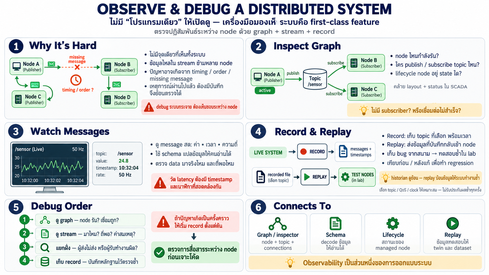

# Observe & debug — ดูระบบกระจายที่ไม่มี "โปรแกรมเดียว" ให้ดู



ในโลก PLC debug คือเปิดโปรแกรมเดียวดู ladder กับ watch table —
โลก node กระจายไม่มี "ที่เดียว" ให้ดู — เครื่องมือมองเห็นระบบจึง
เป็น first-class feature ไม่ใช่ของแถม

## ปัญหาใหม่ของระบบกระจาย

เมื่อโปรแกรมแตกเป็นหลายสิบ node บนหลายเครื่อง:

- **ไม่มี "จุดเดียวที่เห็นทั้งหมด"** — ไม่มี main loop ให้เปิดดู
- ค่าอยู่ใน **stream ที่ไหลระหว่าง node** — ไม่ใช่ตัวแปรใน memory
  เดียว
- bug มักเป็นเรื่องของ **ปฏิสัมพันธ์** (timing, order, missing
  message) ไม่ใช่ logic ผิดบรรทัดเดียว
- เหตุเกิดแล้วผ่านไป — ถ้าไม่ได้บันทึกไว้ **ย้อนดูไม่ได้**

นี่คือเหตุที่ระบบแบบนี้ต้องมีเครื่องมือสำหรับ "เห็นภายใน" ที่แยก
จากโค้ด — เหมือน SCADA historian/trend ของโรงงาน แต่ทำงานบน
message ของ graph ทั้งระบบ

## เครื่องมือสามชิ้นหลัก

สามเครื่องมือดูคนละชั้นของระบบ:

```
┌───────────┐   ┌───────────┐   ┌─────────────┐
│ inspect   │   │ watch     │   │ record      │
│ the graph │   │ one topic │   │ then replay │
└───────────┘   └───────────┘   └─────────────┘
```

บันทึกก่อน แล้วจึงเล่นซ้ำ:

```
┌───────┐                              ┌──────────┐                              ┌─────┐
│ graph │                              │ recorder │                              │ you │
└───┬───┘                              └─────┬────┘                              └──┬──┘
    │                                        │                                      │
    │ live messages ────────────────────────►│                                      │
    │                                        │ replay the same messages ───────────►│
```

### 1. Inspect graph — เห็นโครงสร้างสด

- ดูว่ามี node อะไรบ้าง กำลังรันอยู่จริงไหม
- ดูว่าใคร publish/subscribe topic ไหน — โครงสร้างการคุยที่แท้จริง
  ณ ตอนนี้
- เห็นว่า node อยู่ state ไหน (lifecycle) — ใครยัง configure อยู่
  ใคร active แล้ว
- เทียบ SCADA: เหมือนดู layout ระบบ+สถานะอุปกรณ์ — แต่เป็น graph
  ของ software ไม่ใช่ของไฟฟ้า

คำถามที่ตอบได้ทันที: "node ตัวนี้รันอยู่ไหม", "ใครฟัง topic นี้
อยู่บ้าง", "ทำไมค่าไม่ถึง — เพราะไม่มีใคร subscribe" 

### 2. Watch messages — เห็นข้อมูลที่ไหลจริง

- เลือก topic แล้วดู message ที่ไหลผ่านสด ๆ — ค่า/เวลา/ความถี่
- เห็น schema decode เป็นภาษาคน — ไม่ใช่ byte
- วัดจริงว่าไหลถี่แค่ไหน หน่วงไหม — ตรวจคำตอบ "data มาจริงไหม"
- เทียบ trend/chart ของ SCADA — แต่บน message โครงสร้าง ไม่ใช่ tag

### 3. Record & replay — historian ของ robot

- **record** — บันทึก message ทั้งหมด (หรือเฉพาะ topic ที่สนใจ)
  ลง file พร้อมเวลา
- **replay** — เล่นซ้ำให้ระบบเห็นเหมือนของจริง — **ทดสอบ node โดย
  ไม่ต้องมี hardware**
- ใช้ทำอะไร:
  - bug เกิดครั้งเดียวในสนาม → บันทึกไว้ เล่นซ้ำใน lab จนเจอ
  - พัฒนา/เทส node ใหม่ด้วยข้อมูลจริงจากสนาม — ไม่ต้องจำลอง
  - เทียบพฤติกรรมก่อน/หลังแก้ — regression test ของทั้งระบบ
- เทียบ historian: เก็บอดีตไว้ตอบย้อน — แต่ replay ไปขั้นกว่า:
  **ข้อมูลที่บันทึกขับระบบได้เหมือนของจริง**

นี่คือความต่างสำคัญ: ในโลก historian เรา "ดูย้อน" — ในโลกนี้เรา
"เล่นซ้ำให้ระบบทำงานอีกครั้ง" — สำหรับ debug ระบบกระจายนี่คือ
เครื่องมือที่ทรงพลังที่สุด

## แนวทาง debug ระบบกระจาย

เมื่อมีปัญหา ลำดับที่ทำงานได้:

1. **ดู graph ก่อน** — node ที่ควรรันอยู่จริงไหม? เชื่อมกันถูกไหม?
2. **ดู stream** — message ไหลมาถึงไหม? ถี่พอไหม? ค่าสมเหตุสมผลไหม?
3. **แยกทิศ** — ปัญหาอยู่ฝั่งผลิต (ไม่ส่ง) หรือฝั่งบริโภค
   (รับแต่ทำผิด)?
4. **บันทึกไว้** — ถ้าเป็นเหตุเกิดแล้วหาย record ทันที เล่นซ้ำ
   ในที่ปลอดภัย

ต่างจาก debug PLC ตรง: **อย่าไปหาในโค้ดก่อน** — ไปดูที่ช่องทาง
และข้อมูลที่ไหลจริงก่อน เพราะ bug ส่วนใหญ่อยู่ที่ "ขอบ" ระหว่าง
node ไม่ใช่ข้างใน

## เชื่อมกับส่วนอื่น

- inspector = เครื่องมือมอง graph (บท 02 เป็นที่อยู่ของ graph)
- message decode ได้เพราะ schema (บท 03)
- lifecycle เห็นใน inspector (บท 05)
- replay คือวิธีที่ twin/simulation รับข้อมูลจริงมาเล่น (บท 09–10)
- record คือแหล่ง dataset สำหรับ ML ในอนาคต

## Checklist

| คำถาม | ควรตอบได้ |
|---|---|
| ทำไม debug ระบบนี้ยากกว่า | ไม่มีโปรแกรมเดียว — bug อยู่ที่ปฏิสัมพันธ์ระหว่าง node |
| ดู graph บอกอะไร | ใครรัน/ใครเชื่อมใคร/ใครอยู่ state ไหน — โครงสร้างจริงตอนนี้ |
| watch message ต่างจาก trend | เห็น message โครงสร้างที่ decode แล้ว ไม่ใช่ tag ดิบ |
| replay ทำอะไรได้ | เล่นซ้ำข้อมูลจริงให้ระบบเห็นเหมือนของจริง — ทดสอบโดยไม่มี hardware |
| ลำดับ debug ที่ดี | graph → stream → แยกทิศผลิต/บริโภค → record เก็บไว้ก่อน |
