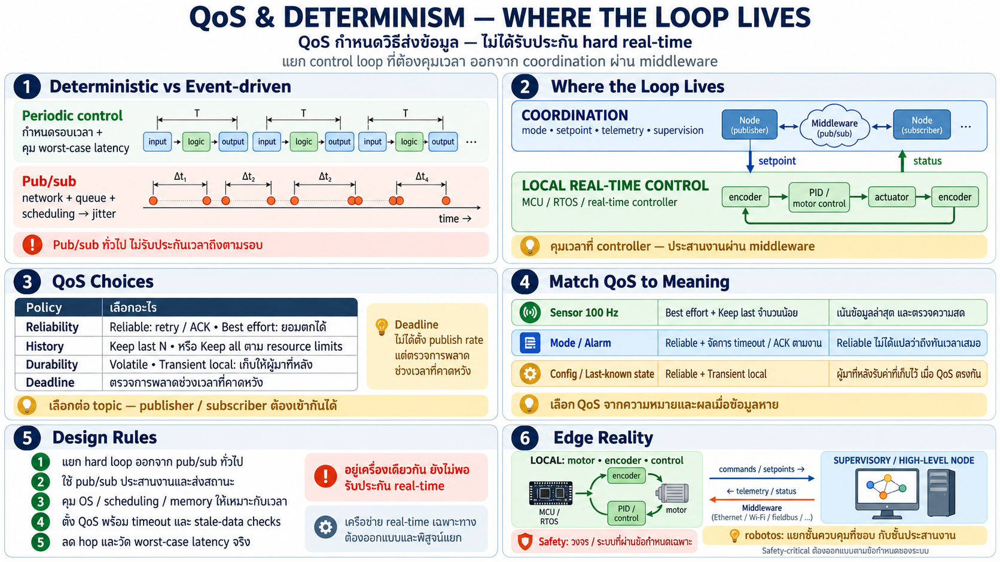

# QoS & determinism — เมื่อ pub/sub ต้องเจอ deadline จริง



สิ่งที่คน automation ถามทันทีเมื่อเห็น pub/sub: **"แล้วเรื่องเวลา
ล่ะ? loop ผมต้องตรงทุก ms"** — บทนี้ตอบคำถามนั้นตรง ๆ

## ต่างกันเชิงหลักการ

**PLC loop เป็น deterministic**: scan ทุก X ms ทุกครั้ง จังหวะ
คือสัญญา — input อ่านตรงเวลา logic รันตรงเวลา output ออกตรงเวลา

**pub/sub เป็น event-driven**: message เดินทางผ่านเครือข่าย/queue
— เวลาถึงไม่แน่นอนแบบ scan cycle — "เมื่อมี" ไม่ใช่ "ทุกรอบ"

สิ่งที่ต้องยอมรับตรง ๆ: **middleware pub/sub ไม่ใช่ hard real-time
loop** — มันคือชั้นสื่อสารไม่ใช่ตัวคุมเวลา

## แล้วระบบที่ต้องแม่นเวลาทำยังไง

คำตอบของสถาปัตยกรรม robot คือ **แยกชั้น**:

```
┌─────────────────────────────┐
│ hard real time              │
│ the period is the contract  │
│ one node, one machine       │
│ motor loop, safety, encoder │
└─────────────────────────────┘

┌──────────────────────────────┐
│ soft coordination            │
│ fast, jitter is acceptable   │
│ publish / subscribe          │
│ telemetry, mode, supervision │
└──────────────────────────────┘
```

- **ลูปที่ต้องแน่นอนอยู่ภายใน node** — motor control, PID, safety
  interlock — ทำบนเครื่องเดียว ใน task ของตัวเอง ไม่ผ่าน network
- **การประสานระหว่าง node ผ่าน pub/sub** — เปลี่ยน mode, ส่ง setpoint,
  telemetry, เหตุการณ์ — ยอมหน่วงเล็กน้อยได้
- นี่คือเหตุที่ robot สมัยใหม่ยังมี real-time controller แยก
  (เช่น MCU ที่คุม motor ตรง ๆ) — **middleware อยู่เหนือมัน ไม่ใช่
  แทนมัน**

## QoS — ความถี่และความน่าเชื่อถือที่เลือกได้

ระบบ pub/sub ที่ดีให้เลือก **คุณภาพของการส่ง** ต่อ topic:

| ปัจจัย | ตัวเลือก | เหมาะกับ |
|---|---|---|
| reliability | ส่งถึงแน่ (ack+retry) vs เร็วสุดยอมตก | state สำคัญ vs telemetry ถี่ ๆ |
| history | เก็บเฉพาะล่าสุด vs เก็บ N ล่าสุด | ผู้เพิ่งเข้ามาต้องการ context ไหม |
| durability | subscriber ใหม่เห็นค่าเดิมไหม | "config ล่าสุด" ต้องยังอยู่ให้ผู้มาใหม่ |
| deadline/rate | คาดหวังจังหวะไหม | ตรวจว่า stream ช้ากว่าที่ตั้งไว้ |

แนวคิดสำคัญ: **ไม่ใช่ทุกข้อมูลต้องการเดียวกัน** —

- ค่า sensor ที่ไหล 100 Hz: ตกบ้างไม่เป็นไร อยากได้ล่าสุดมากกว่า —
  เลือก low-latency
- คำสั่ง mode หรือ alarm: ต้องถึงแน่นอน เลือก reliable
- parameter/config ล่าสุด: ต้องยังอยู่ให้ผู้เพิ่งเข้ามา —
  durable

นี่คือจุดที่ middleware ให้ **ควบคุมต่อช่อง** ไม่ใช่ทั้งระบบเดียว
กัน — คุณเลือก trade-off ต่อ topic ตามความหมายของข้อมูล

## กฎการออกแบบสำหรับคนที่คุ้น real-time

- **อย่าเอา hard loop ไปวางบน pub/sub** — motor torque loop บน
  network = เจ๊ง — ลูปแน่นอนต้องอยู่ใน node เดียว
- **ใช้ pub/sub สำหรับ coordination** — setpoint, mode, telemetry,
  supervision — สิ่งที่ยอมหน่วงได้
- **แยก time-critical ออกจาก convenience** — สิ่งที่ต้องตรงจังหวะ
  vs สิ่งที่ต้องรู้ — คนละชั้น
- **ตั้ง QoS ให้ตรงความหมาย** — telemetry ถี่ไม่ต้อง reliable;
  config หายากต้อง reliable+durable
- **ระวัง "ทุกอย่างผ่านเครือข่าย"** — เพิ่ม hop = เพิ่ม jitter —
  ถ้าสอง node ต้องคุยกันแน่น ๆ ให้อยู่เครื่องเดียวกัน

## เชื่อมกับ edge/embedded

device เล็ก (MCU) มักเป็นที่ที่ hard real-time อยู่จริง — motor
loop, encoder, safety — ทั้งหมดนั้นอยู่ในตัว device ไม่ใช่บน
middleware; middleware ขนเฉพาะผล/สถานะ/คำสั่ง — นี่คือเหตุที่
robotos แยกชั้นชัด: ของที่ต้องตรงอยู่ขอบ ของที่ต้องประสานอยู่กลาง

## Checklist

| คำถาม | ควรตอบได้ |
|---|---|
| pub/sub เป็น hard real-time ไหม | ไม่ — เป็นชั้นประสาน event-driven ไม่ใช่ตัวคุมจังหวะ |
| loop ที่ต้องแน่นอยู่ที่ไหน | ใน node/เครื่องเดียว — motor loop/safety ไม่ผ่าน network |
| QoS ให้เลือกอะไร | reliability, history, durability, deadline — ต่อ topic |
| telemetry ถี่ ๆ ต้อง reliable ไหม | ไม่จำเป็น — อยากได้ล่าสุดมากกว่าครบทุกจุด |
| config/mode ต้องอะไร | reliable + durable — ต้องถึงและยังอยู่ให้ผู้มาใหม่ |
| กฎแยกชั้น | hard loop ใน node / coordination ผ่าน middleware |
