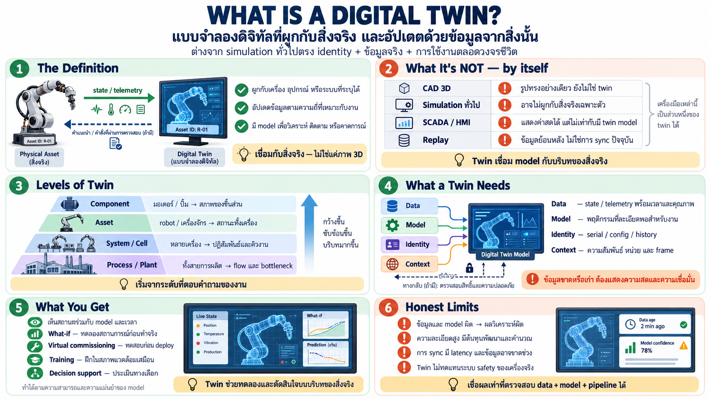

# Digital Twin คืออะไร — ภาพจำลองที่มีชีวิตของเครื่องจริง

คำว่า digital twin ถูกใช้จนกว้าง — บทนี้ตรึงนิยามให้ชัดสำหรับคน
automation: อะไรคือ twin จริง อะไรเป็นแค่ของที่เรียกผิด ๆ

## นิยามที่แท้

**Digital twin = ภาพจำลองดิจิทัลของสิ่งจริงเฉพาะตัวหนึ่งที่ sync
กับของจริงต่อเนื่อง และมีทางกลับได้**

สามเงื่อนไขที่ต้องมีครบ:

1. **ผูกกับเครื่องจริงเครื่องเดียว** — ไม่ใช่ "แขนกลทั่วไป" แต่
   "แขนตัวที่ติดตั้งอยู่ cell 3" — มีตัวตนประจำเครื่อง
2. **sync ต่อเนื่อง** — ของจริงเปลี่ยน → twin เปลี่ยนตาม (ผ่าน
   stream ข้อมูลสด) — twin ต้อง "มีชีวิต" ไม่ใช่ภาพนิ่ง
3. **ทางกลับ** — อย่างน้อยใช้ทดลอง/ตัดสินใจบน twin ก่อนส่งกลับ —
   ไม่ใช่แค่จอดูอย่างเดียว

## อะไร *ไม่ใช่* twin — แยกให้ชัด

| สิ่ง | เป็น twin ไหม | เพราะ |
|---|---|---|
| 3D model ใน CAD | ❌ | เป็นรูป ไม่มีข้อมูลสด ไม่ผูกเครื่องจริง |
| simulation ทั่วไป | ❌ | จำลองพฤติกรรมทั่วไป ไม่ผูกเครื่องเฉพาะตัว |
| SCADA/HMI screen | ❌ | แสดงค่าจริงสดแต่ไม่มี "แบบจำลอง" — ไม่ทำ what-if ได้ |
| replay ของเดิม | ❌ | ข้อมูลจริงแต่ไม่ได้จำลอง — เล่นซ้ำอย่างเดียว |
| **twin** | ✅ | โมเดลมีชีวิต + ผูกเครื่องเดียว + sync สด + ใช้ตัดสินใจ/ส่งกลับได้ |

กฎจำง่าย: **simulation ตอบ "ถ้าเป็นแบบนี้จะเกิดอะไร" / twin ตอบ
"เครื่องตัวนี้กำลังเป็นอะไร และถ้าทำอย่างนั้นจะเกิดอะไร"**

## ระดับของ twin — ไม่ใช่ขนาดเดียวกันหมด

twin มีหลายระดับ ตั้งแต่ชิ้นเดียวถึงทั้งกระบวนการ:

| ระดับ | ตัวอย่าง | ใช้ทำอะไร |
|---|---|---|
| **component** | motor ตัวเดียว, pump ตัวเดียว | สุขภาพชิ้นนั้น — สั่นไหม ร้อนไหม |
| **asset** | robot arm ตัวหนึ่ง เครื่องจักรตัวหนึ่ง | สถานะ/ท่าทางของเครื่องทั้งตัว |
| **system/cell** | cell เชื่อมหลายเครื่อง | ปฏิสัมพันธ์ระหว่างเครื่อง คิวงาน |
| **process/plant** | ทั้งสายการผลิต/โรงงาน | flow ของงานทั้งหมด bottleneck |

ระดับที่ใช้ขึ้นกับคำถาม — component twin ตอบ "ชิ้นนี้จะพังไหม";
cell twin ตอบ "line นี้วิ่งถูกไหม" — ไม่ต้องเริ่มจากใหญ่สุด

## Twin ต้องการอะไร — สิ่งที่มันกิน

twin ไม่ได้อยู่คนเดียว — มันต้องการข้อมูลจริงสม่ำเสมอ:

- **state stream** — ตำแหน่ง/ค่า/สถานะจริงที่ไหลเข้าต่อเนื่อง
  (นี่คือที่ที่ middleware เข้ามา — topic เหล่านั้นคือสายเลือด
  ของ twin)
- **model** — ความรู้ว่าของจริงทำงานยังไง (kinematic, geometry,
  physics เบา ๆ) — twin รู้ว่า "ถ้าแขนขยับแบบนี้ปลายจะไปไหน"
- **identity** — ผูกกับเครื่องเฉพาะตัว (serial, config, history
  ของมันเอง) — ไม่ใช่เครื่องเฉลี่ย
- **ทางกลับ** — วิธีส่งผลทดลอง/คำสั่งกลับสู่ของจริง (อย่างปลอดภัย —
  preview ก่อน)

**จุดสำคัญ: twin ที่ไม่มี stream จริงไหลเข้า คือ simulation ที่
ปลอมตัวเป็น twin** — ความแตกต่างคือว่าเลี้ยงมันด้วยของจริงสด ๆ
หรือแค่ตั้งสมมติฐาน

## ใช้ twin ทำอะไร — ค่าที่มันให้

- **ดูลึกกว่า HMI** — เห็นทั้งสถานะเชิงพื้นที่+เวลา+ภาพ 3D ไม่ใช่
  tag แยกกัน — "เห็นแขนอยู่ไหนจริง" ไม่ใช่ "แกน 3 = 45°"
- **what-if** — ลองเปลี่ยนค่า/เส้นทาง/จังหวะบน twin ดูผลก่อนทำจริง
- **virtual commissioning** — ทดสอบ logic/โปรแกรมใหม่บน twin ก่อน
  deploy — ลด downtime อย่างมหาศาล (ใส่ละเอียดในบทถัดไป)
- **ฝึกอบรม/สาธิต** — คนใหม่เรียนบน twin ไม่เสี่ยงเครื่องจริง
- **ป้อนการตัดสินใจ** — twin คือ "ตัวทดลอง" ของแผนก่อน commit —
  เชื่อมไปสู่การใช้งานร่วมกับ ML/PdM ภายหลัง

## ข้อจำกัดที่ต้องรู้ตรง ๆ

- **twin ดีเท่าข้อมูลที่เลี้ยง** — stream ช้า/หลุด → twin ผิดจาก
  ของจริง — มั่นใจในสิ่งที่มันแสดงเท่าที่มั่นใจใน pipeline
- **ความละเอียดมีราคา** — twin ละเอียดทุกระดับไม่จำเป็น — เริ่มจาก
  ระดับที่ตอบคำถามจริง
- **sync มี lag เสมอ** — twin ไม่เครือข่าย real-time — มันคือ
  "เกือบปัจจุบัน" เสมอ
- **ไม่ใช่ตัวแทนความปลอดภัย** — twin ช่วยทดสอบ แต่ safety ของจริง
  อยู่บนเครื่องจริงเสมอ

## เชื่อมกับบทอื่น

- stream ที่ twin กินคือ topic — middleware คือท่อ (บท 02–03)
- schema ดี = twin decode ได้โดยไม่เขียน parser เฉพาะเครื่อง
- TF ให้ตำแหน่งจริงในโลก — twin ใช้มันแสดง 3D (บท 06)
- record/replay ให้ twin เล่นย้อนอดีต (บท 07)
- บทถัดไป: ทำ twin ทำงานร่วมกับ middleware จริง — virtual
  commissioning และ safe command

## Checklist

| คำถาม | ควรตอบได้ |
|---|---|
| twin คืออะไร | replica ดิจิทัลของเครื่องจริงเครื่องเดียว ที่ sync สดและส่งกลับได้ |
| twin ≠ อะไร | ≠ CAD model / simulation ทั่วไป / SCADA screen — เพราะขาด sync สดและตัวตนเฉพาะเครื่อง |
| เงื่อนไข 3 ข้อ | เฉพาะเครื่อง + sync ต่อเนื่อง + มีทางกลับ |
| twin กินอะไร | stream จริง (middleware) + model + identity + ทางส่งกลับ |
| twin ไม่มี stream จริงคือ | simulation ที่ปลอมตัวเป็น twin |
| ระดับ twin | component → asset → system → process |
