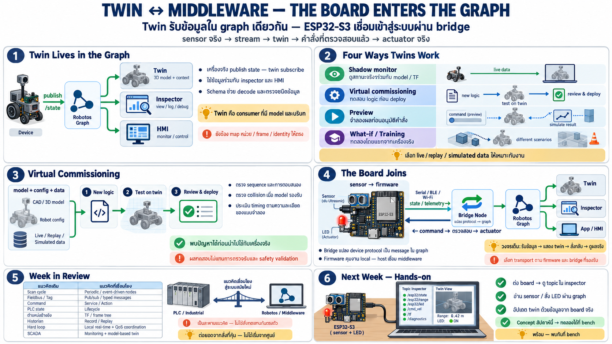

# Twin ↔ middleware — ทำให้ทั้งคู่ทำงานร่วมกัน + ปูทางสู่ hands-on



บทสุดท้ายของ week — เอาทุกอย่างมารวม: twin มีชีวิตเพราะ
middleware และขั้นต่อไปคือเอา board จริงเข้าระบบจริง

## Twin มีชีวิตจาก stream — middleware คือสายเลือด

จากบท 09: twin ต้องการ stream จริง — ในระบบแบบ graph นั่นคือ
topic โดยตรง:

```
┌──────────────┐                     ┌──────────────┐
│ real machine │ ── state topics ──► │ digital twin │
│ (nodes)      │                     │ (alive)      │
└───────┬──────┘                     └───────┬──────┘
        ▲ command, after preview             │
        └────────────────────────────────────┘
```

- เครื่องจริง publish สถานะ → twin subscribe เหมือน consumer ธรรมดา
- twin ไม่ต่างจาก node อีกตัวใน graph — อ่าน stream เดียวกันกับ
  inspector/HMI
- เพราะทุกอย่างเป็น typed message ตาม schema — twin decode ได้
  โดยไม่เขียนโค้ดเฉพาะเครื่อง

**ประเด็นสำคัญ**: twin ไม่ใช่ "ระบบแยกที่ต้องต่อพิเศษ" — มันคือ
subscriber ใน graph เดียวกัน — ถ้าระบบ middleware ดี twin แค่
มาฟัง

## Twin ทำงานกับ middleware อย่างมีประสิทธิภาพ — รูปแบบที่ใช้จริง

### 1. Shadow monitoring — twin เป็นหน้าต่างลึกกว่า HMI

- subscribe state topics → แสดงท่าทางจริง ตำแหน่งจริง ใน 3D
- เห็นสิ่งที่ tag list ให้ไม่ได้: แขนอยู่ตรงไหนในโลก ไม่ใช่
  "joint3=45°"
- ใช้ TF (บท 06) แปลงข้อมูลเป็นตำแหน่งจริงที่ twin แสดง

### 2. Virtual commissioning — เทสก่อน deploy จริง

นี่คือ use case ที่จับต้องได้ที่สุดสำหรับคน automation:

```
new logic or a new program ──► run it against the twin ──► deploy to the machine only after it passes
                               (the line is still running)
```

- ทดสอบ robot program / cell sequence / PLC logic ใหม่กับ twin
  ที่เลี้ยงด้วยข้อมูลจริง ก่อนหยุด line deploy
- เจอ collision, sequence ผิด, timing ไม่พอ — **ก่อนที่เครื่องจริง
  จะเสีย** — ลด downtime และอุบัติเหตุ
- เทียบ offline program check เดิม: ตอนนี้ twin มี "ชีวิต" จริง —
  สภาพจริงล่าสุดไหลเข้าตลอด ไม่ใช่ model ตาย ๆ

### 3. Safe command preview — สั่งผ่าน twin ก่อน

- เขียน command ที่จะส่ง → ให้ twin จำลองผลก่อน → ผู้ใช้ยืนยัน →
  ค่อยส่งเข้าเครื่องจริง
- twin คือ sandbox ของ command path — ลองคำสั่งเสี่ยงบนเงา
- เชื่อมกับ action (บท 04): goal ใหญ่ผ่าน preview ใน twin ก่อน
  commit

### 4. What-if & training — ลองเล่นโดยไม่แตะของจริง

- what-if scenario บน twin ที่ sync กับของจริง — "ถ้าเปลี่ยน
  setpoint นี้จะเป็นอย่างไร" โดยใช้สถานะจริงตอนนี้เป็นจุดเริ่ม
- ฝึกคนใหม่บน twin — เห็นเครื่องจริงในสภาพจริงแต่ทำพังไม่ได้

## ปูทางสู่ hands-on — board จริงเข้า graph จริง

ทุกอย่างในบทนี้เป็น concept — ขั้นต่อไปในสัปดาห์หน้าคือของจริง:

**board ESP32-S3 (เช่น board ที่ใช้ใน course embedded) จะกลายเป็น
node จริงใน graph ของ robotos**

เส้นทางของข้อมูลที่จะทำจริง:

```
┌─────────┐    ┌──────────┐    ┌────────────┐    ┌────────┐    ┌─────────┐    ┌────────────┐
│ sensors │ ─► │ firmware │ ─► │ channel    │ ─► │ bridge │ ─► │ robotos │ ─► │ twin / app │
└────┬────┘    └──────────┘    │ serial/BLE │    └────┬───┘    └────┬────┘    └──────┬─────┘
     │                         └────────────┘         │             │                │
     ▲ command back                                   ▲             ▲                │
     └────────────────────────────────────────────────┴─────────────┴────────────────┘
```

- **sensor/actuator บน board = node ตัวเล็กที่ขอบ graph** — ตามที่
  เห็นในบท 02: device เล็กเข้า graph เดียวกับเครื่องใหญ่ได้
- bridge คือตัวแปล — board พูดผ่านท่อเล็ก bridge แปลเข้า graph —
  concept remote I/O แบบ software
- robotos เบาพอที่ขอบนี้ — board ไม่ต้องรัน middleware หนัก —
  แค่คุยกับ bridge
- เมื่อ board อยู่ใน graph: twin เห็นมัน เหมือน node อื่น — **วงจร
  เต็ม: sensor จริง → stream → twin มีชีวิต → สั่งกลับ → actuator
  จริงขยับ**

สัปดาห์หน้าจะได้ทำจริง: ต่อ board ดู topic มันไหล เห็นใน inspector
สั่ง LED/อ่าน sensor ผ่าน graph — concept ทั้งหมดของ week นี้กลาย
เป็นของที่แตะได้

## ภาพรวมที่คุณได้จาก week นี้

```
┌───────────────────┐      ┌────────────────────────────────┐
│ the old world     │      │ the new world                  │
├───────────────────┤      ├────────────────────────────────┤
│ scan cycle        │ ───► │ event-driven nodes (02)        │
│ fieldbus poll     │ ───► │ topics, publish/subscribe (02) │
│ tag table         │ ───► │ typed messages, schema (03)    │
│ a command word    │ ───► │ a service or an action (04)    │
│ PLC states        │ ───► │ parameters, lifecycle (05)     │
│ a wiring diagram  │ ───► │ a TF frame tree (06)           │
│ trends, historian │ ───► │ inspect, record, replay (07)   │
│ the hard loop     │ ───► │ QoS, split the layers (08)     │
│ a SCADA screen    │ ───► │ a living digital twin (09)     │
└───────────────────┘      └────────────────┬───────────────┘
                                            ▲
                                            │
                                 ┌──────────┴──────────┐
                                 │ an ESP32-S3 board   │
                                 │ as a real node      │
                                 │ (10, then hands-on) │
                                 └─────────────────────┘
```

## Checklist

| คำถาม | ควรตอบได้ |
|---|---|
| twin อยู่ใน graph ยังไง | เป็น consumer เหมือน node อื่น — subscribe state topics |
| virtual commissioning คือ | เทส logic บน twin ที่เลี้ยงข้อมูลจริง ก่อน deploy — ลด downtime |
| สั่งผ่าน twin ปลอดภัยยังไง | preview ผลบน twin → ยืนยัน → ส่งจริง — twin = sandbox |
| board เข้า graph ยังไง | sensor/actuator → ท่อเล็ก → bridge node → robotos graph |
| week นี้ให้อะไร | mental model ครบ: node/topic/schema/service/action/param/TF/observe/QoS + twin — พร้อม hands-on |
