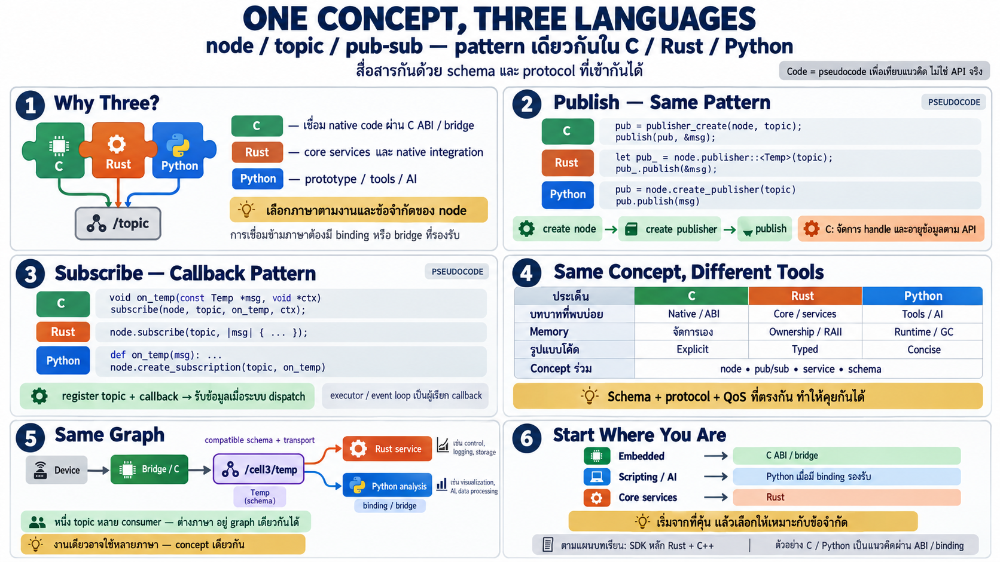

# Concept เดียวกัน สามภาษา — C, Rust, Python



สิ่งที่ middleware ดีให้คือ **แนวคิดเดียวกันเขียนได้หลายภาษา** —
graph/node/topic ไม่ผูกกับภาษาใดภาษาหนึ่ง บทนี้แสดง pattern เดียว
กัน (สร้าง node → publish → subscribe) ในสามภาษาเพื่อให้เห็นว่า
"ความคิดเดียวกัน syntax ต่างกัน"

*ตัวอย่างเป็นแนวคิดเชิงออกแบบ — pseudo-API ใกล้เคียงของจริง ไม่ใช่
code ที่ copy ไป compile ได้ตรง ๆ*

## ทำไมต้องหลายภาษา

สามภาษาเข้ากราฟเดียวกัน:

```
┌─────────────┐    ┌──────┐    ┌───────────────────┐
│ C / C++     │    │ Rust │    │ Python            │
│ ABI and SDK │    │ SDK  │    │ sketch of the ABI │
└──────┬──────┘    └───┬──┘    └─────────┬─────────┘
       │               │                 │
       └────────────────┬────────────────┘
                        ▼
                  ┌───────────┐
                  │ one graph │
                  └───────────┘
```

ในโรงงานจริง node ต่างตัวเขียนคนละภาษาได้ตามหน้าที่:

- **C** — ผ่าน C ABI layer ที่ middleware เปิดให้ — จุดเชื่อม
  พื้นฐานที่ภาษาอื่นและระบบเล็กเข้าถึงได้
- **Rust** — core services / ต้องการความปลอดภัย memory + performance
  (ภาษาที่ middleware เองเขียนด้วย)
- **Python** — prototype / data side / tooling / เชื่อม AI/ML —
  ตัวอย่างว่าภาษาอื่นจะเชื่อมผ่าน ABI เดียวกันได้อย่างไร

ทั้งสามอยู่ใน graph เดียวกันได้ — node ภาษาไหนก็ตามพูดผ่าน message
+ schema เดียวกัน — **นี่คือพลังของ middleware: ภาษาของการคุยคือ
ข้อมูล ไม่ใช่ภาษาโปรแกรม**

> **เรื่องจริงของภาษา**: middleware นี้ให้ SDK อยู่สองภาษา — **Rust
> กับ C++** — ส่วนชั้น C คือ ABI (binary interface) ที่ภาษาอื่น
> เชื่อมผ่านได้ ตัวอย่าง C และ Python ด้านล่างแสดง "หน้าตาที่จะเป็น"
> ผ่าน ABI เดียวกัน — เป็นแนวคิดเชิงออกแบบไม่ใช่ API จริง
>
> อีกจุด: device เล็กอย่าง board ไม่จำเป็นต้องเชื่อม ABI ตรง ๆ —
> เข้า graph ผ่าน **bridge** ที่แปลท่อเล็ก (serial/BLE/WiFi) เข้า
> ระบบ — ภาษาบนบอร์ดเป็นเรื่องของ firmware ไม่ใช่ของ graph

## Publish — ส่งค่าออก

เป้าหมายเดียวกัน: node ชื่อ `temp_sensor` publish ค่าลง topic
`/cell3/temperature`

**Python** — ตรงที่สุด เหมาะ prototype:

```python
node = create_node("temp_sensor")
pub = node.create_publisher("/cell3/temperature", Temperature)

while True:
    msg = Temperature(celsius=read_celsius(), sensor_id="TC-07")
    pub.publish(msg)
    sleep(1)
```

**Rust** — ชัดใน type + ownership:

```rust
let node = Node::new("temp_sensor")?;
let pub_ = node.publisher::<Temperature>("/cell3/temperature")?;

loop {
    let msg = Temperature { celsius: read_celsius(), .. };
    pub_.publish(&msg)?;
    sleep(Duration::from_secs(1));
}
```

**C** — ผ่าน C ABI — เข้มข้นกว่าเพราะจัดการ handle เอง:

```c
robotos_node_t *node;
robotos_node_create("temp_sensor", &node);

robotos_pub_t *pub;
robotos_publisher_create(node, "/cell3/temperature", &pub);

Temperature msg = { .celsius = read_celsius() };
robotos_publish(pub, &msg, sizeof(msg));
```

สังเกต: รูปแบบเดียวกันเป๊ะ — **new node → create publisher →
loop publish** — ต่างแค่ว่า C ต้องบริหาร handle/หน่วยความจำเอง
(และ destroy ตอนจบ) ในขณะที่ Python/Rust จัดการให้

## Subscribe — รับค่าเข้า

เป้าหมายเดียวกัน: callback ถูกเรียกเมื่อมีข้อมูลใหม่

**Python**:

```python
def on_temp(msg):
    if msg.celsius > 80: alarm(msg.sensor_id)

node.create_subscription("/cell3/temperature", on_temp)
```

**Rust**:

```rust
node.subscribe::<Temperature>("/cell3/temperature", |msg| {
    if msg.celsius > 80.0 { alarm(&msg.sensor_id) }
})?;
```

**C**:

```c
void on_temp(const Temperature *msg, void *ctx) {
    if (msg->celsius > 80) alarm(msg->sensor_id);
}
robotos_subscribe(node, "/cell3/temperature", on_temp, NULL);
```

pattern เดียวกัน: **ลงทะเบียน callback + topic → ระบบเรียกเมื่อ
มีของมา** — ไม่มี polling ไม่มี loop ถาม ในทุกภาษา

## Service call — ถาม-ตอบ

**Python**: `resp = client.call("/robot/set_mode", mode="auto")`

**Rust**: `let resp = client.call("/robot/set_mode", &req)?;`

**C**: `robotos_call(svc, &req, &resp);` — ต้องเตรียม buffer รับ
เอง

## ภาพเปรียบเทียบ — อะไรเหมือน อะไรต่าง

| | C (ผ่าน ABI) | Rust | Python (ในอนาคต/ผ่าน ABI) |
|---|---|---|---|
| ใช้ที่ไหน | จุดเชื่อมพื้นฐาน / ภาษาอื่น | core services | prototype/tool/AI |
| จัดการหน่วยความจำ | เองทั้งหมด | compiler บังคับ | runtime ดูแล |
| ความยาวโค้ด | ยาวสุด | กลาง | สั้นสุด |
| เหมือนกัน | node/pub/sub/service/schema เดียวกัน | | |

**Key insight**: เลือกภาษาตามตำแหน่งใน graph ไม่ใช่ตามรสนิยม —
จุดเชื่อมเล็ก ๆ ใช้ C ผ่าน ABI, logic กลางใช้ Rust, เครื่องมือ/AI
อนาคตอาจเป็น Python ผ่าน ABI เดียวกัน — และทั้งหมดคุยกันเพราะ
**schema เดียวกัน**

## ทำไมเรื่องนี้สำคัญกับอาชีพ

- ในโรงงานอนาคต คุณอาจต้อง: เขียนชิ้นส่วนเชื่อมผ่าน C ABI,
  service กลาง (Rust), script วิเคราะห์/AI (ภาษาอย่าง Python) —
  **คนละภาษา concept เดียวกัน**
- ภาษาเป็นตัวเลือกตามข้อจำกัดของตำแหน่ง — ไม่ใช่ตัวตัดสินว่าเข้า
  ระบบได้ไหม — schema+graph คือของร่วม
- เริ่มจากภาษาที่คุ้นสุด — automation คนหลายคนคุ้น C จาก embedded
  หรือ Python จาก scripting — เข้าจากตรงนั้นแล้วขยาย

## Checklist

| คำถาม | ควรตอบได้ |
|---|---|
| concept เดียวกันในทุกภาษาคือ | new node → create pub/sub → callback/publish loop |
| อะไรที่ทำให้ข้ามภาษาได้ | schema + topic name — สัญญาข้อมูลไม่ผูกภาษา |
| C ต่างจากที่อื่นตรง | จัดการ handle/memory เอง — เหมาะกับ device เล็ก |
| Python เหมาะตรงไหน | prototype/tool/AI side — เขียนเร็วอ่านง่าย |
| เลือกภาษายังไง | ตามตำแหน่งใน graph (edge= C/Rust, กลาง=Rust, tool=Python) |
