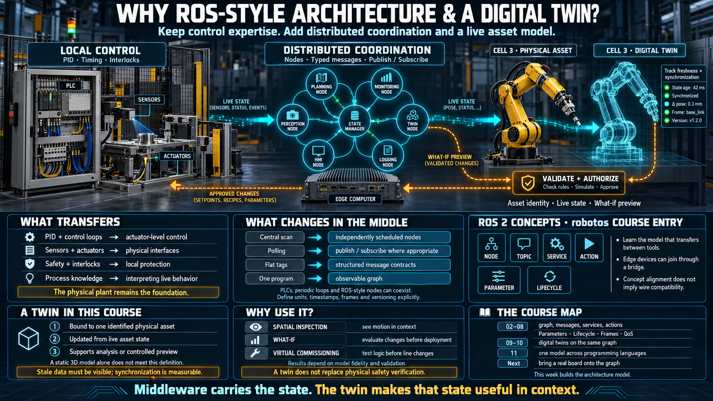

# Why Automation Moves to a ROS-Style Architecture and a Digital Twin

Automation has already changed its stack more than once: relay logic, then PLCs, then DCS, fieldbus, and SCADA. Each time, the people who learned the new middle layer kept the work. The physical plant did not become optional. The way software sat between the sensor and the decision did.

This round is robotics and embodied AI. An AMR in a warehouse, a cobot beside a person, a vision model closing a loop on a live camera. The new constraint is not a novel I/O card. It is a software architecture: many programs, on many machines, exchanging messages, with a living model of one specific machine beside them.

This week teaches that architecture. It does not ask you to write the code yet. It asks you to leave with the model that next week's hands-on will use.

## What you already know is still the scarce part

The control knowledge does not expire. It changes its address.

| You already know           | What it is in the new stack                                                                             |
| -------------------------- | ------------------------------------------------------------------------------------------------------- |
| PID and the control loop   | Still the core of every actuator. A robot is dozens of those loops, nested.                             |
| Sensors and actuators      | The same devices, attached to a node instead of only to an I/O card.                                    |
| Safety and interlocks      | More important, not less. The machine now moves through a space people occupy.                          |
| Reading a process          | The same skill. The data is a stream of messages, not a flat tag.                                       |
| Fieldbus, Modbus, Profibus | The same idea — a shared medium and a shared language — with a different transport and a typed payload. |

What changes is the middle. Between the sensor and the decision there used to be a scan cycle, a fieldbus, and a ladder program in one controller. There is now a set of **distributed software nodes that talk by message**. The loop that must be on time stays close to the actuator. The coordination moves onto the graph.

## The gap to close

| Familiar                                           | New                                                      | The actual difference                                                                             |
| -------------------------------------------------- | -------------------------------------------------------- | ------------------------------------------------------------------------------------------------- |
| A scan cycle that inspects everything on one clock | **Event-driven** nodes, each with its own clock          | There is no central scan. A node runs when it has work.                                           |
| A fieldbus master polling each point               | **Publish / subscribe**                                  | The producer pushes. The consumer does not ask.                                                   |
| A flat tag table                                   | **A typed message and a schema**                         | The data has a structure, a unit, and a version. That structure is the contract.                  |
| One PLC for the cell                               | **A graph of nodes**, possibly on more than one computer | Part of the graph can sit at the edge. Part can sit elsewhere. No single program holds every tag. |
| An HMI watching tags                               | **An inspector watching the graph**                      | You see structure and flow, not only the current number.                                          |

## ROS is the common language, and robotos is the way in

ROS — and the current generation, ROS 2 — is the middleware that research robots and a large share of robot products already assume. Arms, AMRs, drones, and autonomous vehicles are built on the same idea: **a node does one job, and it talks to other nodes through topics**.

**robotos** is the middleware this course uses. It follows the same concepts as ROS 2: node, topic, publish/subscribe, service, action, parameter, and a lifecycle. It is built so that:

- The runtime stays small enough for a large machine and for an edge box.
- A small device can join the same graph, usually through a bridge rather than by running the full stack.
- The system is not an island. The concepts line up with ROS 2, so a later move onto that stack is a change of tools, not a change of model.
- Every idea in this week has a direct counterpart there.

You learn robotos first because the model is the part that transfers. The install is the smaller problem. A person who can say what a topic is for, and what it must not be used for, can pick up the larger stack. A person who only memorized a launch file cannot.

## A digital twin is a living model of one machine

"Digital twin" is used for almost any picture of a machine. In this course it means something narrower, and the later lessons will hold that line:

- The twin is a digital replica of **one physical asset** — the arm installed in cell 3, not "a generic six-axis arm."
- It stays in step with that asset. When the machine moves, the twin moves, because a live stream is feeding it. A model you ran once last month is not a twin.
- It has a way back. You can ask it a question, or preview a command, before anything is committed to the real actuators.

The practical uses sit on those three conditions. You can see the machine in space rather than as a list of joint angles. You can ask what-if against its current state without risking the cell. **Virtual commissioning** — running new logic against the twin before you stop the line to deploy it — is the use that pays for the work, because downtime is the expensive part.

A twin without a live stream is a simulation wearing the wrong name. The stream is what middleware is for. Topics are the twin's blood supply. The two subjects of this week are one circuit: **the middleware delivers the stream, and the twin is alive only while that stream arrives.**

## Why the combination is scarce

The roles that are opening want three things in one person:

- The physical plant: safety, actuators, process behavior. You already have this.
- The software architecture of a distributed system: publish/subscribe, typed messages, a graph of nodes. That is this week.
- A twin used as an instrument: virtual commissioning, what-if, a view that a tag list cannot draw.

An engineer who can run the real machine and also speak the middleware is the bridge both sides are missing. The controls group does not want a robotics stack that ignores interlocks. The robotics group does not want a ladder program that cannot name a frame. The job is the join.

## How the week is split

**First axis — ROS-style thinking, through robotos** (lessons 02–08). The graph of nodes and topics. Messages and schema. Services and actions. Parameters and lifecycle. Frames. Observing a system that has no single program. Quality of service, and why a deadline still lives in one node.

**Second axis — the digital twin** (lessons 09–10). What deserves the name, and how a twin sits on the same graph as the machine. Lesson 11 shows that the model is not owned by one programming language.

By the end of the week you will not have shipped a node. You will be able to name the pieces and say which job each one is for. Next week puts a real board on the graph.

## Checklist

| Question                                   | You should be able to answer                                                                             |
| ------------------------------------------ | -------------------------------------------------------------------------------------------------------- |
| What changed in this round?                | The middle layer. A scan and a fieldbus become distributed nodes and publish/subscribe.                  |
| Did the old knowledge expire?              | No. PID, safety, and process sense are the scarce base. They move onto a new architecture.               |
| What is ROS?                               | The standard robot middleware. Nodes, topics, and services are the shared language.                      |
| What is robotos?                           | A middleware with the same concepts as ROS 2, small enough for the edge, and the stack this course uses. |
| How is a twin different from a simulation? | A twin is bound to one real machine and kept in sync with it. A simulation answers a general "what if."  |
| Why learn both?                            | The middleware carries the stream. The twin is alive only because that stream exists.                    |
