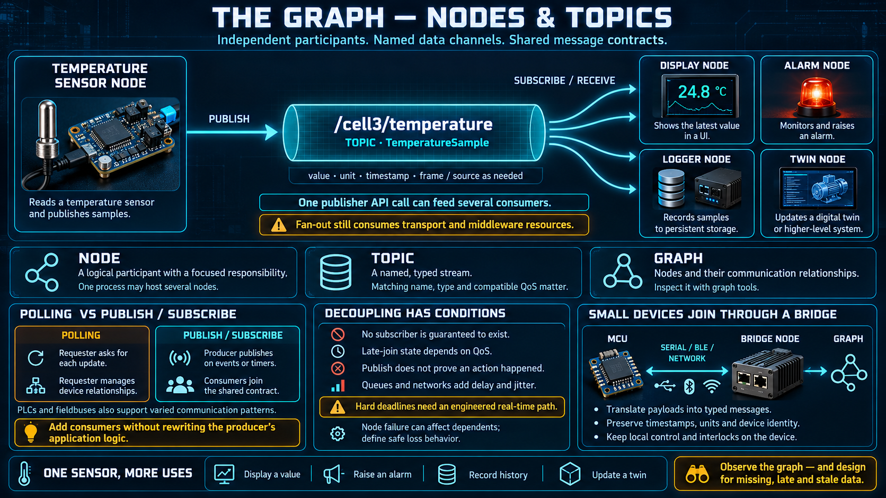

# The Graph — Nodes and Topics



This is the lesson the rest of the week stands on. A node is a small program with one job. A topic is a named channel, not an address. The graph is every node plus every topic you can see at once. If those three sentences stay sharp, services, schema, and the twin have somewhere to sit.

## What you are leaving: one scan, one master

In the PLC shape you already trust:

- One controller repeats one loop: read inputs, run logic, write outputs. The scan is the clock of the cell.
- Devices on a fieldbus (Modbus, Profibus, and their relatives) are reached by **polling**. The master asks, the slave answers, and the master asks again next scan whether or not the value changed.
- There is a center. One program can, in principle, see every tag.

That design has earned forty years. It stops scaling when the system is several robots, dozens of sensors, and more than one computer running a model. A single master that visits every point on one cycle becomes the bottleneck, and it becomes a single point of death for the cell.

## What you are entering: nodes, topics, a graph

ROS and robotos break that one program into many small programs. They do not call each other. They meet at a topic.

```
┌─────────┐    publish    ┌────────────┐    subscribe   ┌─────────┐
│ sensor  │ ────────────► │/temperature│ ────────────►  │ display │
│  node   │               │   (topic)  │                │  node   │
└─────────┘               └────────────┘                └─────────┘
                              │                          ▲
                              └──────────── subscribe ───┤
                                                         │ alarm  │
                                                         │  node  │
                                                         └────────┘
```

- A **node** is a process with one job: read a sensor, run a control step, drive a motor, draw a display. Nothing in the graph grants it a turn. It runs on its own schedule.
- A **topic** is the name of a data channel. The node that produces a value **publishes** it to the topic. Any node that cares **subscribes**. The publisher does not know who is listening. The subscriber does not know who is publishing. The name is the only coupling.
- The **graph** is the picture of all of those nodes and the topics between them. It is not inside any one program. You look at it from outside, which is a later lesson.

Set next to a fieldbus, the change is not the cable. It is who initiates, and who has to be edited when the system grows.

| Fieldbus (poll)                          | Topic (publish / subscribe)                                       |
| ---------------------------------------- | ----------------------------------------------------------------- |
| The master asks every point, every cycle | The publisher pushes when it has a value. Subscribers receive it. |
| The master knows every slave             | The publisher knows no subscriber. The two sides are decoupled.   |
| A new device means editing the master    | A new node publishes or subscribes to a topic that already exists |
| One cycle time bounds everything         | Each node has its own rate                                        |

## Why a robot wants this

- **A real boundary.** Replacing the display node does not require a change to the sensor node. They share a topic name and a message type. They do not share a source file.
- **Growth without a rewrite.** A new consumer joins the graph. The publisher stays as it was.
- **Many consumers at no extra cost to the producer.** One temperature can feed a display, an alarm, a logger, and a twin at the same time. The sensor node publishes once.
- **More than one computer.** A node can run on the main machine, on an edge box, or — through a bridge — beside a small board. It is still one graph.
- **Work follows events.** There is no central loop that wakes up to discover that nothing changed. A node runs when a message arrives, or when its own timer says the next sample is due.

Decoupling has a price, and it is the price you must design for rather than discover in the field. The publisher cannot assume a subscriber exists. The subscriber cannot assume the publisher is alive. "I published" does not mean "someone acted."

## Behavior that surprises people coming from a PLC

- **There is no free "last value."** A topic is a stream. A subscriber that joins late may not see the sample from a moment ago. Whether a late joiner receives the latest value is a quality-of-service choice, covered in the QoS lesson. Do not write a node that assumes the first callback is "the current state of the world" unless that topic was built to provide it.
- **Pushed is not the same as delivered on time.** The message crosses queues and, often, a network. A control loop that needs a fixed period does not belong on that path. Lesson 08 draws the line.
- **A node can die without taking the cell with it.** A PLC fault stops the program that owned every output. Here, the graph loses the topics that node was feeding and the actions it was performing. Everything that did not depend on it keeps running. That is an improvement only if the nodes that remain are safe without it. An interlock that lived only inside the dead node is gone.
- **No node sees the whole graph from the inside.** The overview comes from an inspector, not from a watch table in the one program. If you cannot see the graph, you cannot debug the system. That tool is part of the architecture.

## A sketch of the API, not the API

When you do write a node, the shape is this. Python is the most readable place to show it. **This is a design sketch, not a library you can import.**

```python
# producer — read a sensor and publish
node = create_node("temp_sensor")
pub = node.create_publisher("/cell3/temperature")
while running:
    pub.publish(read_sensor())      # push. anyone subscribed will receive it

# consumer — subscribe and wait
node2 = create_node("monitor")
node2.create_subscription("/cell3/temperature", on_temp)

def on_temp(value):                 # called when a new value arrives
    if value > LIMIT:
        alarm()
```

There is no poll loop and no peer address. Both sides share a topic name. The callback is the consumer's entire steady state: do nothing until a message arrives, then do one thing.

## A small device joins the same graph

A heavy middleware assumes every participant is a Linux process. A plant is full of boards that are not.

- A small MCU or a course board can still be a **node at the edge of the graph**. It does not have to run the full middleware.
- The usual shape is a **bridge**. The board speaks a small channel — serial, BLE, or Wi-Fi. A bridge node translates that into publishes and subscriptions on the graph. Conceptually this is remote I/O, done in software, with a schema instead of a register map.
- The edge of the system is then the actual sensor, not the first computer large enough to run a framework.

This is why a small middleware matters. A graph that only runs on the big machines leaves most of the plant's data outside the system you can inspect, record, and show on a twin.

## Checklist

| Question                                    | You should be able to answer                                                                                  |
| ------------------------------------------- | ------------------------------------------------------------------------------------------------------------- |
| What is a node?                             | A small program with one job, running on its own, as one vertex of the graph.                                 |
| What is a topic?                            | A named channel. Producers publish into it. Consumers subscribe out of it.                                    |
| How is that different from a fieldbus poll? | Values are pushed when they exist, not asked for every cycle. Producer and consumer do not know each other.   |
| How do you add a device?                    | Add a node and connect it to an existing topic. Do not edit the nodes already running.                        |
| What happens when a node dies?              | The rest of the graph stays up. You lose only what depended on that node — so that dependency has to be safe. |
| Can a small device join?                    | Yes. It usually joins through a bridge that translates a small channel onto the graph.                        |
