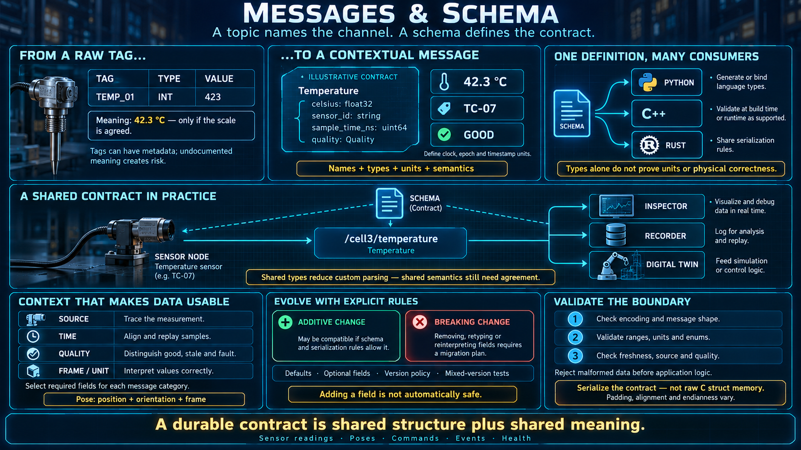

# Messages and Schema



A topic is only a name until you say what flows through it. The thing that flows is a **message**. The definition of that message is a **schema**. This lesson is why a flat tag table does not survive a system that several teams will change.

## From a tag table to a typed message

A traditional automation system stores data as tags:

```
TAG        ADDRESS    TYPE     VALUE
TEMP_01    %MW100     INT      423
PUMP_RUN   %M50       BOOL     1
```

A tag is a name, an address, and a raw type. The value is flat, and it lives in a shared table. The meaning lives in someone's head or in a spreadsheet beside the program: "423 means tenths of a degree." Add a field and you reserve a new address, then you update the document. Miss either step and the system still runs, with a silent wrong scale.

A message puts the structure where the software can see it:

```text
message Temperature {
    float32 celsius
    string  sensor_id
    uint64  timestamp
    Quality quality      // good / stale / fault
}
```

- The data has a structure. Each field has a name and a type. The definition travels with the contract, not in a side document.
- The sample carries its own context: when it was taken, which sensor produced it, and whether the producer still trusts it. A bare 42.3 cannot say any of those things.
- Publisher and subscriber agree the shape before a value is exchanged. A mismatch fails at connection or at build time. It does not fail as a number that happens to be ten times too large.

## The schema is the contract

Both sides hold the same contract:

```
┌────────────┐      ┌─────────┐      ┌─────────────┐
│ publisher  │ ───► │ message │ ───► │ subscriber  │
│ one schema │      └─────────┘      │ same schema │
└────────────┘                       └─────────────┘
```

A graph of dozens of nodes will be written in more than one language, by more than one person, months apart. The schema is how they still agree.

- **One definition, the same reading everywhere.** The field `celsius` is a `float32` in degrees. It is not "probably tenths, check the PDF."
- **Code generation.** The same schema compiles to a type in Python, C++, and Rust. Every node sees the same fields. A rename in the schema is a compile error in every language, which is the point.
- **Change with a rule.** Adding a field can be done so that an old subscriber still reads the fields it knows. Changing or removing a field is a new version and has to be announced. The system can grow without a flag day.
- **Failure that happens early.** A schema mismatch is caught when the nodes are wired together, not as a quiet wrong behavior on a Saturday shift.

For an automation engineer, a schema is the tag list, the data type, the unit, and the meaning, bound into one artifact the machine enforces. It replaces the spreadsheet that used to sit beside the PLC program and drift out of date.

## A message is not a raw stream

Bytes on a topic are not free to mean whatever the subscriber guesses:

- Every message has a **type**. The topic `/cell3/temperature` carries `Temperature`. It does not carry "whatever the sensor felt like sending today."
- A subscriber knows the shape **before** the first sample arrives, and can decode it the same way every time.
- An inspector, a recorder, and a twin can read the message without a private parser for that device. They read the schema.

That is why a large system can collect data without a new integration project per machine. If two cells publish `Temperature`, the historian does not care which vendor built the transmitter. If they do not, no amount of middleware will invent the missing agreement.

## Messages you will actually see

| Kind            | Fields that keep showing up                              |
| --------------- | -------------------------------------------------------- |
| Sensor reading  | value, unit, timestamp, quality                          |
| Pose            | x, y, z, orientation, and the frame those numbers are in |
| Command         | target, mode, parameters                                 |
| Status or event | state, code, human-readable detail, timestamp            |
| Health          | battery, temperature, error flags                        |

Timestamp and source identity are not optional decoration. A sample without a time cannot be aligned with another sample. A sample without an identity cannot be traced to a device when you later build a dataset, a maintenance record, or a replay. Quality belongs in the same list: a number from a sensor that has faulted must not look like a number from a sensor that is healthy. Downstream logic, including a twin, has to be able to reject it.

## Versioning is how the system is allowed to grow

Real systems gain fields. A sensor starts reporting a status bit. A command gains an option.

- **Add a field.** An old subscriber keeps reading the fields it already understood. That is forward compatible. The new subscriber sees the new field.
- **Remove or reinterpret a field.** That is a breaking change. It is a new version of the contract, and it has to be published as one. Both sides move on purpose.
- **The short rule.** Adding is safe. Changing the meaning of something that already exists is not. It is the same instinct as adding a tag without moving the old one — with the difference that the schema, not a meeting, records which you did.

This is the failure mode a tag table hits over and over: one address is reused, and every consumer of that address is wrong at once. A schema makes the change gradual because the old fields keep their meaning until a version says otherwise.

## Where this sits

- A topic name without a type is not a contract. **The topic has no meaning outside its schema.**
- Nodes agree through the type, not through a document in a shared drive. The contract is something the toolchain can check.
- A twin, a recorder, and a later learning pipeline all consume messages. A careful schema is the last time you pay the integration cost. Every layer above it inherits the types.

## A sketch, not an SDK

```python
# pseudo-API — a design sketch, not a real library

class Temperature:
    celsius: float
    sensor_id: str
    timestamp: int
    quality: str

# publish — the value has to be the declared type
pub.publish(Temperature(
    celsius=42.3,
    sensor_id="TC-07",
    timestamp=now(),
    quality="good",
))

# subscribe — the callback receives a structured object, not raw bytes
def on_temp(msg: Temperature):
    if msg.celsius > LIMIT and msg.quality == "good":
        ...
```

The class is the picture of the contract. On the wire, a real system encodes that contract with a schema language, not with the memory layout of a struct. Padding and endianness are the reason. You publish a `Temperature`. You do not publish "twenty bytes that happened to look right on this compiler."

## Checklist

| Question                                          | You should be able to answer                                                                                    |
| ------------------------------------------------- | --------------------------------------------------------------------------------------------------------------- |
| How is a message different from a tag?            | A tag is a name, an address, and a raw type. A message is a structure that carries its meaning and its context. |
| What is a schema?                                 | The definition of that structure. One contract, checked in every language.                                      |
| Can you add a field?                              | Yes, if old readers still understand the old fields. Changing an existing field is a new version.               |
| Why can a twin or a recorder consume this easily? | They decode the schema. They do not carry a private parser per device.                                          |
| What should a message always carry?               | A timestamp, the identity of the source, and a quality. A number alone has no context.                          |
