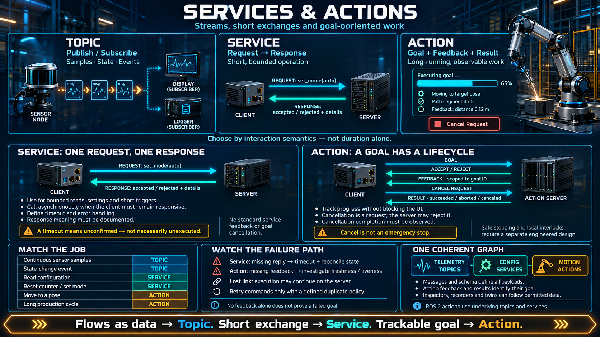

# Services and Actions



A topic is a stream. "Do this" is not a stream. This lesson adds the other two ways a node can talk: a **service**, which is a short request and a response, and an **action**, which is a long piece of work you can watch and cancel.

## Three shapes, and a rule for picking one

| Shape       | Character                                            | Use it for                                           |
| ----------- | ---------------------------------------------------- | ---------------------------------------------------- |
| **Topic**   | A stream. It flows whether or not anyone asked.      | Telemetry, sensor samples, state updates             |
| **Service** | Request, then response. It finishes quickly.         | A read, a setting, a short trigger                   |
| **Action**  | A goal, then feedback, then a result. It takes time. | A move, a long cycle, anything you may need to abort |

One rule covers the choice: **if it does not finish immediately, it is not a service.** Actions exist because that case is common on a robot and a service handles it badly.

## A service is a function call across a node boundary

```
client node ── request ──►  service node ── response ──► client
              (a short wait)               (one reply)
```

- The client asks. The server answers. Logically this is synchronous: the caller does not continue the conversation until the reply arrives, even when the implementation underneath is asynchronous.
- It fits work that **finishes quickly and has a clear result**: read a parameter, turn something on or off, ask for a status, reset a counter.
- It differs from a topic because **there is a specific server and there is a reply**. A topic has neither. Publishing is not asking, and nobody on a topic owes you an answer.

From a controls seat, a service is a function block you can call over the network: "what is the current mode?" or "reset this alarm." One exchange, then it is over. If you cannot say how long "over" is, you have picked the wrong tool.

```python
# pseudo-API — a design sketch, not a real library
resp = client.call("/robot/set_mode", mode="auto")
if resp.ok:
    ...          # there is a reply, so you know whether it succeeded
```

A service that blocks while a mechanism moves will block a client, and often an executor thread, for the whole motion. Callers start adding their own timeouts. The server has no standard way to say "I am halfway" or "stop." You have reinvented an action, badly.

## An action is work that takes time and can be cancelled

Many robot commands do not finish in one exchange. "Move to this pose" takes seconds or minutes. During that time you need three things a service does not give you:

- **Feedback** — how far along the work is.
- **Cancel** — a way to stop it in the middle, safely, rather than by killing a node.
- **A result** — success, failure, or cancelled, when the work actually ends.

An action is the pattern that makes those three part of the interface:

```
client ── goal ──► action server
       ◄── feedback, streaming while the work runs ──
       ── cancel ──►   if it must stop
       ◄── result, when it ends: success, failure, or cancelled
```

- The **goal** is the request: go to this pose, run this cycle.
- **Feedback** is a small stream of progress. It is not a second, unrelated topic that the client hopes someone is publishing. It belongs to this goal.
- **Cancel** is available for the whole lifetime of the goal. The server is required to stop in a way that leaves the machine safe. Cancelling is a normal outcome, not an error you forgot to handle.
- The **result** is one terminal message. After it, the goal is over.

From a controls seat, this is a long sequence that used to be a cluster of busy, done, and error bits, plus a hope that "done" would eventually rise. Feedback replaces the polling of those bits. Cancel replaces pulling a wire.

```python
# pseudo-API — a design sketch
goal = action_client.send_goal("/arm/move_to", target=pose)
goal.on_feedback(lambda f: update_progress(f.percent))
goal.on_result(lambda r: log(r.status))   # success / failure / cancelled
# goal.cancel() is valid at any moment before the result
```

## Picking the tool on real jobs

| Job                                  | Tool    | Why                                                       |
| ------------------------------------ | ------- | --------------------------------------------------------- |
| A sensor updating continuously       | Topic   | It is a stream. Nobody is asking.                         |
| Turn an output on, or reset an alarm | Service | It finishes immediately, and you need an acknowledgement. |
| Read a parameter or a configuration  | Service | One question, one answer.                                 |
| Move a robot to a pose               | Action  | It takes time. You need progress and a way to abort.      |
| Run a long production cycle          | Action  | Progress is continuous, and abort has to be explicit.     |
| Report that something happened       | Topic   | The event is pushed. It is not a reply.                   |

The short form: **fast, with a short reply → service. Slow, and you must see the middle → action. Flows on its own → topic.**

A useful test is the failure you are willing to sit through. If the server never answers a service call, the client waits until its timeout and learns nothing about progress. If an action server stops sending feedback, the client already knows the goal is sick, and it can cancel.

## How the three sit together

- Topics, services, and actions, plus parameters in the next lesson, are the full set of ways a node talks.
- Action feedback is itself a small stream. It is the topic idea, scoped to one goal, so a recorder or a twin can follow the same progress a human is watching.
- When a twin is on the graph, a long command usually goes through an action. The twin can subscribe to the feedback because feedback is a stream of messages, not a private side channel.

## Checklist

| Question                               | You should be able to answer                                                                       |
| -------------------------------------- | -------------------------------------------------------------------------------------------------- |
| How do a topic and a service differ?   | A topic is a stream with no specific peer and no reply. A service is one request and one response. |
| When do you need an action?            | When the work takes time and the caller must see progress or cancel it.                            |
| What does an action contain?           | A goal, a stream of feedback, cancel, and one result.                                              |
| What familiar thing is a service?      | A short function call across a node boundary.                                                      |
| Why is a service wrong for a long job? | There is no progress and no cancel. The caller waits blind, and the server cannot stop cleanly.    |
