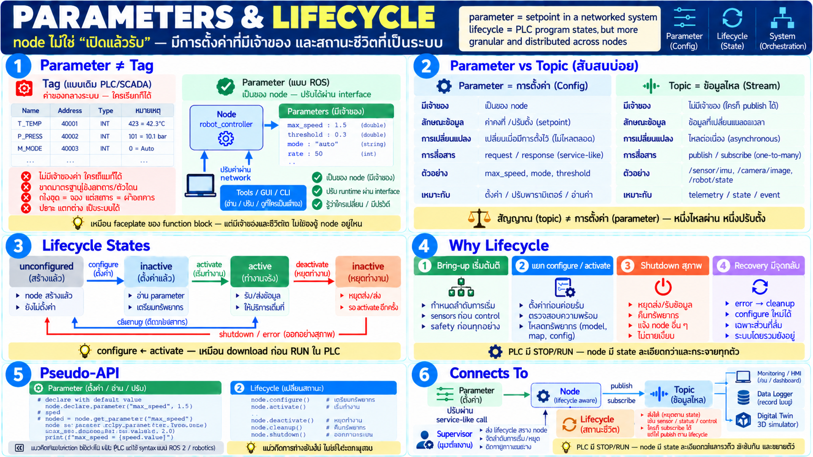

# Parameters and Lifecycle



A PLC program has a state, stop or run, and it has values you can tune. A node has the same two ideas, drawn more carefully. A **parameter** is a setting the node owns. A **lifecycle** is the sequence of states the node is allowed to be in. Neither one is a topic.

## A parameter is a setting with an owner

A tag sits in a shared table. Anyone who knows the address can write it. A parameter does not work that way.

- **It belongs to one node.** There is no global parameter table. The node that uses `max_speed` is the node that declares it.
- **It can change at runtime.** You do not stop the node and recompile to tune it. The feel is a live PID adjustment, done through an interface instead of by writing a raw address.
- **It has a type and a range.** A setpoint, a threshold, a mode, a rate. You read and write it through a call in the service style: one request, one response.
- **The write has an owner.** The change goes through the node's interface, so the node can reject a value it will not accept. Overwriting a memory address cannot do that.

From a controls seat, a parameter is the faceplate of a function block, reachable over the network without knowing which machine the process is on.

```python
# pseudo-API — a design sketch, not a real library
node.declare_parameter("max_speed", 1.5)   # default
speed = node.get_parameter("max_speed")    # read
node.set_parameter("max_speed", 2.0)       # tune while running
```

Declaring the parameter is part of bringing the node up. A consumer that sets a name the node never declared is not configuring the system. It is talking to a setting that does not exist.

## Why a parameter is not a topic

The two are easy to confuse because both carry a value with a name.

- A **topic** is a stream: sensor samples, a published state. It changes because the world changed. Nobody "owns" the latest sample. A late subscriber may not even see it.
- A **parameter** is the node's configuration. It changes when someone changes it on purpose. The node owns the value, and the value stays until the next intentional write.

The process-control reading is the clean one. A topic is the process variable, flowing through. A parameter is the setpoint or the configuration inside the controller. One is a signal. The other is a setting. Publishing your setpoint on a topic and also storing it as a parameter, without saying which one wins, is how two nodes end up acting on different speeds.

## A lifecycle: the node is not "started, therefore running"

A PLC program is basically stopped or running. A graph of many nodes cannot use a switch that coarse, because the order in which things become live matters.

```
unconfigured ── configure ──► inactive ── activate ──► active
     ▲                           │                        │
     └──────── cleanup ──────────┘                        │
     ▲                                                    │
     └──────────── shutdown / error ──────────────────────┘
```

- **Unconfigured.** The process exists. It has not been given its parameters or its connections. It must not publish, subscribe, or move anything yet.
- **Inactive.** Configuration is done. The node is ready and still not doing its job. This is the state that lets you finish bringing the whole graph up before any of it acts.
- **Active.** The node is doing the job: publishing, subscribing, commanding.
- **Shutdown or error.** A defined way out. Connections close, resources return, and other nodes can see that this one has left. A process that vanishes is not the same thing.

These names line up with the lifecycle of a managed ROS 2 node. The picture above is the model to learn. Transition tables and error codes belong to the API, later.

## Why the states are separate

Tens of nodes on more than one computer will not come up safely if they all start work at the same instant.

- **Bring-up has an order.** A sensor node before a control node. A safety node before either. A lifecycle gives a supervisor something to command: configure this one, then activate that one. "Start all processes and hope" is not an order.
- **Configure is not activate.** Load the settings, check them, then allow the node to run. The PLC equivalent is a download that finishes before you press run.
- **Shutdown is a behavior, not a crash.** The node releases what it held and tells the graph it is leaving. A node that dies without that step looks, to everyone else, like a network fault.
- **Recovery has a state to return to.** Error leads to cleanup, then back to unconfigured, then configure again. You do not restart the whole cell to repair one node — provided that node can actually reach those states. A lifecycle you cannot observe is a diagram, not a control.

Each node has its own small state machine. A supervisor coordinates them. The role is the same as a master that sequences a cell, moved out of one PLC and onto the graph.

## How this connects

- A parameter write is a short call, the same shape as a service. It is not a sample on a topic.
- Lifecycle state is visible on the graph. The inspector in a later lesson is where you see who is active and who is still only configured.
- A twin can tell "this machine is still coming up" from "this machine is running" only if those are different facts on the wire. Lifecycle events are that fact.
- In a large system a supervisor watches the lifecycle of many nodes and decides the sequence. That pattern — one node whose job is the life of the others — is how a cell keeps a start order after you have broken the cell into a graph.

## Checklist

| Question | You should be able to answer |
|---|---|
| How is a parameter different from a topic? | A parameter is a setting the node owns, changed on purpose. A topic is a stream of data. |
| Can you change a parameter while the node runs? | Yes. Through the node's interface. You do not stop and recompile, and you cannot poke a raw address. |
| Which lifecycle states matter? | Unconfigured, then inactive, then active, plus shutdown and error. |
| Why is configure separate from activate? | So the node is fully set up before it is allowed to act. Download, then run. |
| What does a lifecycle give a large system? | An ordered bring-up, a clean shutdown, and a state to recover into. |
| Who commands the lifecycle? | A supervisor or orchestrator. The same role as a master sequencing a cell. |
