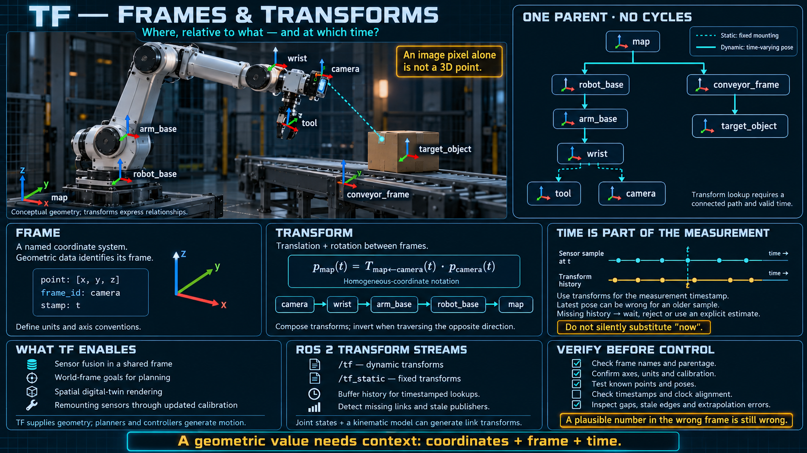

# TF — Frames and Transforms



The lessons so far have been about how nodes talk. This one is about space. A robot has to know where something is, and "where" is meaningless until you say relative to what. A PLC cell rarely asks that question, because the machine is bolted down. A robot asks it on every sample.

## The problem a fixed cell never had

In a classical cell the sensor is mounted in one place and the actuator lives in one place. A value is a value. You do not ask which coordinate system it was measured in, because there is only one, and it is the mechanical drawing.

A robot breaks that assumption in three ordinary ways:

- A camera sits on a head that pans. "The object is in the center of the image" is a pixel fact. The position in the room depends on where the head was pointing at that instant.
- A gripper is at the end of an arm that is always moving. "The object is at x = 1.2" is incomplete until you say whether 1.2 was measured from the base or from the hand.
- A mobile robot moves, so the same sensor, a moment later, is measuring from a new place. The device did not change. The frame it lives in did.

**A sensor reading has no meaning outside the frame it was taken in.** The frame is part of the data, in the same way the unit is part of the data.

## A frame is a coordinate system with a name

- A **frame** is a coordinate system attached to one body, or to the world. Names you will see constantly: `base_link` for the robot's body, a wrist frame, a `camera` frame, a `map` frame for the world the robot localizes against.
- Every geometric measurement carries a **frame id**. "These numbers were measured in this frame." Drop the id and the numbers cannot be used. They are not slightly worse. They are uninterpretable.
- Each frame has a position and an orientation relative to another frame. "The camera is 10 cm above the wrist, pitched down 15 degrees" is a relationship between two frames, not a property of the camera alone.

## A transform is that relationship, at a time

- A **transform** is the spatial relationship between two frames: where the wrist is relative to the base right now. In the usual rigid-body form it is a translation plus a rotation.
- Applying it moves a point from one frame into the other. A point the camera saw becomes a point in the world, by walking the chain of transforms between those frames.
- The relationship is not a constant. The wrist moves, so the transform changes, so **the transform has a timestamp**. "Where was the wrist?" is a different question from "where is the wrist?", and a point measured at time T must be transformed with the relationship that was true at time T.

This is the conceptual break with a tag. The data has a time and a frame inside it. The current value, stripped of both, is not the measurement.

## The frame tree

The frames of a system form a **tree**. One parent each, no cycles:

```
map
 └─ robot_base
     └─ arm_base
         └─ wrist
             ├─ tool        (the gripper)
             └─ camera
 └─ conveyor_frame
     └─ target_object
```

- You can walk the tree in either direction: camera to wrist to arm base to robot base to map. A point in the camera becomes a point in the map by composing the transforms on that path.
- A new sensor is a new frame, attached to whichever body it is bolted to. You do not edit the old frames to make room for it.
- The tree is live. Each edge is a transform, and many of those edges are a stream, published like any other telemetry. A static edge — a camera screwed to a bracket — is the special case, not the general one.

The controls analogy is a wiring diagram that says what is connected to what. A frame tree says where something is relative to something else, at a given time. Both are structures you inspect. Only one of them moves.

## Why this is infrastructure, not a math elective

- **Sensors can be fused.** A camera on the head, an encoder in the arm, and a sensor on the floor can contribute to one picture only after every reading has been expressed in one frame. The transform tree is what makes that expression mechanical instead of a special case in each node.
- **A command can be given in the world.** "Put the hand on the box on the conveyor" is a pose in the conveyor's frame, or in the map. Something in the system converts that into joint motion. The node that asked does not do the trigonometry.
- **A twin can draw the machine.** The twin knows where the gripper is in the world because a transform says so. "Joint 3 is at 45 degrees" is not a position. It is one input to a chain.
- **Hardware can move without a rewrite.** Add a sensor, or remount one, and you add or edit a frame. Nodes that already say "give me this point in the map frame" do not change.

## What you have to get right before any code

- **Every position is relative.** There is no absolute coordinate hiding underneath. There is only "in which frame." The frame id is as much a part of the value as the unit is.
- **A transform is a stream with a time.** Using the latest transform on a point that was measured 200 ms ago puts the point where the robot is now, not where it was when the camera fired. Pick the time deliberately. If the tree does not have a transform at that time, you do not yet have an answer. Extrapolating a moving joint is a choice, and it has an error.
- **Forgetting the frame id fails quietly.** The numbers still look like numbers. They are the wrong numbers in a plausible range, which is worse than a value that is obviously broken. A schema for any geometric message should make the frame id mandatory.
- **A broken tree cannot be bridged by hoping.** If the link between the camera and the wrist is missing, there is no transform from the image to the hand. The data on either side of the gap is fine and still useless together. The inspector has to show you the gap.

## How this connects

- Transforms travel on topics, like any other telemetry. TF is the stream that answers "where was each body, at this time?"
- Any message that carries a position should carry a frame id. That field is part of the schema, not a comment.
- A twin uses the tree to draw the machine in space rather than to print joint angles.
- A new camera is a new frame on the tree. Existing consumers that ask for a point in a frame they already understand keep working.

## Checklist

| Question | You should be able to answer |
|---|---|
| What is a frame? | A named coordinate system attached to a body or to the world. Every geometric value names its frame. |
| Why does a sensor reading need a frame id? | The numbers mean nothing outside the frame they were measured in. The center of an image is not a position in the room. |
| What is a transform? | The translation and rotation from one frame to another, at one time. |
| What does the frame tree give you? | A path from any frame to any other, so a point in the camera can become a point in the hand and a point in the map. |
| Does a transform stay still? | Only the bolted ones. A joint's transform is a stream, and you must use the sample from the right time. |
| What happens if you drop the frame id? | The value is silently wrong. That is worse than a value that is obviously wrong. |
