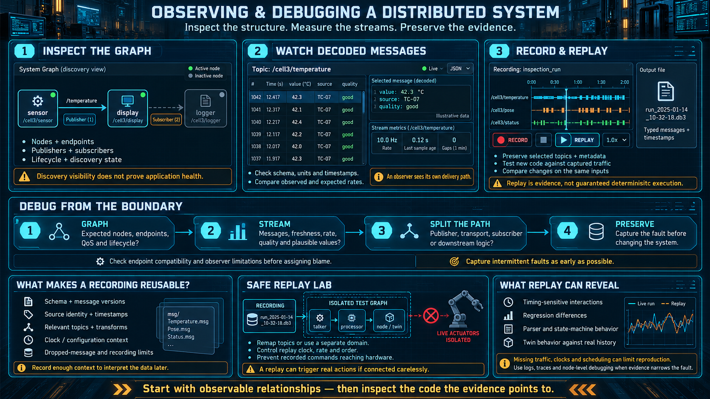

# Observing and Debugging a Distributed System

On a PLC, debugging means opening the one program and watching the ladder and the tag table. A graph has no such place. The tools that show you the running system are part of the architecture, not an accessory you add when something breaks.

## What is hard about a system with no center

Once the program is dozens of nodes on more than one computer:

- **Nothing sees the whole system from the inside.** There is no main loop to open.
- The values you care about are **in the streams between nodes**, not in one memory map.
- The bug is often an **interaction**: timing, order, a message that never arrived. It is not a wrong rung.
- The event has already passed. If you did not record it, **you cannot go back and look.**

This is why the stack needs a way to see inside itself that is separate from the application code. The plant equivalent is a SCADA historian and a trend, pointed at the messages of the whole graph rather than at a tag database.

## Three tools

### 1. Inspect the graph — the structure, live

- Which nodes exist, and which of them are actually running.
- Who is publishing and who is subscribing to each topic. This is the real conversation, not the one you drew last month.
- Which lifecycle state each node is in. Still configuring is different from active.
- The SCADA analogy is a layout of the plant with device status on it. Here the layout is software.

The questions it answers immediately: "Is this node up?" "Who is listening to this topic?" "Why did the value never arrive — because nobody subscribed?"

A graph that looks right and a graph that is right are different objects. The inspector shows you the second one. Debugging from a diagram you remember is how you chase a node that is not running.

### 2. Watch messages — the data, decoded

- Pick a topic and see the messages crossing it: value, time, and rate.
- The schema has already decoded them. You are not reading bytes and applying a scale from memory.
- You can check the claim "the data is arriving" against a measurement: the rate, the gap since the last message, whether the value is plausible.
- The SCADA analogy is a trend. The difference is that each sample is a structured message, not a raw tag.

Watching a topic is also how you tell a quiet sensor from a quiet subscriber. If the messages are on the wire and the display is still, the display node is the suspect. If the messages are not on the wire, the publisher is.

### 3. Record and replay — a historian you can run again

- **Record** writes the messages, all of them or only the topics you name, to a file with their timestamps.
- **Replay** feeds that file back into the graph so a node sees what it would have seen on the machine. **You can test a node without the hardware.**
- What you use it for:
  - A fault that happened once, in the field, can be recorded and replayed in the lab until the cause is boring and repeatable.
  - A new node can be developed against real traffic from the plant instead of against a guess.
  - A change can be compared with the previous behavior on the same recording. That is a regression test of the system, not of one function.
- A historian lets you look backward. Replay goes further: **the recording can drive the system the way the live machine did.**

That difference is the one to remember. Looking at a trend tells you what the numbers were. Replaying the messages tells you what your new code does when it sees them. For a distributed system, replay is the strongest debugging tool you have, because the bug is in the interaction and the interaction is in the recording.

A recording is only as useful as its schema. If the file stores typed messages, a node written later can still subscribe. If it stores opaque bytes, you have archived a format nobody can read.

## A debug order that works

When something is wrong, this sequence beats opening a source file:

1. **Look at the graph.** Are the nodes that should be running actually running? Are they connected to the topics you think they are? Is one of them still inactive?
2. **Look at the stream.** Are messages arriving? At the rate you expected? Are the values plausible, and is the quality field still "good"?
3. **Split the direction.** Is the producer failing to send, or is the consumer receiving and then doing the wrong thing? Those are different bugs, and the stream tells them apart.
4. **Record before you touch anything.** If the fault is one that disappears, record it now and replay it somewhere safe. Editing code against a problem you can no longer see is how the problem becomes a story.

The habit that is different from a PLC: **do not start in the source.** Start at the boundary between nodes, because that is where most of the bugs are. The code inside a node is the place you go after the stream has shown you which node is lying.

## How this connects

- The inspector is the window onto the graph from lesson 02. The graph is not real to you until you can look at it.
- Messages decode because of the schema from lesson 03. Without it, the watcher shows bytes.
- Lifecycle state from lesson 05 is one of the things the inspector is for. "Running" is not a single fact.
- Replay is how a twin or a simulation consumes a real past. Lessons 09 and 10 use that.
- A recording is also the start of a dataset, later, for anything that wants to learn from what the plant actually did.

## Checklist

| Question | You should be able to answer |
|---|---|
| Why is this harder to debug than a PLC? | There is no single program. The bug is in the interaction between nodes. |
| What does the graph view tell you? | Who is running, who is connected to whom, and which lifecycle state they are in. The structure right now. |
| How is watching a message different from a trend? | You see a decoded structured message, not a raw tag. |
| What does replay give you? | The real messages, played again, so a node can be tested without the hardware. |
| What is a sound debug order? | Graph, then stream, then producer versus consumer, and record a disappearing fault before you change code. |
