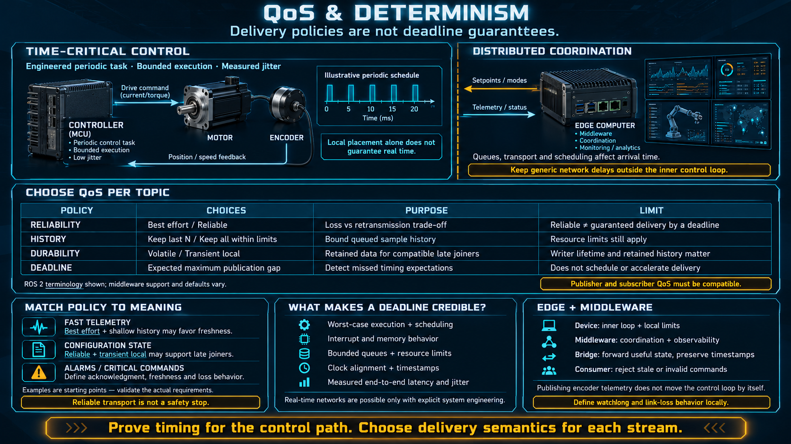

# QoS and Determinism



The question from anyone who has tuned a scan time: "What about the clock? My loop has to land every millisecond." This lesson answers it directly. Publish/subscribe is not that clock. Quality of service is how you say, per topic, what you are willing to lose.

## Two different promises

A **PLC scan is deterministic**. Every X milliseconds the controller reads inputs, runs the logic, and writes outputs. The period is the contract. A late scan is a fault in the controller, not a property of the network.

**Publish/subscribe is event-driven.** A message crosses queues and, often, a network. It arrives when it arrives. "When there is something to say" is not "on every tick." Jitter is normal. A lost sample, on a best-effort topic, is also normal.

The admission up front: **a pub/sub middleware is not a hard real-time loop.** It is a communications layer. It does not own the deadline of a motor. Pretending that it does is how a torque loop ends up waiting on a socket.

## Where the deadline actually lives

The architecture used on real robots splits the problem by how much jitter it can stand:

```
┌─────────────────────────────┐
│ hard real time              │
│ the period is the contract  │
│ one node, one machine       │
│ motor loop, safety, encoder │
└─────────────────────────────┘

┌──────────────────────────────┐
│ soft coordination            │
│ fast, jitter is acceptable   │
│ publish / subscribe          │
│ telemetry, mode, supervision │
└──────────────────────────────┘
```

- **The loop that must be on time stays inside one node.** Motor control, a PID, a safety interlock: one machine, one task, no network in the round trip.
- **Coordination between nodes uses publish/subscribe.** A mode, a setpoint, telemetry, an event. A few milliseconds of delay is acceptable, and it has to have been designed as acceptable.
- This is why a modern robot still has a separate real-time controller, often an MCU on the motor. **The middleware sits above that controller. It does not replace it.**

A setpoint that arrives late is a degraded command. A torque command that arrives late is a different machine. The split is how you tell those two messages apart before you put them on a topic.

## QoS — a choice per topic, not a property of the bus

A useful middleware lets you set the delivery contract on each topic. The knobs that matter at this level:

| Knob        | The choice                                                                     | What it is for                                                                          |
| ----------- | ------------------------------------------------------------------------------ | --------------------------------------------------------------------------------------- |
| Reliability | Deliver reliably, with acknowledgement and retry, or send once and accept loss | A mode or an alarm, versus a fast sensor stream                                         |
| History     | Keep only the latest, or keep the last N                                       | Whether a slow consumer needs more than the newest sample                               |
| Durability  | Does a subscriber who joins later still see the last value?                    | A configuration that must be waiting for the next node to start                         |
| Deadline    | Do you expect a maximum gap between messages?                                  | Detecting that a stream has gone slower than the contract, not guaranteeing the network |

The point of the table is that **one setting for the whole system is the wrong setting for most of the data.**

- A sensor at 100 Hz can drop a sample. You would rather have the latest value than a retransmission of an old one. Choose low latency, and do not ask for reliability you will not use.
- A mode change or an alarm must arrive. Choose reliable. A lost "stop" is not a dropped temperature.
- The latest configuration must still be there when a node starts late. Choose durable, or the new node comes up with a default and acts on it.

You are picking the trade per topic, based on what the data means. Reliability costs latency and buffer space. Durability costs memory and forces you to define what "the latest" means. Deadline monitoring tells you the stream missed its gap. It does not make the network faster.

This is also the answer to the late subscriber from the graph lesson. "No free last value" is the default. Durability is how you opt a specific topic out of that default, on purpose, because the value is a setting rather than a sample.

## Rules if you are used to a fixed scan

- **Do not put a hard loop on publish/subscribe.** A motor torque loop that closes over the network will miss. The certain loop stays inside one node.
- **Use publish/subscribe for coordination.** Setpoints, modes, telemetry, supervision: the things that can be late by a little and still be right.
- **Keep time-critical work off the convenience path.** The message that has to land on a tick and the message that keeps a display honest are different layers. Do not give them the same topic because they happen to share a node.
- **Match the QoS to the meaning.** Fast telemetry does not need to be reliable. A rare configuration change needs to be reliable and durable.
- **Count the hops.** Every process boundary and every network adds jitter. Two nodes that must stay tight belong on the same machine, and the tight part belongs in one of them.

## The edge is where the hard loop already is

A small device — an MCU on a joint, a board reading an encoder — is usually where the hard real-time work actually runs. The motor loop, the encoder, the local safety check: all of that stays on the device. The middleware carries the result, the status, and the command. It does not carry the inner cycle.

That split is the reason a small middleware still has a sharp edge. What must be on time stays at the boundary. What must be coordinated stays in the middle. A bridge that forwards every encoder tick onto a topic has moved the hard loop onto the network, which is the failure this lesson exists to prevent.

## Checklist

| Question                                    | You should be able to answer                                                                    |
| ------------------------------------------- | ----------------------------------------------------------------------------------------------- |
| Is publish/subscribe hard real time?        | No. It is an event-driven coordination layer. It is not the clock.                              |
| Where does a tight loop live?               | Inside one node, on one machine. A motor loop or a safety interlock does not cross the network. |
| What does QoS let you choose?               | Reliability, history, durability, and a deadline, per topic.                                    |
| Does fast telemetry need reliable delivery? | No. You want the latest sample more than you want every sample.                                 |
| What does a configuration or a mode need?   | Reliable delivery, and durability so a late subscriber still sees the current value.            |
| What is the layering rule?                  | The hard loop stays in the node. Coordination goes through the middleware.                      |
