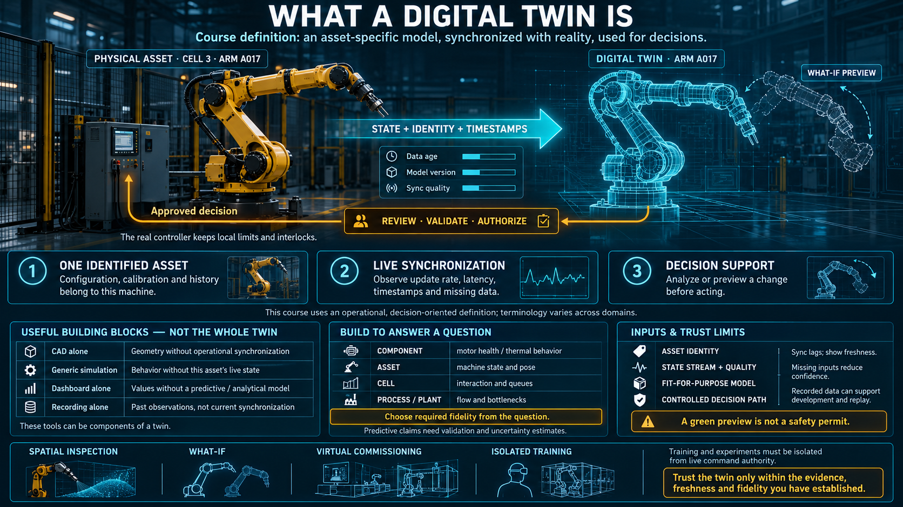

# What a Digital Twin Is



"Digital twin" gets applied to any picture of a machine. This lesson fixes the definition for an automation engineer: what earns the name, and what is only borrowing it.

## The definition this course will hold

A twin stays alive because state flows in and a command can flow back:

```
┌─────────┐                              ┌──────┐
│ machine │                              │ twin │
└────┬────┘                              └───┬──┘
     │                                       │
     │ live state ──────────────────────────►│
     │◄──────────── command, after a preview │
```

**A digital twin is a digital replica of one specific physical thing, kept continuously in sync with that thing, with a path back from the replica to a decision.**

All three conditions have to be true:

1. **It is bound to one machine.** Not "a robot arm." The arm installed in cell 3, with its serial identity, its configuration, and its own history.
2. **The sync is continuous.** The real machine changes, and the twin changes with it, because a live stream is feeding it. A twin that you update by exporting a file at the end of the shift is a snapshot.
3. **There is a way back.** At least, you can try a change or a decision on the twin before anything is sent to the machine. A display you can only watch is not using the model. It is showing it.

Miss any one of the three and you have something useful that is not a twin. The rest of this lesson is that distinction, applied.

## What is not a twin

| Thing | A twin? | Why not |
|---|---|---|
| A CAD model | No | It is geometry. It has no live data and it is not bound to one installed machine. |
| A general simulation | No | It explores a class of behavior. It is not kept in step with a specific asset. |
| A SCADA or HMI screen | No | It shows live values and has no model. You cannot ask it what-if. |
| A replay of a recording | No | The data is real, and nothing is being simulated. You are watching the past. |
| **A twin** | Yes | A living model, bound to one machine, fed by a live stream, and usable for a decision you can send back. |

The short form: **a simulation answers "what would happen if the world were like this?" A twin answers "what is this particular machine right now, and what would happen if we did that to it?"**

Replay and a twin are easy to blur because both consume recorded or live messages. Replay shows you what already happened. A twin has a model that can be stepped forward from the current state into a state that has not happened yet. If you cannot step it forward, you have a historian with a 3D view.

## Twins have a scale, and you start at the question

Not every twin is a factory.

| Scale | Example | The question it can answer |
|---|---|---|
| **Component** | One motor, one pump | Is this part healthy? Is it hot, is it vibrating, is it leaving its normal range? |
| **Asset** | One robot arm, one machine | What state is this whole machine in, including its pose? |
| **System or cell** | Several machines that share a cell | How are they interacting? Where is the queue? |
| **Process or plant** | A line, or the site | Where is the flow stuck? Where is the bottleneck? |

The scale follows the question. A component twin answers "will this part fail?" A cell twin answers "is this line behaving?" You do not start at plant scale because the word sounds larger. A plant model that is not fed by asset-level streams is a diagram.

## What a twin consumes

A twin does not sustain itself. It needs four inputs, and the absence of any one of them collapses the definition:

- **A state stream.** Position, values, and status, continuously. This is where the middleware enters. Those topics are the twin's blood supply. When they stop, the twin is guessing.
- **A model.** Enough knowledge of the real machine to infer what the stream does not say directly. Kinematics, geometry, a light physical model: "if the joints are here, the tool is there."
- **An identity.** Bound to one asset — serial number, configuration, its own history. An average machine is a simulation.
- **A path back.** A way to return an experiment or a command to the real machine, and to do it safely. Preview first. The real interlocks still live on the real machine.

**A twin with no live stream is a simulation using the wrong name.** The difference is whether you are feeding it the real machine, now, or feeding it an assumption.

## What you get for the cost

- **A deeper view than an HMI.** State in space and time, including a 3D pose, instead of a list of unrelated tags. "Where the arm actually is," not "axis 3 = 45°."
- **What-if, from the current state.** Change a value, a path, or a timing on the twin and read the result before you do it to the line. The starting point is the live machine, not a generic initial condition.
- **Virtual commissioning.** Test new logic or a new robot program on the twin before you deploy it. The downtime you avoid is the reason the twin exists. The next lesson goes into how that test is wired.
- **Training and demonstration.** A new person can learn on the twin. The picture is the real machine in its real state, and they cannot break it from there.
- **A place to try a decision.** The twin is where a plan is rehearsed before it is committed. That is also the door, later, to maintenance models that want a structured history rather than a folder of trends.

## Limits you should say out loud

- **The twin is only as true as the stream.** A slow or broken pipeline makes a confident, wrong twin. Trust the picture exactly as far as you trust the topics feeding it. Show the age of the data. A frozen pose with no timestamp is a false instrument.
- **Fidelity has a cost.** A twin that is detailed at every scale answers no question well. Build the scale that matches the question you are actually asking.
- **Sync always lags.** The twin is not a real-time network. It is "close to now," and the size of "close" is the latency of the stream plus the time the model takes to update.
- **It is not a safety system.** The twin can rehearse a move. The interlock that prevents the move from hurting someone runs on the real machine, in the hard-real-time layer from the QoS lesson. A green result on the twin is not a permit.

## How this connects

- The stream a twin consumes is a set of topics. The middleware is the pipe. That was lessons 02 and 03.
- A shared schema means the twin decodes a machine it has never carried a special parser for.
- TF supplies position in the world. The twin draws with it, instead of printing joint angles. That was lesson 06.
- Record and replay let the twin be shown a past, or be developed against one. That was lesson 07.
- The next lesson puts the twin on the graph for real: virtual commissioning, and a command that is previewed before it is sent.

## Checklist

| Question | You should be able to answer |
|---|---|
| What is a twin? | A digital replica of one specific real machine, kept in live sync, with a path back to a decision. |
| What is it not? | Not a CAD model, not a general simulation, not a SCADA screen, not a replay. Each of those is missing live sync, identity, or a model. |
| What are the three conditions? | One specific machine, continuous sync, and a way back. |
| What does a twin consume? | A live stream from the middleware, a model, an identity, and a safe path back. |
| What is a twin with no live stream? | A simulation using the wrong name. |
| Which scales are there? | Component, asset, system or cell, and process or plant. Start from the question, not from the largest picture. |
