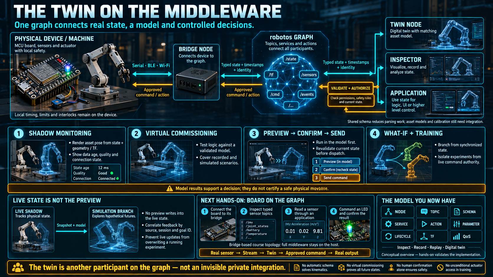

# The Twin on the Middleware



This lesson puts the week together. The twin is alive because it is a consumer on the graph, and the next concrete step is a real board joining that same graph.

## The stream is the blood supply

A twin needs a live state stream. On a graph, that stream is a set of topics:

```
┌──────────────┐   state topics    ┌──────────────┐
│ real machine │ ────────────────► │ digital twin │
│   (nodes)    │                   │    (alive)   │
└──────────────┘                   └──────┬───────┘
      ▲                                   │
      │         command, after preview    │
      └───────────────────────────────────┘
```

- The real machine publishes state. The twin subscribes, the way any other consumer would.
- The twin is not a side system with a private connector. It is another node on the same graph. It reads the same stream an inspector or an HMI can read.
- Because the messages are typed by a schema, the twin decodes them without a driver written for one vendor's register map.

The practical consequence: **if the middleware is healthy, a twin is a subscriber you add, not an integration you invent.** If the twin needs a special path that nothing else can see, the graph was not finished.

## Four ways the two are actually used

### 1. Shadow monitoring — a deeper window than the HMI

- Subscribe to the state topics and draw the real pose in 3D.
- Show what a tag list cannot: where the arm is in the cell, not "joint 3 = 45°."
- Use the transform tree to turn joint and sensor data into that pose. The twin does not invent the geometry. TF already published it.

The shadow is only a shadow while the stream is live. The view owes the operator the same honesty as any other instrument: connected or not, and how old the pose is.

### 2. Virtual commissioning — test before you stop the line

This is the use an automation engineer can take to a project review.

```
new logic or a new program ──► run it against the twin ──► deploy to the machine only after it passes
                               (the line is still running)
```

- A new robot program, a new cell sequence, or new PLC logic is tried against a twin that is being fed by the real machine's current state, before you take the line down to load it.
- Collisions, a wrong sequence, and a timing gap show up **before the real machine pays for them.** The thing you are buying is downtime you did not take, and a move you did not make into a person or a fixture.
- It is stricter than an offline program check against a dead model. The twin's starting point is the latest real state, not a model someone last updated at install.

Be precise about what the test proves. A preview against the current state catches "this command, from where the machine is now." It does not, by itself, prove the program against every future state. A full virtual commission also needs a model that can be stepped, and a recording or a simulation for the cases the live line is not currently in. The twin is necessary for that. It is not, alone, a complete test bench.

### 3. Preview a command, then send it

- Write the command you intend to send. Let the twin show the result. A person confirms. Only then does the command go to the real machine.
- The twin is a sandbox on the command path. A risky move is tried on the shadow.
- This is the action pattern from earlier in the week: a long goal can be previewed before it is committed. Feedback from a real action and feedback from a preview are the same kind of stream, so the same view can show either.

Confirmation is a human step on purpose. A twin that forwards every previewed command by itself has removed the sandbox.

### 4. What-if, and training, without touching the machine

- A what-if starts from the synchronized state: "if we change this setpoint, given where the machine is right now, what happens?" The value of the twin over a generic simulation is that starting point.
- A new operator trains on the twin. They see the real machine in its real condition, and they cannot break it from the model.

## The hands-on this is building toward

Everything above is the model. Next week it becomes a board.

**An ESP32-S3 board — the kind already used on the embedded side of this course — becomes a real node at the edge of a robotos graph.**

```
sensors on the board ──► firmware ──► a small channel (serial, BLE, or Wi-Fi)
        ──► bridge node ──► robotos graph ──► twin / inspector / application
                                                                    │
command back:  twin or app ──► robotos ──► bridge ──► the board acts ◄┘
```

- The board's sensors and actuators are a **small node at the edge of the graph**. That was the claim in the graph lesson: a small device can sit on the same graph as a large machine.
- The bridge is the translator. The board speaks a small channel. The bridge publishes and subscribes on the graph. It is remote I/O, in software, with a schema.
- The board does not run the middleware. robotos stays on the machine that can host it. The board only has to talk to the bridge. The hard real-time work, if the board has any, stays on the board.
- Once the board is on the graph, the twin sees it the way it sees any other node. The loop closes: **a real sensor, a stream, a living twin, a command back, a real actuator.**

Next week you will do that with your hands. Connect the board, watch its topics move, see them in the inspector, command an LED and read a sensor through the graph. Every concept in this week becomes something you can point at.

## What this week has been

```
The old world                    The new world
─────────────                    ─────────────
scan cycle            ─►         event-driven nodes                 (02)
fieldbus poll         ─►         topics, publish and subscribe      (02)
tag table             ─►         typed messages and a schema        (03)
a command word        ─►         a service, or an action            (04)
PLC states            ─►         parameters and a lifecycle         (05)
a wiring diagram      ─►         a TF frame tree                    (06)
trends and a historian─►         inspect, record, and replay        (07)
the hard loop         ─►         QoS, and a split between layers    (08)
a SCADA screen        ─►         a living digital twin              (09)
                                      ▲
an ESP32-S3 board, as a real node ────┘                            (10, then hands-on)
```

## Checklist

| Question                                 | You should be able to answer                                                                                    |
| ---------------------------------------- | --------------------------------------------------------------------------------------------------------------- |
| How does the twin sit on the graph?      | As a consumer, like any other node. It subscribes to state topics.                                              |
| What is virtual commissioning?           | New logic, tested on a twin that is fed by real state, before you stop the line to deploy it.                   |
| How is a command through the twin safer? | Preview the result, confirm, then send. The twin is a sandbox. The real interlock stays on the machine.         |
| How does the board join the graph?       | Sensors and actuators, a small channel, a bridge node, then the robotos graph.                                  |
| What does this week leave you with?      | The model: node, topic, schema, service, action, parameter, TF, observation, QoS, and a twin. Hands-on is next. |
