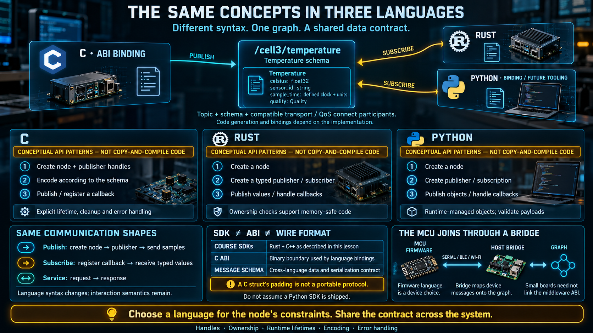

# The Same Concepts in Three Languages



A middleware earns its place when the same idea can be written in more than one language. The graph, the node, and the topic are not a Python idea or a Rust idea. This lesson shows one pattern — create a node, publish, subscribe — in three languages, so the concept stays put while the syntax changes.

The samples are design sketches. They are close to the shape of a real API and they are **not code you can copy into a toolchain and compile.**

## Why more than one language

Three languages, one graph:

```
┌─────────────┐    ┌──────┐    ┌───────────────────┐
│ C / C++     │    │ Rust │    │ Python            │
│ ABI and SDK │    │ SDK  │    │ sketch of the ABI │
└──────┬──────┘    └───┬──┘    └─────────┬─────────┘
       │               │                 │
       └────────────────┬────────────────┘
                        ▼
                  ┌───────────┐
                  │ one graph │
                  └───────────┘
```

In a real plant, nodes are written in the language that fits the job:

- **C**, through the C ABI the middleware exposes. This is the stable binary door. Other languages, and small hosts that can link a C library, enter here.
- **Rust**, for core services, where memory safety and performance both matter. It is also a language the middleware itself is written in.
- **Python**, for prototypes, data work, tools, and the place an AI or learning stack usually lives. The point of the Python sketch is that another language can sit on the same ABI.

All three can live on one graph. Whichever language a node is written in, it speaks the same messages and the same schema. **The language of the conversation is the data, not the programming language.**

Two facts keep the picture honest:

- The SDKs this middleware ships are **Rust and C++**. The C layer is an ABI, a binary interface other languages bind to. The C and Python sketches below show the shape of that door. They are not a second and third SDK.
- A small board does not link that ABI at all. It joins the graph through a **bridge** that translates a small channel — serial, BLE, or Wi-Fi — into topics. The language on the board is a firmware choice. It is not a choice about the graph.

## Publish

The same goal in each language: a node named `temp_sensor` publishes on `/cell3/temperature`.

**Python** — the shortest, and the right shape for a prototype:

```python
node = create_node("temp_sensor")
pub = node.create_publisher("/cell3/temperature", Temperature)

while True:
    msg = Temperature(celsius=read_celsius(), sensor_id="TC-07")
    pub.publish(msg)
    sleep(1)
```

**Rust** — the type and the ownership are visible:

```rust
let node = Node::new("temp_sensor")?;
let publisher = node.publisher::<Temperature>("/cell3/temperature")?;

loop {
    let msg = Temperature { celsius: read_celsius(), .. };
    publisher.publish(&msg)?;
    sleep(Duration::from_secs(1));
}
```

**C** — through the ABI. More ceremony, because you hold the handles yourself:

```c
robotos_node_t *node;
robotos_node_create("temp_sensor", &node);

robotos_pub_t *pub;
robotos_publisher_create(node, "/cell3/temperature", &pub);

Temperature msg = { .celsius = read_celsius() };
robotos_publish(pub, &msg, sizeof(msg));
```

The pattern is the same in all three: **create a node, create a publisher, loop and publish.** C makes you manage the handle and free it when the node is done. Python and Rust do that work for you. The `sizeof` in the C sketch is a stand-in, not a wire format. A real encoding follows the schema. A C struct's padding is not a contract other languages can share.

## Subscribe

The same goal: a callback runs when a new value arrives.

**Python:**

```python
def on_temp(msg):
    if msg.celsius > 80:
        alarm(msg.sensor_id)

node.create_subscription("/cell3/temperature", on_temp)
```

**Rust:**

```rust
node.subscribe::<Temperature>("/cell3/temperature", |msg| {
    if msg.celsius > 80.0 {
        alarm(&msg.sensor_id);
    }
})?;
```

**C:**

```c
void on_temp(const Temperature *msg, void *ctx) {
    if (msg->celsius > 80) alarm(msg->sensor_id);
}
robotos_subscribe(node, "/cell3/temperature", on_temp, NULL);
```

The pattern is the same: **register a callback and a topic, and the middleware calls you when a message arrives.** There is no poll and no "anything new?" loop in any of the three.

## A service call

**Python:** `resp = client.call("/robot/set_mode", mode="auto")`

**Rust:** `let resp = client.call("/robot/set_mode", &req)?;`

**C:** `robotos_call(svc, &req, &resp);` — you provide the buffer the reply is written into.

Same idea as the lesson on services. One request, one response, and the C version makes the memory explicit.

## What is shared, and what is not

|                      | C (through the ABI)                                       | Rust                                         | Python (later, or through the ABI)  |
| -------------------- | --------------------------------------------------------- | -------------------------------------------- | ----------------------------------- |
| Where it sits        | The binary door, and hosts that can link it               | Core services. C++ is the other shipped SDK. | Prototypes, tools, and AI-side code |
| Memory               | You manage all of it                                      | The compiler checks it                       | The runtime manages it              |
| How much code        | The most                                                  | In between                                   | The least                           |
| What does not change | The same node, publisher, subscriber, service, and schema |                                              |                                     |

The choice of language follows the place in the graph, not a preference. A constrained host that can link the ABI uses C. Core logic uses Rust, or the C++ SDK. A tool, or a future learning script, can be Python on the same ABI. They understand each other because **the schema is the same.**

Do not read the C column as "the microcontroller speaks robotos." If the device cannot run the middleware, it does not. The bridge does, and the firmware on the far side of the bridge can be C without ever calling `robotos_node_create`.

## Why this matters to the job

- On a future line you may touch a binding through the C ABI, a service in Rust or C++, and an analysis or learning script in Python. **Different languages, one concept.**
- The language is chosen for the constraints of that node. It does not decide whether the node is allowed on the graph. The schema and the topic name decide that.
- Start from the language you already have. Many automation engineers already have C from embedded work, or Python from scripting. Enter there, and extend. You do not have to learn three languages before you can read a graph.

## Checklist

| Question                                    | You should be able to answer                                                                                                                                                |
| ------------------------------------------- | --------------------------------------------------------------------------------------------------------------------------------------------------------------------------- |
| What is the same pattern in every language? | Create a node, create a publisher or a subscription, then publish in a loop or wait for a callback.                                                                         |
| What lets the languages interoperate?       | The schema and the topic name. The data contract is not owned by a language.                                                                                                |
| How is C different?                         | You manage handles and memory yourself. It is the ABI other languages bind to, not the language the board must run.                                                         |
| Where does Python fit?                      | Prototypes, tools, and the AI side. Short to write and easy to read. It is not a second core SDK.                                                                           |
| How do you pick a language?                 | By the node's place. The ABI or Rust or C++ at the core and at hosts that can link it. Python for tools. A bridge, not the SDK, for a board that cannot run the middleware. |
