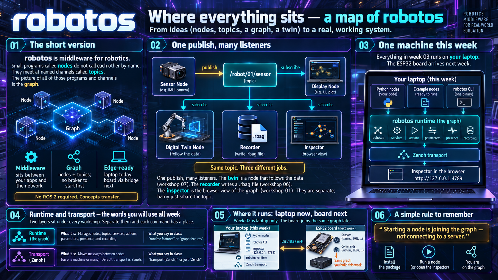

# ND03 — Week 03: Hands-on with robotos

> Week 02 was concepts — week 03 is doing.
> Seven workshops, all on your laptop, no hardware required.

This week you run real robotos nodes, topics, services, and
parameters on your machine, and finish with a mini digital twin.
The ESP32-S3 board arrives **next** week.

## Start here

1. **[System overview](SYSTEM-OVERVIEW.md)** — map + vocabulary
   (topics, services, actions, parameters, presence, `.rbag`,
   Zenoh). Read before the first terminal command.
2. **[Workshops](workshops/)** — seven guides in order
   (01 install → 07 mini digital twin).

## What you need

- **robotos** for your OS — bundled under `workshops/code/`
- **Python ≥ 3.10** — workshop language (SDK from a bundled wheel)
- **One laptop** — no network, no board, no compiler
- **Windows:** **PowerShell** only (not Git Bash)

Full install and shell notes:
[workshops/README.md](workshops/README.md).

## Workshop path (summary)

| #   | Focus                               |
| --- | ----------------------------------- |
| 01  | Install, CLI, inspector, first node |
| 02  | Publish & subscribe                 |
| 03  | Services                            |
| 04  | Actions                             |
| 05  | Parameters                          |
| 06  | Record & replay (`.rbag`)           |
| 07  | Mini digital twin (capstone)        |

Details and links: [workshops/README.md](workshops/README.md).

[← Week 02](../week02/README.md) · [Course docs](../README.md) · [System overview →](SYSTEM-OVERVIEW.md)
