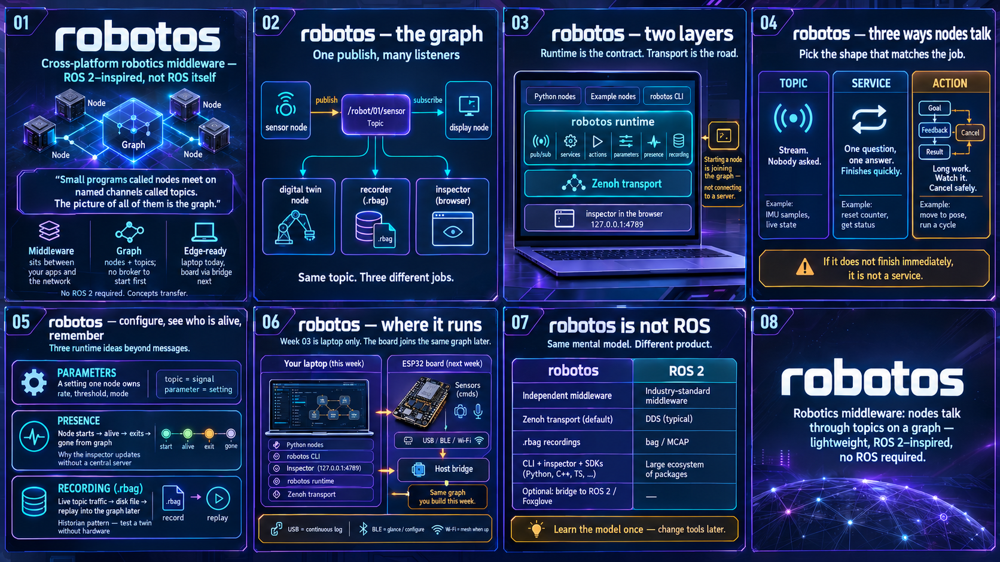

# Where everything sits — a map of robotos

Week 02 gave you the ideas: nodes, topics, a graph, a twin. This
week you run them. Before the first terminal command, it helps to
see **where those ideas live in the real product** — what sits on
your laptop, what sits on the board later, and what joins them.

You do not need to memorize every box. You need one clear picture
so that each workshop has a place to hang — and a short vocabulary
for **runtime** ideas (topics, services, actions, and the rest)
before you write code.



The poster above is the whole week in one picture. The sections
below unpack the same ideas in reading order.

---

## The short version

robotos is middleware for robotics. Small programs called **nodes**
do not call each other by name. They meet at named channels called
**topics**. The picture of all of those programs and channels is
the **graph**.

There is no broker to start first. When you run a node, or open
the inspector, you **are** on the graph. Other nodes find you
through the transport (Zenoh, by default). On one machine that
happens with almost no setup.

```
┌──────────┐  publish     ┌──────────────────┐   subscribe   ┌──────────┐
│  sensor  │ ───────────► │ /robot/01/sensor │ ────────────► │ display  │
│   node   │              │     (topic)      │               │   node   │
└──────────┘              └────────┬─────────┘               └──────────┘
                                   │
                 ┌─────────────────┼─────────────────┐
                 │                 │                 │
                 │ subscribe       │ subscribe       │ subscribe
                 ▼                 ▼                 ▼
          ┌────────────┐    ┌──────────┐    ┌────────────┐
          │ digital    │    │ recorder │    │ inspector  │
          │ twin node  │    │ (.rbag)  │    │ (browser)  │
          └────────────┘    └──────────┘    └────────────┘
```

One publish, many listeners. The **twin** is a node that follows
the data (workshop 07). The **recorder** writes a `.rbag` file
(workshop 06) — robotos’s own bag format: a disk file of
timestamped topic messages you can replay later, like a ROS bag
but native to robotos. The **inspector** is the browser view of
the graph (workshop 01). They are separate; they just share the
topic.

That is the same story as week 02. This overview only answers:
**which programs, on which machine, make that picture real?**

---

## One machine this week

Everything in week 03 runs on **your laptop**. The ESP32 board
arrives next week. Keep that boundary sharp so you do not look for
hardware that is not in the room.

On the laptop you will meet four citizens of the same graph:

1. **Your Python nodes** — the programs you write (and the ready
   scripts in `workshops/code/`). They publish, subscribe, call
   services, and drive the twin.
2. **The `robotos` CLI** — one binary. It lists nodes and topics,
   echoes messages, calls services, records bags, and serves the
   inspector.
3. **The inspector** — a page in the browser at
   `http://127.0.0.1:4789`. It does not open a website on the
   internet. It watches the same graph your code joins.
4. **Example nodes** that ship in the package — so workshop 01 can
   show a live node before you write a line of Python.

Under those sits the **runtime** and the **transport**. The next
section names what they own. You need those words before the
first `import`.

```
┌──────────────────────────────────────────────────────┐
│                      your laptop                     │
│                                                      │
│   Python nodes     example nodes     robotos CLI     │
│                          │                           │
│                          ▼                           │
│              robotos runtime (the graph)             │
│                          │                           │
│                     Zenoh transport                  │
│                          │                           │
│              inspector in the browser                │
│                 (127.0.0.1:4789)                     │
│                                                      │
└──────────────────────────────────────────────────────┘
```

When you install the package in workshop 01, you are installing
exactly that stack: the CLI, the shared library the Python SDK
loads, and the examples. Starting `robotos ui` or a publisher is
not “connecting to a server.” It is joining the graph.

---

## Runtime and transport — the words you will use all week

Two layers sit under every workshop. Confuse them once and the
code will feel magical. Separate them and each command has a
place.

| Layer         | What it is                                          | What you say in class                                                      |
| ------------- | --------------------------------------------------- | -------------------------------------------------------------------------- |
| **Runtime**   | The robotos library your node loads                 | “How we talk” — topics, services, actions, parameters, presence, recording |
| **Transport** | How bytes move between processes (Zenoh by default) | “The road under the graph” — you rarely name it in workshop code           |

The **runtime** is the contract. The **transport** is the wire that
carries it. On one laptop Zenoh just works; you still need the
runtime ideas, because the workshops teach those ideas, not Zenoh
APIs.

### Pub / sub (topics) — a stream, not a question

A **topic** is a named channel. One node **publishes** messages.
Any number of nodes **subscribe**. The publisher does not know
who listens. The subscriber does not know who produces. The name
is the only coupling.

Use a topic when the data is a **stream**: sensor samples, state
updates, live telemetry. Publishing is not asking. Nobody on a
topic owes you an answer. One publish can feed a display, a twin,
a recorder, and the inspector at the same time.

Workshop **02** is this pattern.

### Services — one question, one answer

A **service** is a short **request** and a **response**. The
client asks a named server; the server replies. Logically it is
like a function call across a node boundary.

Use a service when the job **finishes quickly** and has a clear
result: reset a counter, read a status, flip a mode. It differs
from a topic because there is a specific server and there is a
reply. If you cannot say how long “over” is, it is not a service.

Workshop **03**.

### Actions — long work you can watch and cancel

An **action** is work that **takes time**. The client sends a
**goal**. While the work runs, the server can send **feedback**.
The client can **cancel**. When the work ends, there is one
**result** (success, failure, or cancelled).

```
┌────────┐                                ┌───────────────┐
│        │ ── goal ──────────────────────►│               │
│        │◄────────────────── feedback ── │               │
│ client │ ── cancel ────────────────────►│ action server │
│        │◄──────────────────── result ── │               │
└────────┘                                └───────────────┘
```

Use an action for “move to this pose,” “run this cycle,” or any
job you may need to abort safely. A service that blocks for the
whole motion is the wrong tool; you have reinvented an action
badly.

Workshop **04**.

### How to pick: topic, service, or action

| Job                          | Tool    | Why                        |
| ---------------------------- | ------- | -------------------------- |
| Sensor updating continuously | Topic   | Stream; nobody asked       |
| Reset counter / get status   | Service | Short; one reply           |
| Move that takes seconds      | Action  | Feedback + cancel + result |
| Live plot of IMU             | Topic   | Many listeners, no reply   |
| “Are you done yet?” polling  | (avoid) | Use an action instead      |

**Rule:** if it does not finish immediately, it is not a service.

### Parameters — settings the node owns

A **parameter** is a named setting that belongs to **one node** —
rate, threshold, mode, max speed. It is not a global table. The
node declares it, can reject a bad write, and can change it while
running (no recompile).

A topic is a **signal** (the world changed). A parameter is a
**setting** (someone changed it on purpose). Publishing a setpoint
on a topic and also storing it as a parameter, without saying
which one wins, is how two nodes end up with different speeds.

Workshop **05**.

### Presence — who is on the graph right now

**Presence** is how the graph knows a node is alive. When a node
starts, it announces itself. While it runs, it keeps a heartbeat.
When it exits (or the heartbeat stops), others can see it leave.

That is why the inspector can show a node appear and disappear
without you refreshing a server. Presence is not a topic you
publish by hand in the first workshops; the runtime does it when
you create a node. You will notice it in workshops **01** and
**06** (`robotos presence`).

### Recording — the historian (`.rbag`)

**Recording** captures live topic traffic into a `.rbag` file —
timestamped messages on disk. **Replay** feeds that file back
into the graph so another node sees the same stream later.

That is how you debug a fault that already happened, test a twin
without hardware, and compare “before” and “after” on the same
recording. The recorder is just another subscriber; it does not
change the publisher.

Workshop **06**.

### Transport (Zenoh) — the road, not the lesson

**Zenoh** is the default transport under the runtime. It discovers
peers on the machine (and later on a network) and moves the
runtime’s messages. You do not open a Zenoh tutorial to finish
week 03. You start a node; the transport joins the mesh.

Remember one sentence: **runtime = what “publish” and “call
service” mean; transport = how those bytes reach another
process.** If the inspector shows your node, the transport is
already doing its job.

---

## What you will practice, in order

Each workshop adds one skill on that laptop graph:

- **01 — Getting started.** Install, check the install, open the
  inspector, see your first node appear.
- **02 — Publish and subscribe.** Two small Python programs; live
  messages; the same stream in the inspector.
- **03 — Services.** Ask a node a question and get an answer —
  request and response.
- **04 — Actions.** Start a job that takes time, watch feedback,
  cancel if you need to.
- **05 — Parameters.** Named settings you can change while the
  node is running.
- **06 — Record and replay.** Capture traffic into a `.rbag` file
  and play it back — the historian pattern.
- **07 — Mini digital twin.** Put the pieces together: a twin that
  consumes data, can send a command, and can be tested against a
  recording.

Two week‑02 ideas stay **talk only** for now: QoS presets and TF
frames. They matter in the field; they are not the focus of this
week’s Python exercises.

---

## Where the board fits (next week, not this one)

Later you will plug in an ESP32‑S3 board. It does not run your
Python. It runs firmware that talks a framed byte protocol over
USB, Bluetooth, or Wi‑Fi. A small program on the laptop (the
serial bridge) turns those frames into the **same topics** you
already use — so a subscriber written this week can, next week,
listen to a real IMU without changing its idea of the graph.

```
┌─────────────┐    USB / BLE / Wi-Fi     ┌──────────────┐
│ ESP32 board │ ───────────────────────► │ host bridge  │
│   sensors   │                          │ on the laptop│
│  cmds / BLE │                          └──────┬───────┘
└─────────────┘                                 │
                                                ▼
                                         same graph you
                                         build this week
```

Hold three honest facts for later (you do not need them to finish
week 03):

- **USB serial** is the path that behaves like a continuous sensor
  log.
- **Bluetooth** is excellent for connect, configure, and a live
  glance — not for a perfect timed recording.
- **Wi‑Fi** lets the board join the mesh when the station is up.

The board is another citizen of the graph, not a second product.

---

## How to read the rest of the course materials

- **This file** — the map. Read it once at the start of the week.
- **The workshops** — step by step. Do them in order.
- **Week 02 lessons** — the why behind each idea, when you want
  the deeper story.
- **Product docs under `robotos/docs/`** — wire formats, ADRs, and
  status. Open those when you are building or debugging the board,
  not when you are learning the graph for the first time.

If something feels abstract in a workshop, come back here and ask:
_is this a node on my laptop, the inspector watching the graph, or
(later) the board speaking into that same graph?_

---

## Before you open a terminal

You should be able to say, in your own words:

1. There is a **graph**, not a broker I have to start.
2. This week everything runs on **my laptop**.
3. The **CLI**, the **inspector**, and **my Python** are peers on
   that graph.
4. **Topic** = stream; **service** = short ask/answer; **action** =
   long goal with feedback and cancel.
5. A **parameter** is a setting a node owns; **presence** is who is
   alive; a **`.rbag`** is a recording you can replay.
6. **Runtime** is the contract; **Zenoh** is the road under it.
7. The **board** joins the same story next week through a bridge.

Then go to [Workshop 01 — Getting started](workshops/01-getting-started.md).

<sub>[← Week 03](README.md) · [Workshop list →](workshops/README.md)</sub>
