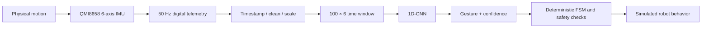

# ND03 — Week 07: Sensors, IMU Perception, and Intelligent Robotics (Theory)

**Track:** Automation & Robotics. This Week 07 textbook focuses on physical sensing, time-series processing, learned perception and deterministic robotic decisions. Week 08 remains the **hands-on sensor, ML and simulated FSM lab**.

## Shared foundations

Start with the [common theory textbook](../../../shared/week07/foundations/README.md) covering sensors, ADC, sampling, DSP, ML, data collection, evaluation and deployment.

## ND03-specific chapters

1. [IMU physics, coordinates, sampling, and calibration](theory/01-imu-physics.md)
2. [Temporal signal processing and learned motion features](theory/02-time-series-perception.md)
3. [Robotic finite-state machines, AI interpretation, and safety](theory/03-robot-fsm-and-safety.md)
4. [Real-time telemetry, middleware, and system architecture](theory/04-realtime-system-integration.md)

## Why these foundations matter

Robotics integrates **measurement**, **estimation**, **decision** and **action**. A 6-axis IMU provides acceleration and angular velocity, not an “I am shaking” semantic label. A classifier must learn a mapping from validated windows to movement classes. The robot then decides whether the classification is relevant and safe in its current state.

## Learning outcomes

You should be able to:
- Interpret 3-axis acceleration and 3-axis angular velocity physically.
- Explain gravity, orientation, calibration and unit conversion.
- Prepare a clean, fixed-rate multichannel time window.
- Compare feature thresholds with temporal CNN classification.
- Explain a state-machine transition guard and why “AI detected” is not equivalent to “safe to act.”
- Distinguish software emergency-stop demonstrations from real machine-safety functions.
- Describe where timestamps, packet validity and middleware sit in the system.

## Transition to Week 08

- [ND03 Week 08 IMU labs](../week08/labs/README.md)
- [ND03 Week 08 checkpoint](../week08/checkpoint.md)

**Safety note:** Week 08's `robot_fsm.py` is a teaching simulator with printed actuator messages. It must not be used as the safety controller for a physical robot. A real emergency stop requires an independent suitable safety architecture and a deliberate reset.
