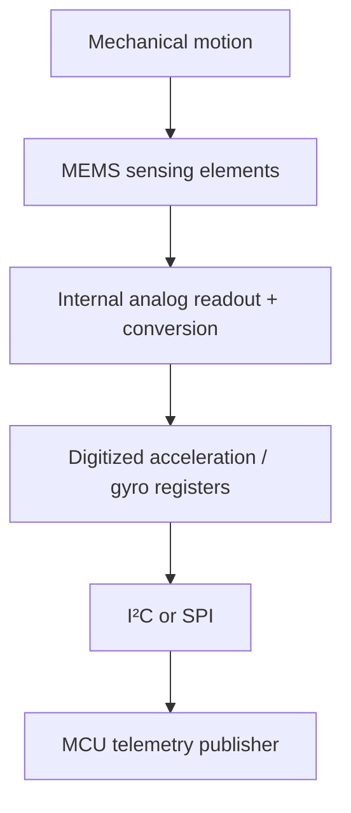

# ND03.1 — IMU Physics, Coordinate Frames, and Sensor Calibration

[ND03 Week 07](../README.md) | [Shared sensors](../../../../shared/week07/foundations/01-sensors-and-signals.md) | [Next: Temporal perception](02-time-series-perception.md)

## What a six-axis IMU actually measures

An inertial measurement unit (IMU) commonly combines:
- A three-axis **accelerometer** measuring specific force along X, Y and Z.
- A three-axis **gyroscope** measuring angular velocity around X, Y and Z.

The output is six numbers, typically expressed as:

```text
[ax, ay, az] in m/s²
[gx, gy, gz] in rad/s
```

Other software uses g or degrees/second. Always check units rather than assuming a standard.

## Accelerometer versus motion

An accelerometer does not directly output position or speed. At rest on a table with its +Z axis upward, an accelerometer often reports near `[0, 0, +9.81] m/s²` as **specific force**, while angular velocity is near zero. Rotate the board and the gravity-related component moves between axes.

A large acceleration transient may indicate shaking, collision, being picked up, or normal machine vibration. The physical interpretation depends on context.



## Gyroscope measurements

A gyro measures rotational rate, not absolute heading. A single gyro-axis rate may be given in degrees/s or radians/s. Integrating angular velocity estimates an angle change, but small bias errors accumulate as drift.

For example, a constant 1°/s gyro bias accumulates about 10° of angle error after 10 seconds of naive integration. Real orientation estimation often combines several sensors through complementary, Kalman-family or other fusion methods.

## Coordinate frames

Distinguish:
- **Sensor frame:** axes printed in the sensor/module datasheet.
- **Board/body frame:** axes physically attached to the device or robot chassis.
- **World frame:** gravity-aligned or map-aligned reference.

An axis-aligned gesture model trained only with one hand orientation may fail after rotating the board. Document the transformation or use suitable augmentation and validation.

## Sampling and timing

The Week 08 lab reads approximately 50 samples per second from a ws28p board's QMI8658. At 50 Hz, nominal interval is 20 ms. Two seconds create 100 rows.

If recorded timestamps show a gap above 30 ms, investigate dropped or irregular samples; the example course uses a tolerance related to 1.5× the nominal interval. Do not naively assume every USB frame arrives at precisely 20 ms.

Use timestamps to detect gaps, resample to a defined grid, and reject corrupted windows if necessary.

## Calibration and filtering

Common error sources:
- Accelerometer offset and sensitivity mismatch.
- Gyroscope zero-rate bias.
- Cross-axis coupling and alignment.
- Vibration, shock and temperature dependence.
- ADC / sensor-range saturation and timing jitter.

Calibration often begins by measuring a stationary device, estimating gyro bias and checking acceleration magnitude against approximately 9.81 m/s². More advanced procedures use multiple orientations, known rotations and temperature sweeps.

A low-pass filter can reduce high-frequency noise but may remove sharp impacts. A high-pass filter can emphasize changes but eliminate static gravity information. Select filtering appropriate to the label definitions.

## Worked exercise

A board is stationary but turned so its +X axis points upward. Which axis now includes the gravity-related specific force? Why is it wrong to assume `az ≈ +9.81` for every stationary orientation?

## Questions

1. Does an accelerometer directly measure position?
2. Why can gyro integration drift?
3. What should be stored as sensor metadata for an IMU classifier?
4. How do mounting orientation and units affect generalization?
5. Does an MCU need a separate general-purpose ADC to read a digital IMU?

[Next: Temporal perception](02-time-series-perception.md)
