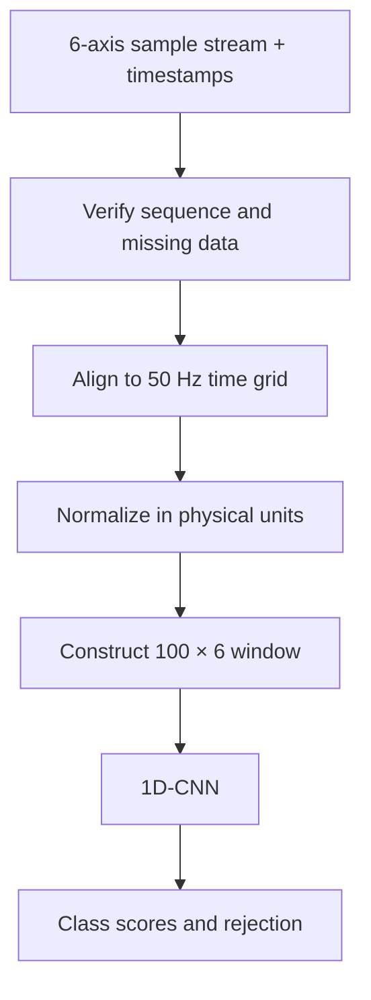

# ND03.2 — Time-Series Processing and Motion Recognition

[ND03 Week 07](../README.md) | [Previous: IMU physics](01-imu-physics.md) | [Next: FSM and safety](03-robot-fsm-and-safety.md)

## Why a gesture is a sequence

A sensor snapshot gives an instantaneous acceleration and angular velocity. A motion gesture is a **pattern through time**. For example, `lift` may produce a particular sequence of acceleration changes; `circle` involves directional changes and rotation over a larger interval.

A motion classifier needs enough temporal context to distinguish behaviors that may share similar peak accelerations.

## Creating a fixed-rate input tensor

The Week 08 laboratory uses six channels at 50 Hz and a 2-second window. The intended tensor has:

```text
shape = (100 time steps, 6 channels)
channel order = [ax, ay, az, gx, gy, gz]
```



Timestamp-based interpolation can align small irregularities to a uniform grid. It **cannot recreate true information** after significant packet loss. Reject large gaps or flag data quality instead of hiding every error with interpolation.

## Fixed physical scaling

The lab uses example fixed normalization such as:
- Acceleration divided by `9.80665 m/s²` (express in g units).
- Gyroscope divided by a chosen representative scale such as `4 rad/s`.

This preserves meaningful amplitude information: a gentle movement remains smaller than an intense shake. In contrast, per-window z-score normalization forces each window to unit variance and can make a small vibration appear similar to a violent one. Per-window standardization may also be numerically unstable for almost constant signals.

The correct scaling is part of the model-input contract and must match at training and inference.

## Handcrafted features versus learned representations

Possible traditional features:
- Average and standard deviation of each axis.
- RMS of acceleration magnitude.
- Maximum angular rate.
- Number and timing of peaks.
- Dominant vibration frequency.
- Relative timing between axis extrema.

A 1D-CNN instead uses temporal convolution filters to learn patterns from the multi-channel sequence. It can learn features more flexible than a small set of handcrafted statistics, but needs sufficiently varied labelled examples.

### Example: peak threshold versus learned gesture

A simple rule `if |acceleration| > limit` might flag a severe shake but could confuse it with a brief knock or placing the board onto a desk. A learned model may distinguish sequence shape, but that does not make it appropriate as the sole trigger for a safety-critical emergency stop.

## Window overlap and inference frequency

A sliding window may be 2 seconds long yet updated every 200 ms. These windows overlap heavily. Multiple predictions of the same gesture may be produced. Use event debouncing, refractory logic or state-machine constraints for stable actions.

The first complete 2-second window requires enough history; continuous inference at 200 ms hops does **not** eliminate the observation duration.

## Train and test honestly

A person-disjoint test holds out entire users from training. This better evaluates generalization to unseen operators than random splitting of neighboring windows. Also test:
- Different board orientations.
- Different movement speeds and amplitudes.
- Different platforms and vibration sources.
- Quiet periods and borderline gestures.
- Sensor dropouts and timing irregularities.

## Exercise

Draw idealized plots for `idle`, `shake`, `lift` and `circle`. Which channels change and in what order? What variation between people should your dataset include?

## Questions

1. Why can a static acceleration threshold confuse different gestures?
2. Why must window length and axis order match during inference?
3. What is lost when a multi-axis sequence is reduced to one RMS value?
4. When can interpolation hide a data integrity problem?
5. How does person-disjoint testing differ from random-window testing?

[Next: FSM and safety](03-robot-fsm-and-safety.md)
