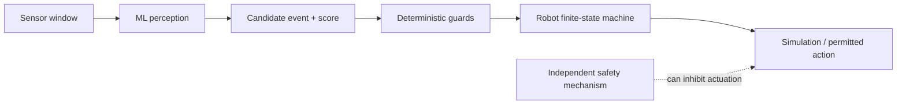
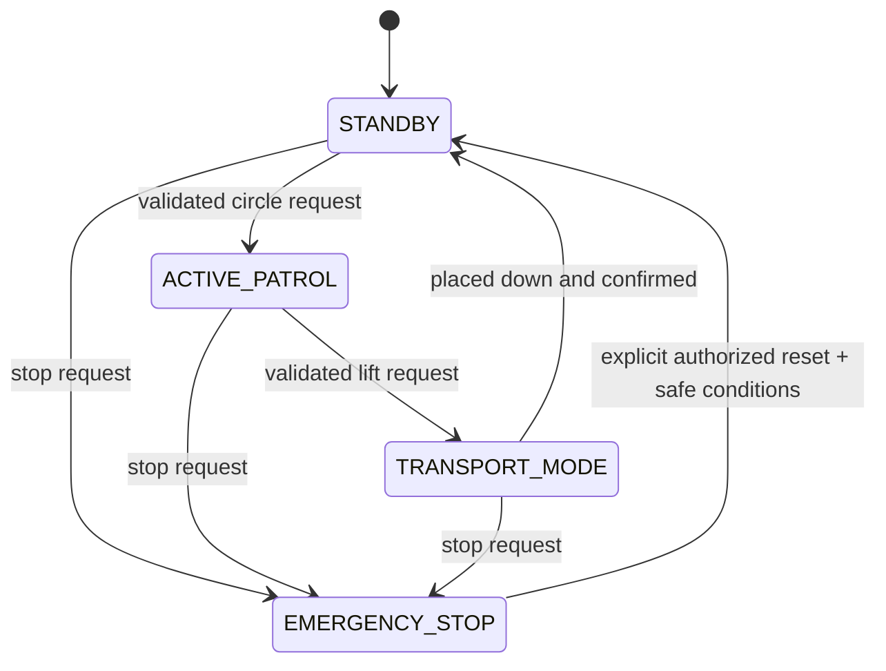

# ND03.3 — Robot Finite-State Machines, AI Interpretation, and Safety

[ND03 Week 07](../README.md) | [Previous: Temporal perception](02-time-series-perception.md) | [Next: System integration](04-realtime-system-integration.md)

## Prediction is not permission to act

A model converts a sensor window into a proposed label and score. A robot's control architecture must decide **whether that event is valid, authorized and safe in the current state**.

The separation is fundamental:

## Why use a finite-state machine?

A finite-state machine (FSM) defines explicit system states and allowed transitions. A state transition may depend on an event, a guard and an action.

A teaching FSM could have:
- `STANDBY`: waiting for a valid command.
- `ACTIVE_PATROL`: simulated patrol mode.
- `TRANSPORT_MODE`: simulated lifted-device behavior.
- `EMERGENCY_STOP`: simulated stopped/latched state.

A real robot might allow fewer transitions. The diagram is an *illustrative software-state exercise*, not a safety certification.

## The danger of treating gesture scores as ground truth

Imagine that the classifier predicts `circle` at confidence 0.93. Questions to ask:
1. Did the correct sensor stream produce the window?
2. Is it in the permitted orientation/range?
3. Was the data loss-free and recent?
4. Does the current state allow entering patrol?
5. Is another controller or operator authorized to start movement?
6. Are interlocks, workspace conditions and independent safety channels healthy?

An ML prediction is one piece of evidence, not an authorization.

## Emergency stop is different

A **real safety-critical emergency-stop function** must not depend solely on a non-safety-rated model recognizing a gesture. It requires an appropriate safety design, depending on application, hazard analysis and relevant standards. Physical E-stop devices, fail-safe circuitry, drive inhibit, watchdogs and explicit reset are typical concepts.

In particular, an emergency stop should not be cleared automatically merely because a gesture classifier returns `idle`. The Week 08 demo's automatic idle-based transition should be treated as an **instructional simplification**, and revised before any physical actuator is connected.

## Latching and resetting

A latched emergency stop remains active until explicit, authorized reset conditions are met. Reset itself must not automatically restart hazardous motion. The controller must separately receive a valid start command after safe conditions have been established.

For a classroom software simulation, you can demonstrate:
- `shake` requests an immediate simulated stop.
- `idle` does not clear the stop.
- A separate `RESET` event plus safe-state checks permits returning to standby.
- `circle` during an active stop is ignored.

## Reliability measures

- Confidence threshold and hysteresis.
- Debounce and minimum dwell times.
- Maximum input-data age.
- Lost telemetry / sensor disconnect detection.
- Validity of model and feature pipeline version.
- Deterministic command permissions and state guards.
- Safe fallback when any required component fails.

## Activity

Write a transition table:

| Current state | Event | Guard | Result |
|---|---|---|---|
| STANDBY | validated circle | authorized and healthy | ACTIVE_PATROL |
| ACTIVE_PATROL | stop request | none for software stop | EMERGENCY_STOP |
| EMERGENCY_STOP | circle | blocked | no transition |
| EMERGENCY_STOP | authorized reset | safe conditions confirmed | STANDBY |
| STANDBY | stale or unknown event | invalid | no transition |

This table is suitable for a simulated controller. Real safety functions must be designed and validated separately.

## Questions

1. Why is a high-confidence label not sufficient permission for a robot action?
2. What is the difference between the FSM's `EMERGENCY_STOP` simulation state and a real E-stop?
3. Why must reset and restart be separate actions?
4. What should happen if telemetry stops arriving?
5. Which transitions should be rejected even with high-confidence model output?

[Next: System integration](04-realtime-system-integration.md)
