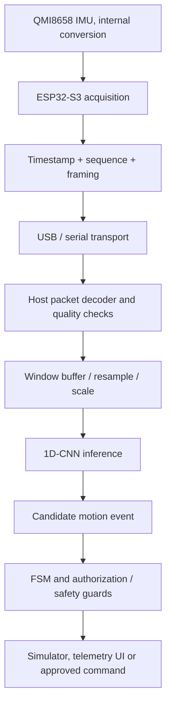

# ND03.4 — Real-Time Telemetry, Middleware, and AI-Robot Integration

[ND03 Week 07](../README.md) | [Previous: FSM and safety](03-robot-fsm-and-safety.md) | [Week 08 practical](../../week08/labs/README.md)

## Architecture: many clocks, one coherent perception system

A robotic perception loop spans sensor acquisition, firmware, transport, host processing, inference and control logic. They run on different clocks and can fail independently. An end-to-end architecture must define data integrity, units, timing and fault behavior.

The Week 08 ws28p workshop uses COBS-framed, CRC-verified messages and a 50 Hz IMU stream. Packet framing and CRC help identify corruption but cannot guarantee that every expected sample arrived; timestamps and sequence/gap checks remain useful.

## Message boundaries and provenance

A well-defined telemetry message identifies:
- Device and sensor.
- Acquisition timestamp or sample index.
- Sequence number.
- Unit convention and axis order.
- Acceleration and angular velocity values.
- Validity flags where supported.

Do not assign host reception timestamps as if they were measured at the physical sensing instant. USB batching, task scheduling and application buffering can shift arrival times.

## Middleware versus the sensor driver

In a modular robotic architecture:
- A **driver** talks to the physical IMU.
- A **telemetry publisher** exposes measured samples.
- A **perception component** transforms buffered data into recognized events.
- A **decision component** checks event validity and state.
- A **controller** sends permitted outputs to actuators or a simulator.
- A **monitoring application** displays raw data, predictions and error states.

This maps naturally to ROS-style nodes and topics and to the robotos middleware concepts from earlier ND03 weeks.

## Throughput and backpressure

At 50 samples/s, each sensor sample interval is 20 ms. The model may operate on 2-second windows, updated at a different hop (for example 200 ms). The transport must deliver all needed samples fast enough to keep windows fresh.

If the classifier runs slowly, options include:
- Bounded queues with explicit drop or replacement policies.
- Processing at a slower inference hop.
- Reducing model cost or moving inference to suitable hardware.
- Rejecting stale or incomplete windows.

Never silently use stale predictions as current commands.

## Time alignment and resampling

Measurements can arrive irregularly while having valid sensor acquisition times. A resampler can reconstruct a uniform 50 Hz grid from sufficiently dense, trustworthy observations, but it must reject windows with large gaps or corrupted data.

Resampling choices must match training-time preprocessing. A different interpolation technique can alter the classifier's input distribution.

## Model update and robot state

Model version, class mapping and decision thresholds should be treated as part of a deployed perception module. A new model may be more accurate yet produce different scores or ordering. Validate before switching, and ensure that switching models does not bypass the current robot state or its safety guards.

## Latency budget exercise

Define an end-to-end latency budget spanning:
1. Sensor acquisition and internal filtering.
2. Firmware buffer and USB transmission.
3. Host decoding and window accumulation.
4. Model inference.
5. Event validation and state transition.
6. Simulated action / monitor update.

Measure these stages instead of treating a 200 ms inference hop as a complete response-time guarantee.

## Failure-handling table

| Failure | Correct architectural response |
|---|---|
| USB disconnect | Mark sensor unavailable; inhibit autonomous commands |
| Lost or corrupt frames | Flag/reject affected windows |
| Model cannot load | Enter unavailable / safe fallback state |
| Incompatible axes or units | Reject invalid model input |
| Classifier returns unknown | No control action |
| Operator safety stop | Use appropriate independent stop mechanism |
| Model update changes label mapping | Block activation until compatibility is checked |

## Capstone design exercise

Design a modular **IMU Gesture Perception Node** with inputs, outputs, timestamp rules, health status, processing stages, and safe rejection rules. Show where the trained 1D-CNN is used and which state transitions must remain deterministic.

## Questions

1. Why is a transport CRC not enough to detect missing samples?
2. How do sensor-time timestamps differ from message arrival times?
3. What is the difference between a telemetry topic and a decision event?
4. What does “stale prediction” mean in a moving robot?
5. Which engineering activities remain necessary after model evaluation?

Continue to [ND03 Week 08 practical labs](../../week08/labs/README.md).
