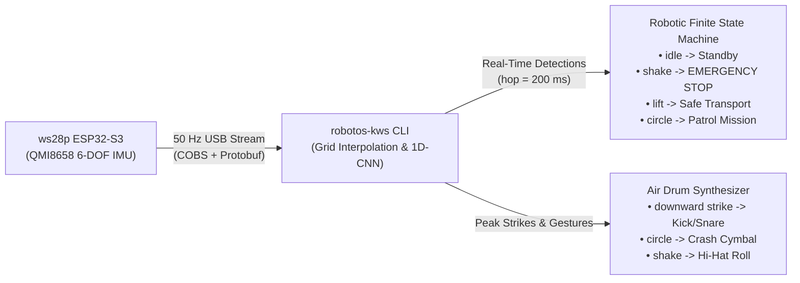

# ND03 — Week 08: Robotic IMU Perception & Motion Telemetry

> **Before the practical:** [ND03 — Week 07 Edge AI theory](../week07/README.md). Week 07 explains the foundational concepts; this Week 08 section applies them in labs.


**Session:** Saturday 21 November 2026 · Online · 09:00–12:00  
**Topic:** *Real-Time IMU Telemetry, 1D-CNN Motion Recognition, and Robotic State Machines*  
**Track Focus for ND3:** **Automation & Robotics — CLI with Real Microcontroller Board & 50 Hz IMU Telemetry**

In this session, you work with physical hardware: an **ESP32-S3 microcontroller board (ws28p)** streaming real-time 6-axis Inertial Measurement Unit (IMU) telemetry at 50 Hz over USB. You use the unified **`robotos-kws` CLI** to inspect hardware telemetry, record labelled robotic motion/gesture windows, train a 1D Convolutional Neural Network (1D-CNN), quantize it to int8, and run real-time hardware inference wired to a robotic Finite State Machine (FSM).

> [!NOTE]
> - **ND01 (Embedded Track):** Embedded Systems & IoT — Focus on CLI-only pipeline using PC microphone, model quantization, and C firmware generation.
> - **ND02 (App Track):** Backend & Frontend — Focus on Python SDK (`import robotos_edge`), FastAPI inference APIs, WebSockets, and reactive web dashboards.
> - **ND03 (This Track):** Automation & Robotics — Focus on real board hardware and 50 Hz IMU motion gestures.
>
> 💡 *Note: While **KWS** originally stands for **Keyword Spotting** (acoustic wake-words), `robotos-kws` is designed as a unified Edge AI toolkit: ND1/ND2 perform audio keyword spotting, while ND3 applies the exact same TinyML sliding-window pipeline to **Motion Gesture Spotting** using 6-DOF IMU sensors.*

---

## Table of Contents

- [Labs Guide](labs/README.md)
- [Pre-Flight Self-Check (10 questions)](preflight.md)
- [Self-Check](checkpoint.md) (with answers)
- [Track Index](../../README.md)

---

## Learning Outcomes

- **Read Hardware Sensor Telemetry**: Read COBS-framed, CRC-16-verified protobuf `Imu` messages streaming from the ws28p board at 50 Hz (~20 ms interval).
- **Physical Sensor Diagnostics**: Measure gravity alignment ($|\vec{a}| \approx 9.8\text{ m/s}^2$) on the vertical axis and calculate stationary gyroscope drift noise.
- **Lost Frame Detection**: Count timestamp gaps ($dt > 1.5 \times 20\text{ ms}$) caused by USB packet loss or CPU starvation, rejecting corrupted data windows.
- **Temporal Signal Conditioning**: Resample irregular arrival timestamps onto a fixed 2.0-second uniform grid ($100\text{ rows} \times 6\text{ channels}$) and apply fixed physical unit normalization.
- **1D-CNN Temporal Neural Network**: Train a 3-layer 1D-CNN on multi-channel time-series data with person-disjoint validation splits.
- **Robotic State Interlock & Musical Air Play**: Connect real-time sliding-window inference into a robotic Finite State Machine (e.g. `shake` $\to$ E-STOP, `lift` $\to$ Safe Transport, `circle` $\to$ Patrol) and an interactive Air Drum Synthesizer (`strike` $\to$ Kick/Snare, `circle` $\to$ Crash Cymbal, `shake` $\to$ Hi-Hat Roll).

---

## Hardware & Firmware Requirements

- **Microcontroller Board:** Waveshare ESP32-S3-Touch-LCD-2.8 (**ws28p**).
- **On-Board Sensor:** QMI8658 6-axis IMU (3-axis Accelerometer $\pm 4g$, 3-axis Gyroscope $\pm 512^\circ/\text{s}$).
- **Prebuilt Firmware:** Workshop prebuilt `ws28p` firmware (`BoardInfo.caps = 0x3c`).

> [!IMPORTANT]
> ### ⚡ Mandatory Step: Flash Workshop Firmware First!
> Before starting **Block 1** (Lab 3.1), your ESP32-S3 board must be programmed with the workshop firmware. If the board is unprogrammed or has factory demo code, all IMU commands will time out.
>
> Simply connect your board via USB-C and run:
> ```bash
> # Automated firmware flasher (auto-detects port, downloads binaries, flashes, and verifies):
> robotos flash-firmware --board ws28p
> # (or: robotos-kws flash-firmware / robotos-flash)
> ```
> *(Prebuilt binaries and manual flashing guide also available at [`hardware-interface-workshop/firmware-prebuilt`](https://github.com/drsanti/hardware-interface-workshop/blob/main/firmware-prebuilt/README.md))*.

---

## Schedule

| Block | Topic | Hands-On CLI Command |
| :--- | :--- | :--- |
| **Prerequisite** | ⚡ **Flash Firmware First** (Auto-Detect, Flash & Verify) | `robotos flash-firmware --board ws28p` |
| **Block 1** | Physical Telemetry & Wire Protocol Inspection | `robotos check-imu` |
| **Block 2** | Motion Gesture Dataset Collection (Physical Board) | `robotos-kws collect-imu --port COM7` |
| **Block 3** | 6-DOF Signal Conditioning & 1D-CNN Training | `robotos-kws train-imu --data imu_dataset` |
| **Block 4** | Person-Disjoint Benchmarking & Int8 Quantization | Review `imu_artifacts/meta.json` |
| **Block 5** | Real-Time Hardware Recognition, Robot FSM & Air Drum | `python robot_fsm.py` or `python air_drum.py` |

---

## System Architecture


