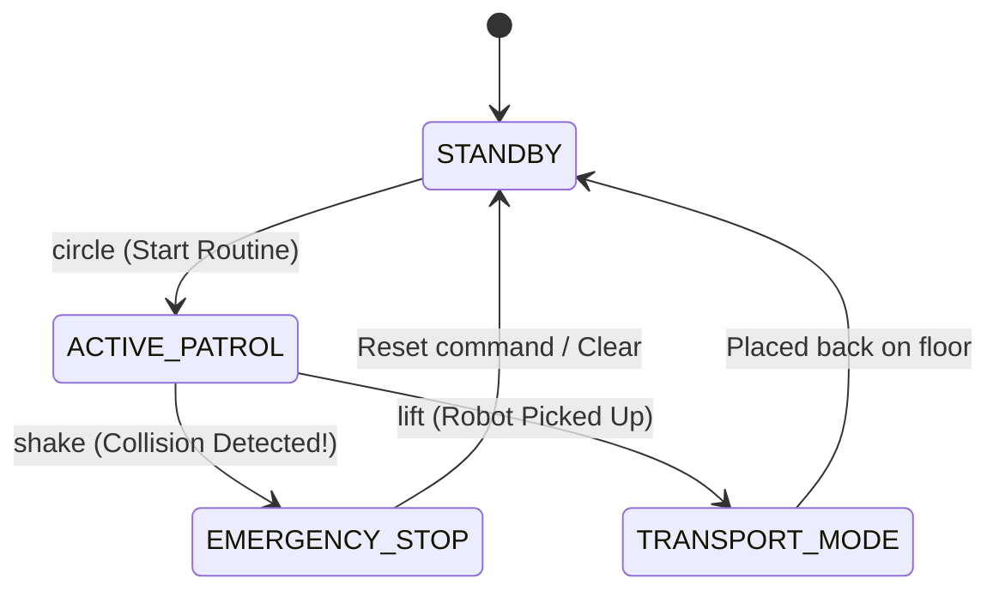

# Week 08 Labs: IMU Motion Telemetry & Robotic State Interlocks


**Focus for Group 3 (ND3 — Automation & Robotics):**
In this lab, you work with physical hardware: the **ws28p ESP32-S3 board** streaming 50 Hz 6-axis IMU sensor data. You will use the unified **`robotos-kws` CLI** to inspect hardware telemetry, record labelled robotic motion/gesture windows, train a temporal 1D-CNN, quantize to int8, and integrate real-time sliding-window predictions into a robotic Finite State Machine (FSM).

---

## Table of Contents

- [1. Environment Setup](#1-environment-setup)
- [2. Hardware Connection & Prebuilt Firmware](#2-hardware-connection--prebuilt-firmware)
- [3. Lab 3.1: Hardware Telemetry & IMU Stream Inspection](#3-lab-31-hardware-telemetry--imu-stream-inspection)
- [4. Lab 3.2: Multi-Class Motion Dataset Collection](#4-lab-32-multi-class-motion-dataset-collection)
- [5. Lab 3.3: 6-DOF Signal Windowing & 1D-CNN Training](#5-lab-33-6-dof-signal-windowing--1d-cnn-training)
- [6. Lab 3.4: Benchmarking & Model Quantization](#6-lab-34-benchmarking--model-quantization)
- [7. Lab 3.5: Real-Time Hardware Recognition & Robot FSM](#7-lab-35-real-time-hardware-recognition--robot-fsm)
- [Troubleshooting](#troubleshooting)

---

## 1. Environment Setup

### 1.1 Virtual Environment

```bash
cd nd3/docs/week08/labs/robotics
```

- **Windows (Git Bash):**
  ```bash
  py -3.11 -m venv .venv      # or: python -m venv .venv
  source .venv/Scripts/activate
  ```
- **Windows (PowerShell):**
  ```powershell
  py -3.11 -m venv .venv      # or: python -m venv .venv
  # If script execution is disabled: Set-ExecutionPolicy -Scope Process -ExecutionPolicy Bypass
  .\.venv\Scripts\Activate.ps1
  ```
- **Windows (Command Prompt cmd.exe):**
  ```cmd
  py -3.11 -m venv .venv      # or: python -m venv .venv
  .venv\Scripts\activate.bat
  ```
- **Linux / macOS:**
  ```bash
  python3 -m venv .venv
  source .venv/bin/activate
  ```

*(When activated, your terminal prompt will show `(.venv)`).*

> [!TIP]
> **Prefer typing `py` instead of `python` on Windows?**  
> Virtual environments create `python.exe` by default. If you prefer typing `py` in Git Bash or PowerShell, copy it once:
> - **Git Bash:** `cp .venv/Scripts/python.exe .venv/Scripts/py.exe`
> - **PowerShell:** `Copy-Item .\.venv\Scripts\python.exe .\.venv\Scripts\py.exe`
> - **CMD:** `copy .venv\Scripts\python.exe .venv\Scripts\py.exe`  
> Now both `python` and `py` will work interchangeably in your terminal!

> [!TIP]
> **Already set up ND1 or ND2? Reuse your existing `.venv`!**
> If you already configured the virtual environment in `nd1` (or `nd2`), you do not need to download or install dependencies again (~1.5 GB). You can simply activate the existing environment:
> - **Git Bash:** `source ../../../nd1/docs/week08/labs/python/.venv/Scripts/activate`
> - **PowerShell:** `..\..\..\nd1\docs\week08\labs\python\.venv\Scripts\Activate.ps1`
> - **CMD:** `..\..\..\nd1\docs\week08\labs\python\.venv\Scripts\activate.bat`
> - **Linux / macOS:** `source ../../../nd1/docs/week08/labs/python/.venv/bin/activate`

### 1.2 Install Requirements & Wheel

```bash
pip install -r requirements.txt
pip install ../dist/robotos_kws-0.1.0-py3-none-any.whl
```

> [!TIP]
> **Universal Fallback:** If `pip` says `command not found`, use `python -m pip install -r requirements.txt` and `python -m pip install ../dist/robotos_kws-0.1.0-py3-none-any.whl`.

Verify that the CLI is ready:
```bash
robotos-kws --help
```
*(Or use `python -m robotos_kws --help`)*

> [!NOTE]
> **Windows Note (`python` vs `py`):**  
> On Windows, `py` launches the global system Python and ignores your virtual environment. Once your `.venv` is activated (your prompt shows `(.venv)`), always use **`python`**, which points to `.venv/Scripts/python.exe`.

You should see `check-imu`, `collect-imu`, `train-imu`, and `live-imu` listed under Available Subcommands.

---

## 2. Hardware Connection & Prebuilt Firmware

1. Connect your **ws28p** board (Waveshare ESP32-S3-Touch-LCD-2.8) to your computer with a USB-C data cable.
2. Identify your serial port:
   - Windows: `COMx` (e.g. `COM7`, check in Device Manager)
   - Linux: `/dev/ttyACM0` or `/dev/ttyUSB0`
   - macOS: `/dev/cu.usbmodem*`
3. If not already flashed with the workshop firmware:
   ```bash
   # Flash prebuilt ws28p firmware (from hardware-interface-workshop):
   python -m esptool --chip esp32s3 -p <PORT> write-flash "@flash_args"
   ```

> [!WARNING]
> **Serial Port Exclusivity**: Close any open serial monitors (Arduino IDE, VSCode Serial Monitor, WebSerial tabs) before running board commands. Only one application can access the COM port at a time.

---

## 3. Lab 3.1: Hardware Telemetry & IMU Stream Inspection

Test the board connection and verify the 50 Hz IMU telemetry stream:

```bash
robotos-kws check-imu --port COM7
```
*(Replace `COM7` with your actual serial port).*

### Expected Output:
- Reads `BoardInfo`: Caps `0x3c` (IMU + RTC + BATT).
- Confirms streaming rate: **~50 Hz** (one frame every 20 ms).
- Acceleration magnitude: $|\vec{a}| \approx 9.8\text{ m/s}^2$ when stationary.
- Gyro noise: $< 0.05\text{ rad/s}$ drift when still.

---

## 4. Lab 3.2: Multi-Class Motion Dataset Collection

Collect labelled motion windows from the physical board:

```bash
robotos-kws collect-imu --port COM7 --person student_a --session s01 --takes 20
```

### The 4 Gestures to Record:
| Gesture | Physical Motion | Robotic Meaning |
| :--- | :--- | :--- |
| **`idle`** | Hold still in hand, rest on desk, natural slight drift | Robot stationary / normal vibration |
| **`shake`** | Fast, vigorous left-right oscillation | Collision / rough terrain / vibration fault |
| **`circle`** | Draw 1-2 smooth circles in the air | Turn-in-place / 360° scan routine |
| **`lift`** | Lift board vertically up ~20 cm and put down | Robot picked up off ground / payload lift |

### Data Recording Protocol:
1. The terminal prompts: `Press Enter for <gesture> take N/20...`
2. Press Enter $\to$ Countdown $1.0\text{ s}$ $\to$ **GO!**
3. Perform the gesture within the $2.0\text{ s}$ window.
4. Gaps check: If USB packet loss drops more than 3 samples, the CLI automatically discards the take and prompts for a clean retry.

The recorded CSV files are saved in `imu_dataset/<gesture>/`.

---

## 5. Lab 3.3: 6-DOF Signal Windowing & 1D-CNN Training

Train a 1D Convolutional Neural Network on the recorded 6-channel IMU windows:

```bash
robotos-kws train-imu --data imu_dataset --out imu_artifacts --epochs 60
```

> [!TIP]
> **Need to test offline without physical board?**
> You can train on synthetically generated multi-person IMU data:
> ```bash
> robotos-kws train-imu --synthetic --out imu_artifacts --epochs 60
> ```

### Training Pipeline Concepts:
- **Resampling**: Interpolates irregular timestamp samples onto an exact 20 ms uniform grid ($100\text{ timesteps} \times 6\text{ channels}$).
- **Normalization**: Scales acceleration by $1g$ ($9.80665\text{ m/s}^2$) and gyro by $4.0\text{ rad/s}$.
- **Data Augmentation**: Applies random rotation in hand, time shifts ($\pm 200\text{ ms}$), magnitude scaling ($\pm 20\%$), and Gaussian noise.
- **Person-Disjoint Split**: Whole persons are held out for validation, proving the model generalizes to unseen users.

---

## 6. Lab 3.4: Benchmarking & Model Quantization

Review the generated training artifacts in `imu_artifacts/`:
- `model.keras`: Full float32 Keras model.
- `model_float.tflite`: Float32 TFLite model (~10 KiB).
- `model_int8.tflite`: Int8 quantized model (~3.2 KiB).
- `meta.json`: Quantization loss, accuracy metrics, and confusion matrix.

Notice that the int8 model is only **~3.2 KiB**, small enough to run on any microcontroller with virtually zero quantization loss!

---

## 7. Lab 3.5: Real-Time Hardware Recognition & Robot FSM

Now run real-time hardware inference connected to a robotic state machine.

### 7.1 Direct CLI Live Inference
Run real-time sliding-window inference on the live USB stream:
```bash
robotos-kws live-imu --port COM7 --model imu_artifacts/model_int8.tflite
```
Move the board: perform `shake`, `circle`, `lift`. Watch the terminal print detections when confidence exceeds $0.70$.

> [!TIP]
> **Offline Live Inference (No Board):**
> You can test sliding-window inference using pre-recorded or synthesized gesture CSV files:
> ```bash
> robotos-kws live-imu --replay samples/shake.csv --model imu_artifacts/model_int8.tflite
> ```

### 7.2 Robotic Finite State Machine Interlock
Run the included robot controller script:

**With Physical ws28p Board:**
```bash
python robot_fsm.py --port COM7 --model imu_artifacts/model_int8.tflite
```

**Offline / Replay Mode (Without Board):**
You can replay individual gesture files to test specific state machine transitions:
```bash
# Test 'circle' -> triggers ACTIVE_PATROL
python robot_fsm.py --replay samples/circle.csv --model imu_artifacts/model_int8.tflite

# Test 'shake' -> triggers EMERGENCY_STOP
python robot_fsm.py --replay samples/shake.csv --model imu_artifacts/model_int8.tflite

# Test 'lift' -> triggers TRANSPORT_MODE
python robot_fsm.py --replay samples/lift.csv --model imu_artifacts/model_int8.tflite

# Full FSM sequence simulation (works even without trained model)
python robot_fsm.py --replay sample_gesture.csv
```

### State Machine Behavior:


- When you **`shake`** the board $\to$ The controller immediately enters `EMERGENCY_STOP`, cutting virtual motor power.
- When you **`lift`** the board $\to$ Enters `TRANSPORT_MODE`, disengaging wheel encoders.
- When you draw a **`circle`** $\to$ Initiates `ACTIVE_PATROL` trajectory.

---

## Troubleshooting

- **Access Denied / Permission Error on Serial Port:**
  Close all other applications using the COM port (VSCode Serial Monitor, Arduino IDE, Chrome WebSerial tabs).
- **Board Not Streaming IMU Frames:**
  Confirm the board is flashed with `ws28p` firmware (caps `0x3c`). If the board was flashed with `es3c28p` (mic firmware, caps `0x33`), the CLI will reject it with a clear error message.
- **Too Many Lost Samples Warning:**
  Ensure you are using a good quality USB-C data cable connected directly to your computer (avoid unpowered USB hubs).
