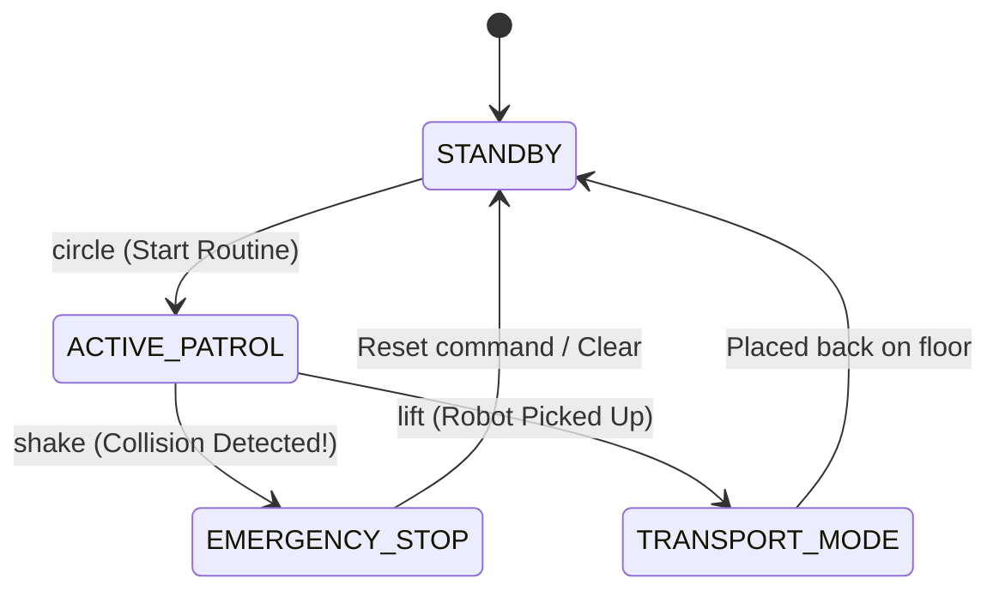

# Week 08 Labs: IMU Motion Telemetry & Robotic State Interlocks


**Focus for Group 3 (ND3 — Automation & Robotics):**
In this lab, you work with physical hardware: the **ws28p ESP32-S3 board** streaming 50 Hz 6-axis IMU sensor data. You will use the unified **`robotos-kws` CLI** to inspect hardware telemetry, record labelled robotic motion/gesture windows, train a temporal 1D-CNN, quantize to int8, and integrate real-time sliding-window predictions into a robotic Finite State Machine (FSM).

> [!NOTE]
> ### 💡 Why is the CLI named `robotos-kws`?
> **KWS** stands for **Keyword Spotting** (traditionally used for audio wake-words like *"Hey Siri"* or command words in ND1/ND2).  
> In this curriculum, `robotos-kws` is the **unified Edge AI toolkit** across all three tracks:
> - **ND1 & ND2 (Audio Tracks):** Acoustic Keyword Spotting on 16 kHz microphone streams (`red`, `blue`, etc.)
> - **ND3 (Robotics Track):** **Motion Gesture Spotting** on 50 Hz 6-DOF IMU streams (`shake`, `circle`, `lift`, `idle`)
>
> Both domains share the exact same Edge AI architecture: continuous high-frequency sensor streams, sliding-window buffers, temporal neural networks (CNNs), int8 post-training quantization, and low-latency inference on the ESP32-S3.

---

## Table of Contents

- [1. Environment Setup](#1-environment-setup)
- [2. Hardware Preparation: Flash Firmware First](#2-hardware-preparation-flash-firmware-first)
- [3. Lab 3.1: Hardware Telemetry & IMU Stream Inspection](#3-lab-31-hardware-telemetry--imu-stream-inspection)
- [4. Lab 3.2: Multi-Class Motion Dataset Collection](#4-lab-32-multi-class-motion-dataset-collection)
- [5. Lab 3.3: 6-DOF Signal Windowing & 1D-CNN Training](#5-lab-33-6-dof-signal-windowing--1d-cnn-training)
- [6. Lab 3.4: Benchmarking & Model Quantization](#6-lab-34-benchmarking--model-quantization)
- [7. Lab 3.5: Real-Time Hardware Recognition & Robot FSM](#7-lab-35-real-time-hardware-recognition--robot-fsm)
- [Troubleshooting](#troubleshooting)

---

## 1. Environment Setup

> [!TIP]
> ✈️ **Before you begin:** Test your developer literacy with the **[Pre-Flight Readiness Quiz](../preflight.md)** (10 self-check questions on Python versions, terminal paths, and permissions).

### 1.1 Virtual Environment

> [!IMPORTANT]
> **Python Version Requirement (Python 3.10 – 3.13; Python 3.11 recommended):**  
> TensorFlow does **not** yet have wheels for Python 3.14+ on Windows or macOS.  
> - **Windows:** If Python 3.11 is not installed, install it in PowerShell: `winget install Python.Python.3.11`
> - **macOS:** If `python3 --version` shows 3.14+, install Python 3.11 via Homebrew: `brew install python@3.11`
> - **Already created `.venv` with the wrong Python (e.g. 3.14)? Delete and recreate it:**
>   - macOS/Linux: `deactivate && rm -rf .venv && python3.11 -m venv .venv && source .venv/bin/activate`
>   - Windows (PowerShell): `deactivate; Remove-Item -Recurse -Force .venv; py -3.11 -m venv .venv; .\.venv\Scripts\Activate.ps1`
>   - Verify with: `python --version` (must output `Python 3.11.x`!)

```bash
cd nd3/docs/week08/labs/robotics
```

- **Windows (Git Bash):**
  ```bash
  py -3.11 -m venv .venv      # or: python -m venv .venv
  source .venv/Scripts/activate
  ```
- **Windows (PowerShell):**
  ```powershell
  py -3.11 -m venv .venv      # or: python -m venv .venv
  # If script execution is disabled: Set-ExecutionPolicy -Scope Process -ExecutionPolicy Bypass
  .\.venv\Scripts\Activate.ps1
  ```
- **Windows (Command Prompt cmd.exe):**
  ```cmd
  py -3.11 -m venv .venv      # or: python -m venv .venv
  .venv\Scripts\activate.bat
  ```
- **Linux / macOS:**
  ```bash
  # Check your version with 'python3 --version'. If it shows 3.14+ (common on Homebrew),
  # specify python3.11 or python3.12 (TensorFlow requires Python 3.10-3.13):
  python3.11 -m venv .venv       # or: python3.12 -m venv .venv / python3 -m venv .venv
  source .venv/bin/activate
  ```

*(When activated, your terminal prompt will show `(.venv)`).*

> [!TIP]
> **Prefer typing `py` instead of `python` on Windows?**  
> Virtual environments create `python.exe` by default. If you prefer typing `py` in Git Bash or PowerShell, copy it once:
> - **Git Bash:** `cp .venv/Scripts/python.exe .venv/Scripts/py.exe`
> - **PowerShell:** `Copy-Item .\.venv\Scripts\python.exe .\.venv\Scripts\py.exe`
> - **CMD:** `copy .venv\Scripts\python.exe .venv\Scripts\py.exe`  
> Now both `python` and `py` will work interchangeably in your terminal!

> [!TIP]
> **Already set up ND1 or ND2? Reuse your existing `.venv`!**
> If you already configured the virtual environment in `nd1` (or `nd2`), you do not need to download or install dependencies again (~1.5 GB). You can simply activate the existing environment:
> - **Git Bash:** `source ../../../nd1/docs/week08/labs/python/.venv/Scripts/activate`
> - **PowerShell:** `..\..\..\nd1\docs\week08\labs\python\.venv\Scripts\Activate.ps1`
> - **CMD:** `..\..\..\nd1\docs\week08\labs\python\.venv\Scripts\activate.bat`
> - **Linux / macOS:** `source ../../../nd1/docs/week08/labs/python/.venv/bin/activate`

### 1.2 Install Requirements & Wheel

```bash
pip install -r requirements.txt
pip install ./dist/robotos_kws-0.1.8-py3-none-any.whl
```

> [!TIP]
> **Universal Fallback:** If `pip` says `command not found`, use `python -m pip install -r requirements.txt` and `python -m pip install ./dist/robotos_kws-0.1.8-py3-none-any.whl`.

Verify that the CLI is ready:
```bash
robotos-kws --help
```
*(Or use `python -m robotos_kws --help`)*

> [!NOTE]
> **Windows Note (`python` vs `py`):**  
> On Windows, `py` launches the global system Python and ignores your virtual environment. Once your `.venv` is activated (your prompt shows `(.venv)`), always use **`python`**, which points to `.venv/Scripts/python.exe`.

You should see `check-imu`, `collect-imu`, `train-imu`, and `live-imu` listed under Available Subcommands.

---

## 2. Hardware Preparation: Flash Firmware First

> [!IMPORTANT]
> ### ⚡ MANDATORY STEP: Flash Your Board Before Starting Lab 3.1!
> Fresh ESP32-S3 boards (**ws28p**) or boards flashed in other courses do **not** have the RobotOS 50 Hz IMU telemetry firmware. If you skip this step and try to run `check-imu` or `collect-imu`, your terminal will hang or report:
> ```text
> WireError: Serial timeout waiting for BoardInfo on COM...
> ```
> You must flash the workshop firmware first using the automated flasher.

### 2.1 Connect the Hardware
1. Connect your **ws28p** board (Waveshare ESP32-S3-Touch-LCD-2.8) to your computer using a **USB-C data cable** (avoid charge-only cables).
2. The board will appear as a USB Serial / JTAG device:
   - **Windows:** `COM...` (e.g. `COM17` or `COM7`, visible in Device Manager)
   - **macOS:** `/dev/cu.usbmodem*` (e.g. `/dev/cu.usbmodem1101` — find with `ls /dev/cu.usb*`)
   - **Linux:** `/dev/ttyACM0` or `/dev/ttyUSB0`

> [!WARNING]
> **Serial Port Exclusivity**: Close any open serial monitors (Arduino IDE, VSCode Serial Monitor, WebSerial browser tabs) before flashing or inspecting. Only one process can access the serial port at a time.

### 2.2 Flash the Firmware (One Command)
With your virtual environment active (`(.venv)`), run:

```bash
robotos flash-firmware
```
*(Or use any alias: `robotos flash`, `robotos-flash`, or `robotos-kws flash-firmware`)*.

#### What Happens Automatically:
1. **Auto-Detects ESP32-S3:** Scans USB hardware VID/PID (`303A:1001`) and selects your port automatically.
2. **Auto-Installs `esptool`:** If missing in `.venv`, installs `esptool>=4.7` automatically via pip.
3. **Downloads & Caches Firmware:** Automatically fetches `bootloader.bin`, `partition-table.bin`, and `robotos_board.bin` for `ws28p` from the workshop repository to `~/.robotos/firmware/ws28p`.
4. **Flashes Board:** Flashes all partitions with a smooth single-line in-place progress bar.
5. **Verifies Board Telemetry:** Performs an automated handshake — verifies `BoardInfo` (caps `0x3c`), reads board UUID, and tests 1.5 seconds of live 50 Hz IMU streaming!

#### Sample Successful Output:
```text
============================================================
 RobotOS Firmware Flasher (ESP32-S3)
 Target Board: ws28p (Waveshare ESP32-S3-Touch-LCD-2.8)
============================================================

[1/4] Detecting ESP32-S3 Serial Port...
   ✓ Auto-detected ESP32-S3 on port: COM17 (USB Serial Device)

[2/4] Resolving Prebuilt Firmware for board: 'ws28p'...
   Local Cache: C:\Users\student\.robotos\firmware\ws28p
     • bootloader.bin       (14.8 kB) [cached]
     • partition-table.bin  (3.0 kB)  [cached]
     • robotos_board.bin    (1.3 MB)  [cached]

[3/4] Flashing Firmware to ESP32-S3 via esptool...
   Target Port: COM17
   Baud Rate:   460800
   ------------------------------------------------------------
   [chip]  Chip is ESP32-S3 (QFN56) (revision v0.2)
   [flash] Writing at 0x00153a30 ============================== 100.0% 822.39kB/822.39kB [4s]
   [flash] ✓ Wrote 1373568 bytes (842127 compressed) at 0x00010000 in 4.1 seconds
   [done]  Hash of data verified.
   [done]  Hard resetting via RTS pin...
   ✓ Firmware written successfully! Board reset triggered.

[4/4] Verifying Board Telemetry Handshake...
   Waiting for board to finish booting on COM17...
   ✓ Board Telemetry Verified:
     • Hardware Model:  ws28p
     • Firmware ID:     robotos-fw-v1.0.0
     • Capabilities:    0x3c (IMU, RTC, BATT)
     • Board UUID:      a4cf1289fe20
   Checking live 50 Hz IMU telemetry stream for 1.5 seconds...
     • Received: 75 frames (streaming at 50.1 Hz)
     • Mean accel magnitude: 9.81 m/s² [verified]

============================================================
 ✓ Board ws28p is successfully flashed, verified, and ready!
============================================================
```

### 2.3 Advanced / Alternative Flashing Options
If you have multiple boards connected, or need to flash offline:

```bash
# Explicit serial port (if multiple USB devices are connected):
robotos flash-firmware --port COM17                     # Windows
robotos flash-firmware --port /dev/cu.usbmodem1101      # macOS

# Use pre-downloaded local folder (offline mode):
robotos flash-firmware --from-dir ~/Downloads/ws28p

# Specify custom remote repository:
robotos flash-firmware --source robotos-workshop

# Manual guide and raw files:
# https://github.com/drsanti/hardware-interface-workshop/blob/main/firmware-prebuilt/README.md
```

### 2.4 Flashing Troubleshooting
- **Port Busy / Access Denied (`PermissionError`):**  
  Close Arduino IDE, VSCode Serial Monitor, or any browser WebSerial tabs.
- **Board Not Detected (`Could not find an ESP32-S3`):**  
  Ensure your USB-C cable supports data (test with another cable or port).
- **Flashing Fails / esptool Timeout:**  
  Put the board into ROM bootloader mode:
  1. Hold down the physical **BOOT** button.
  2. Press and release the **RESET** button.
  3. Release the **BOOT** button.
  4. Run `robotos flash-firmware`.

---

## 3. Lab 3.1: Hardware Telemetry & IMU Stream Inspection

Test the board connection and verify the 50 Hz IMU telemetry stream:

```bash
# 1. One-click Auto-Detection (Recommended):
robotos check-imu

# 2. Specify port manually:
robotos check-imu --port COM17                # Windows
robotos check-imu --port /dev/cu.usbmodem1101 # macOS
```

> [!TIP]
> **Want to inspect all connected boards and their wire protocol handshake?**  
> Run:
> ```bash
> robotos detect
> ```
> This scans all serial ports, tests the wire handshake, displays the board model (`ws28p` vs `es3c28p`), firmware version, UUID, and live sensor readings.

> [!TIP]
> **Clean Connection Without Resets:**  
> The `robotos-kws` CLI explicitly manages the USB DTR and RTS control line states to prevent unintended hardware resets on the ESP32-S3's native USB Serial/JTAG port. Telemetry streaming connects and disconnects smoothly without restarting your board.

### Expected Output:
```text
   [auto-detect] Selected ESP32-S3 board on COM17 (ws28p, 0x3c (IMU|RTC|BATT|BTN))
Board: IMU stream detected
151 samples, 50.0 Hz, lost 0
mean accel (m/s^2) [ 0.12  0.08  9.81]  |a| 9.81  (about 9.8 when still)
gyro std (rad/s)   [0.002 0.001 0.001]
```
- Reads `BoardInfo`: Caps `0x3c` (IMU + RTC + BATT).
- Confirms streaming rate: **~50 Hz** (one frame every 20 ms).
- Acceleration magnitude: $|\vec{a}| \approx 9.8\text{ m/s}^2$ when stationary.
- Gyro noise: $< 0.05\text{ rad/s}$ drift when still.

---

## 4. Lab 3.2: Multi-Class Motion Dataset Collection

Collect labelled motion windows from the physical board:

```bash
# 1. One-click Auto-Detection (Recommended):
robotos-kws collect-imu --person student_a --session s01 --takes 20

# 2. Specify port manually:
robotos-kws collect-imu --port COM17 --person student_a --session s01 --takes 20
```

### The 4 Gestures to Record:
| Gesture | Physical Motion | Robotic Meaning |
| :--- | :--- | :--- |
| **`idle`** | Hold still in hand, rest on desk, natural slight drift | Robot stationary / normal vibration |
| **`shake`** | Fast, vigorous left-right oscillation | Collision / rough terrain / vibration fault |
| **`circle`** | Draw 1-2 smooth circles in the air | Turn-in-place / 360° scan routine |
| **`lift`** | Lift board vertically up ~20 cm and put down | Robot picked up off ground / payload lift |

### Data Recording Protocol:
1. The terminal prompts: `Press Enter for <gesture> take N/20...`
2. Press Enter $\to$ Countdown $1.0\text{ s}$ $\to$ **GO!**
3. Perform the gesture within the $2.0\text{ s}$ window.
4. Gaps check: If USB packet loss drops more than 3 samples, the CLI automatically discards the take and prompts for a clean retry.

The recorded CSV files are saved in `imu_dataset/<gesture>/`.

---

## 5. Lab 3.3: 6-DOF Signal Windowing & 1D-CNN Training

Train a 1D Convolutional Neural Network on the recorded 6-channel IMU windows:

```bash
robotos-kws train-imu --data imu_dataset --out imu_artifacts --epochs 60
```

> [!TIP]
> **Need to test offline without physical board?**
> You can train on synthetically generated multi-person IMU data:
> ```bash
> robotos-kws train-imu --synthetic --out imu_artifacts --epochs 60
> ```

### Training Pipeline Concepts:
- **Resampling**: Interpolates irregular timestamp samples onto an exact 20 ms uniform grid ($100\text{ timesteps} \times 6\text{ channels}$).
- **Normalization**: Scales acceleration by $1g$ ($9.80665\text{ m/s}^2$) and gyro by $4.0\text{ rad/s}$.
- **Data Augmentation**: Applies random rotation in hand, time shifts ($\pm 200\text{ ms}$), magnitude scaling ($\pm 20\%$), and Gaussian noise.
- **Person-Disjoint Split**: Whole persons are held out for validation, proving the model generalizes to unseen users.

---

## 6. Lab 3.4: Benchmarking & Model Quantization

Review the generated training artifacts in `imu_artifacts/`:
- `model.keras`: Full float32 Keras model.
- `model_float.tflite`: Float32 TFLite model (~10 KiB).
- `model_int8.tflite`: Int8 quantized model (~3.2 KiB).
- `meta.json`: Quantization loss, accuracy metrics, and confusion matrix.

Notice that the int8 model is only **~3.2 KiB**, small enough to run on any microcontroller with virtually zero quantization loss!

---

## 7. Lab 3.5: Real-Time Hardware Recognition & Robot FSM

Now run real-time hardware inference connected to a robotic state machine.

### 7.1 Direct CLI Live Inference
Run real-time sliding-window inference on the live USB stream:

```bash
# 1. One-click Auto-Detection (Recommended):
robotos-kws live-imu --model imu_artifacts/model_int8.tflite

# 2. Specify port manually:
robotos-kws live-imu --port COM17 --model imu_artifacts/model_int8.tflite
```
Move the board: perform `shake`, `circle`, `lift`. Watch the terminal print detections when confidence exceeds $0.70$.

> [!TIP]
> **Offline Live Inference (No Board):**
> You can test sliding-window inference using pre-recorded or synthesized gesture CSV files:
> ```bash
> robotos-kws live-imu --replay samples/shake.csv --model imu_artifacts/model_int8.tflite
> ```

### 7.2 Robotic Finite State Machine Interlock
Run the included robot controller script:

> [!TIP]
> **Check Your Python Command (`python`, `python3`, or `py`):**
> Depending on your operating system and environment setup, the command to invoke Python may differ:
> - **Windows (PowerShell / Git Bash with `.venv`):** `python robot_fsm.py`
> - **macOS / Linux:** `python3 robot_fsm.py` (or `python robot_fsm.py`)
> - **Windows Python Launcher:** `py robot_fsm.py` (if `py.exe` was copied to your `.venv`)
>
> 💡 *Quick check:* Run `python --version` (or `where python` on Windows / `which python` on macOS/Linux) to ensure it points to your activated `.venv`!

**With Physical ws28p Board:**
```bash
# 1. One-click Auto-Detection (Recommended):
python robot_fsm.py --model imu_artifacts/model_int8.tflite
# (or if using py on Windows: py robot_fsm.py --model imu_artifacts/model_int8.tflite)

# 2. Specify port manually:
python robot_fsm.py --port COM17 --model imu_artifacts/model_int8.tflite
# (or: py robot_fsm.py --port COM17 --model imu_artifacts/model_int8.tflite)
```

**Offline / Replay Mode (Without Board):**
You can replay individual gesture files to test specific state machine transitions:
```bash
# Test 'circle' -> triggers ACTIVE_PATROL
python robot_fsm.py --replay samples/circle.csv --model imu_artifacts/model_int8.tflite

# Test 'shake' -> triggers EMERGENCY_STOP
python robot_fsm.py --replay samples/shake.csv --model imu_artifacts/model_int8.tflite

# Test 'lift' -> triggers TRANSPORT_MODE
python robot_fsm.py --replay samples/lift.csv --model imu_artifacts/model_int8.tflite

# Full FSM sequence simulation (works even without trained model)
python robot_fsm.py --replay sample_gesture.csv
```
*(On Windows machines using `py`, replace `python` with `py` in any of the above commands)*.

### State Machine Behavior:


- When you **`shake`** the board $\to$ The controller immediately enters `EMERGENCY_STOP`, cutting virtual motor power.
- When you **`lift`** the board $\to$ Enters `TRANSPORT_MODE`, disengaging wheel encoders.
- When you draw a **`circle`** $\to$ Initiates `ACTIVE_PATROL` trajectory.

---

### 7.3 Interactive Musical Air Play: Air Drum Synthesizer

In addition to state machines, the same 50 Hz IMU telemetry can transform the ESP32-S3 into a high-performance **interactive musical air instrument** (Air Drum).

The included `air_drum.py` script features:
- **Zero External Audio Files**: Generates punchy, studio-quality drum waveforms (Kick, Snare, Hi-Hat, Tom, Cowbell, Crash Cymbal) directly in memory using mathematical audio synthesis (`numpy` + `sounddevice`).
- **Low-Latency Polyphonic Engine**: Multiple drum sounds ring out simultaneously without cutting each other off, with automatic soft-limiting saturation (`tanh`).
- **Dual Triggering Architecture**:
  1. **Transient Strike Detection**: Air-drumming downward strikes are captured instantly via peak acceleration ($|\vec{a}| > 19.5\text{ m/s}^2$). Dynamic velocity scaling ensures hitting harder produces a louder hit (35% to 100% volume). The tilt of your hand steers the instrument:
     - **Tilted Left** ($a_y < -3.5$) $\to$ **Snare Drum**
     - **Tilted Right** ($a_y > +3.5$) $\to$ **Tom Drum**
     - **Hard Downward Strike** ($|\vec{a}| > 30\text{ m/s}^2$) $\to$ **Bass Kick Drum**
     - **Flat / Horizontal Strike** $\to$ **Closed Hi-Hat**
     - **Tilted Upward** ($a_x > 4.5$) $\to$ **Cowbell Accent**
  2. **1D-CNN Gestural Music**:
     - **`circle`** $\to$ Triggers an explosive, shimmering **Crash Cymbal** swell!
     - **`shake`** $\to$ Triggers a rapid 4-hit **Hi-Hat / Snare Drum Roll**!
     - **`lift`** $\to$ Triggers a dynamic **Tom Fill & Crash** finish!

#### Running Air Drum:

**1. One-click Auto-Detection (Recommended):**
```bash
python air_drum.py
# (or if using py on Windows: py air_drum.py)
```

**2. Specify port manually:**
```bash
python air_drum.py --port COM17
# (or: py air_drum.py --port COM17)
```

**3. Sound Check Demo (No hardware needed):**
Verify your computer's audio synthesis and listen to all percussion sounds:
```bash
python air_drum.py --demo
# (or: py air_drum.py --demo)
```

**4. Offline Replay Mode:**
Test gesture classification and drum triggers using pre-recorded gesture takes:
```bash
# Replay circle gesture -> Triggers Crash Cymbal
python air_drum.py --replay samples/circle.csv

# Replay shake gesture -> Triggers Hi-Hat / Snare Roll
python air_drum.py --replay samples/shake.csv

# Replay lift gesture -> Triggers Tom Drum Fill
python air_drum.py --replay samples/lift.csv
```

#### Terminal ASCII Drum Pad Visualizer:
```text
  +--------------------------- AIR DRUM KIT ---------------------------+
  |                                                                    |
  |     [CRASH]                  (HI-HAT)                   [RIDE]     |
  |       *                         #                       @          |
  |                                                                    |
  |               [SNARE]                        [TOM]                 |
  |                 X                            o                     |
  |                                                                    |
  |                               (KICK)                               |
  |                                 O                                  |
  |                                                                    |
  +--------------------------------------------------------------------+
  >>> HIT: [SNARE DRUM]    | Accel:  28.4 m/s² | Velocity:  76%
```

---

---

## Troubleshooting

- **Access Denied / Permission Error on Serial Port:**
  Close all other applications using the COM port (VSCode Serial Monitor, Arduino IDE, Chrome WebSerial tabs).
- **Board Not Streaming IMU Frames:**
  Confirm the board is flashed with `ws28p` firmware (caps `0x3c`). If the board was flashed with `es3c28p` (mic firmware, caps `0x33`), the CLI will reject it with a clear error message.
- **Too Many Lost Samples Warning:**
  Ensure you are using a good quality USB-C data cable connected directly to your computer (avoid unpowered USB hubs).
