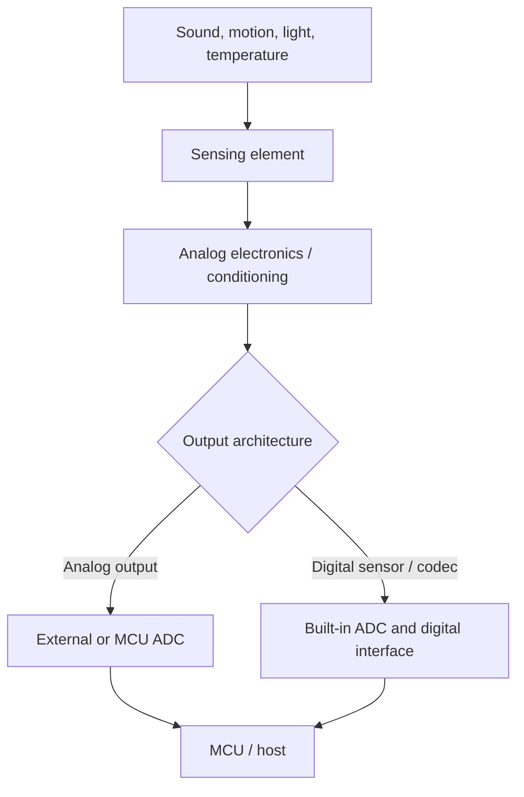

# 01 — Sensors, Transducers, and Physical Signals

[Foundations](README.md) | [Next: ADC and sampling](02-adc-and-sampling.md)

## What is a physical signal?

A **physical quantity** changes in the world even before software exists: sound pressure, velocity, acceleration, rotation, light, temperature, electrical current, or chemical concentration. A **signal** describes how that quantity varies over time or space.

In a mathematical model, a continuous-time signal is written as `x(t)`. A digitized sample sequence is written as `x[n]`. The two are related but they are not the same: the measured data are limited by sensors, noise, calibration and sampling.

A **measurand** is the property we want to measure. A **sensor** detects it. A **transducer** converts a physical input into another form, usually an electrical one. A complete sensor module may contain a sensing element, amplifiers, filters, ADC, digital interface, calibration and firmware.

## Sensor output is not always analog

### Analog-output sensor

A thermistor voltage-divider or analog microphone may deliver an electrical voltage. Its output must fit the ADC input range. Typically the electrical path needs biasing, gain, impedance planning and anti-alias filtering.

### Digital-output sensor

A 6-axis MEMS IMU typically digitizes measurements internally and exposes register data over I²C or SPI. An audio codec may sample microphone audio and send PCM words over I²S. **Using a sensor does not imply using the ESP32 general-purpose ADC.**

### Example sensors for the three learning tracks

| Sensor | Measurand | Typical output | Common problem |
|---|---|---|---|
| MEMS microphone | Sound pressure | Analog electrical signal or digital PCM | Gain, ambient noise, clipping |
| Accelerometer | Specific force (m/s²) | Three axes | Gravity contribution, orientation |
| Gyroscope | Angular velocity (rad/s) | Three axes | Offset, temperature drift |
| Thermistor | Temperature | Resistance or conditioned voltage | Nonlinearity and calibration |
| Rotary encoder | Relative motion | Pulses / counts | Missed events, resolution |
| Light sensor | Illuminance / irradiance proxy | Analog or digital | Saturation and ambient effects |

## Accuracy, resolution and sensitivity

These terms are not interchangeable:
- **Range:** interval over which the sensor is intended to measure, e.g. accelerometer range ±4 g.
- **Sensitivity:** output change for a given input change, e.g. counts per g.
- **Resolution:** smallest distinguishable increment.
- **Accuracy:** closeness to the true quantity.
- **Precision / repeatability:** how close repeated measurements are to each other.
- **Offset (bias):** systematic shift.
- **Noise:** random fluctuations.
- **Bandwidth:** frequencies that pass through the signal chain.
- **Latency:** delay before usable measurements arrive.

A high-resolution sensor can still be inaccurate if the offset is wrong. Likewise, a prediction model cannot compensate reliably for clipping or broken calibration unless explicitly designed and evaluated for it.

## Why orientation and units matter for IMUs

An accelerometer measures **specific force**. When a board rests still on a table, it normally reports a gravity-related magnitude near 9.81 m/s², even though its translational acceleration is zero. The sign and axis depend on the mounting orientation. The gyroscope, by contrast, should ideally report approximately zero angular velocity while stationary.

Before interpreting IMU samples:
1. Inspect axis names, signs and mounting direction.
2. Identify units (g vs m/s², °/s vs rad/s).
3. Identify full-scale range and output data rate.
4. Check stationary offsets and noise.
5. Preserve these settings in the dataset metadata.

## Calibration and reproducibility

A digital reading is not automatically calibrated. A simple linear sensor conversion might be `physical_value = (raw_count - offset) * scale`. Real sensors can also require temperature compensation, nonlinear correction and axis alignment.

If two students collect identical gestures but use different orientations or scales, their datasets may not be comparable. The ML training pipeline must understand the physical measurement contract.

## Concept check

1. Which physical quantity does a microphone measure? Which does a gyroscope measure?
2. Why can a digital IMU work without configuring the MCU ADC?
3. Explain precision vs accuracy using a deliberately miscalibrated temperature sensor.
4. What happens when an analog signal exceeds the ADC range?
5. Why does a dataset need sensor units, gain and axis conventions?

## Mini exercise

Draw the complete sensing chain for **one microphone** and **one IMU**. Label the *physical input*, the point where data become digital, the data interface, and the first software processing stage.

[Next: ADC and sampling](02-adc-and-sampling.md)
