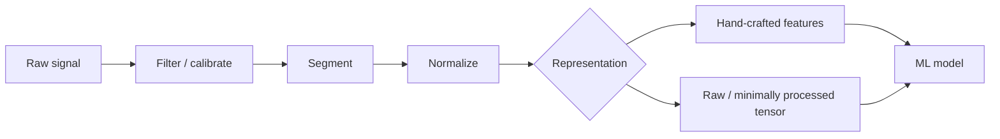

# 03 — Digital Signal Processing and Feature Extraction

[Foundations](README.md) | [Previous: ADC and sampling](02-adc-and-sampling.md) | [Next: ML fundamentals](04-machine-learning-fundamentals.md)

## Raw measurements versus informative representations

Digitizing a signal produces numbers, but numbers alone do not identify a command or a gesture. **Digital signal processing (DSP)** transforms samples while preserving or emphasizing properties needed for a task.

Typical operations:
1. Calibration and unit conversion.
2. Noise filtering and artifact rejection.
3. Segmentation into fixed-duration windows.
4. Scaling / normalization.
5. Extraction of informative features.
6. Passing consistent tensors to the model.

A model can also learn some features from raw data. Hand-engineered features are not universally mandatory; their usefulness depends on dataset size, architecture, compute and domain.

## Time-domain representations

For samples `x[0] ... x[N-1]`:

- Mean: average level (for audio, a nonzero DC offset may need attention).
- RMS: `sqrt(sum(x[n]^2) / N)`, a measure of signal magnitude.
- Peak amplitude: largest absolute sample.
- Zero-crossing rate: number of changes in signal sign per window.
- Variance / standard deviation: magnitude of variation.

Example: RMS may indicate how loud a microphone signal is or how strong an IMU acceleration fluctuation is. RMS **alone** cannot reliably identify which word was spoken or which motion occurred.

## Filtering

A low-pass filter suppresses fast variations; a high-pass filter suppresses slow variation or drift. A band-pass filter retains an interval of frequencies.



A moving average can smooth noisy readings but introduces delay. A high-pass filter can remove slow offsets but may also remove information useful to a task. Choose signal-processing operations because they fit the physics and goal, not because they are fashionable.

## Framing and windows

A continuous stream is often divided into frames or windows. One-second speech may be analyzed with short, overlapping frames. Motion recognition may use a two-second multi-axis window.

For a signal of `L` samples, frame length `W` and hop `H`:

```text
complete frame count = 1 + floor((L - W) / H), when L >= W
```

Audio course example: `L=16000, W=480, H=320` gives `1+floor(15520/320)=49` complete frames. Frames overlap by 160 samples. Shorter hops produce denser temporal coverage but more computation.

The **window function** (e.g. Hann) applied to each frame is a separate concept from choosing the frame's duration. It reduces spectral leakage at the expense of altering some amplitude details.

## Frequency-domain representation: FFT

The discrete Fourier transform represents a finite sequence by frequency components. An FFT is an efficient implementation of this transform. It helps detect spectral structure, harmonics, vibrations and other periodic phenomena.

An FFT is **not** itself a neural network. It is a numerical transform often used *before* machine learning.

A spectrogram stacks spectra from consecutive short-time frames so frequency content can be seen changing through time.

## Audio keyword spotting: log-mel features


The mel filter bank aggregates spectral energy into perceptually motivated bands. Log compression reduces the effect of large multiplicative changes in energy and improves dynamic range. In the ND01 workshop, a 1-second clip is represented by approximately **49 time frames × 40 mel bands**.

A model trained on this representation expects the **same** sample rate, frame length, hop, filter-bank configuration and scaling at inference. Even reasonable changes can degrade its predictions.

## IMU motion recognition: time-series features

At 50 Hz, 2 seconds of acceleration and gyro data produce a tensor with 100 rows and 6 channels:

```text
row: [ax, ay, az, gx, gy, gz]
shape: [100, 6]
```

Hand-crafted motion features include average acceleration, variance, vector magnitude, number of peaks, dominant motion frequency and angular velocity. Alternatively, a **1D-CNN** can learn temporal patterns directly from the scaled six-channel sequence.

The workshop uses fixed physical scales for IMU channels. Per-window standardization can erase useful magnitude information: a subtle vibration and a large shake may otherwise look deceptively similar.

## Concept exercise

Compare three input representations: (1) one RMS value; (2) a 49×40 log-mel matrix; (3) a 100×6 IMU sequence. Which could detect the intensity of an event, which could distinguish spoken commands, and which could preserve movement order? Explain the trade-offs.

## Review questions

1. What information is lost when a window is reduced to one RMS value?
2. Why does a spectrogram retain more temporal information than a single full-clip FFT?
3. What does a shorter sliding-window hop change?
4. Why must feature extraction match between training and deployment?
5. Can a neural network use raw sensor samples directly? When might that be practical?

[Next: ML fundamentals](04-machine-learning-fundamentals.md)
