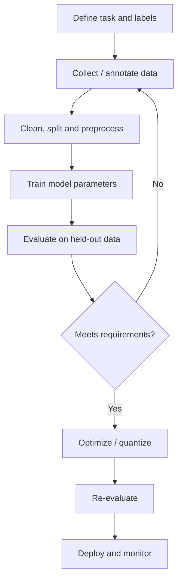

# 04 — Machine Learning Fundamentals

[Foundations](README.md) | [Previous: DSP and features](03-dsp-and-feature-extraction.md) | [Next: Dataset design](05-dataset-design.md)

## Fixed rules versus learned patterns

Traditional programming explicitly encodes a decision: for example, `if acceleration_magnitude > threshold: alarm()`. The program's behavior follows the rule specified by the engineer.

In supervised machine learning, we provide examples of sensor measurements paired with labels. An optimization procedure adjusts model parameters so the model predicts labels for new inputs.

A model does not automatically understand physics or language. It learns statistical regularities in its training data. The system still needs explicit engineering for sensing, preprocessing, confidence handling, safety and actions.

## The machine learning lifecycle



### Important vocabulary

- **Example / sample:** one labelled event or observation, e.g. a 1-second audio clip.
- **Feature:** numerical representation of the observation, e.g. log-mel bands.
- **Label / target:** desired class such as `red`, `shake` or `idle`.
- **Model:** a parameterized mathematical function producing a prediction.
- **Training:** optimization of model parameters using training examples.
- **Epoch:** one pass through training data.
- **Loss function:** scalar objective minimized during training.
- **Inference:** forward computation of output using fixed trained parameters.
- **Hyperparameter:** configuration chosen outside direct learning, e.g. learning rate or architecture width.

## Classification

A classifier maps input data to a finite set of labels. Its output is often a vector of **scores** or probabilities. For six audio classes, the output may be:

```text
red         0.03
green       0.02
blue        0.88
off         0.01
_silence_   0.02
_unknown_   0.04
```

The top label is `blue`; the associated score is 0.88. This does not prove an 88% real-world chance of correctness: network probabilities can be poorly calibrated and affected by out-of-distribution inputs.

Common decision stages include: choosing the top label, requiring a minimum confidence, ignoring unknown/silence, smoothing across windows, and enforcing a refractory period before another trigger.

## Why convolutional neural networks?

A **CNN** uses filters that learn local patterns. For keyword spotting, frequency-time structures in a log-mel representation can be analyzed by compact 2D-like convolutional operations. A **depthwise-separable CNN (DS-CNN)** reduces multiply-accumulate work and parameter counts compared with ordinary convolutions.

For IMU streams, a **1D-CNN** scans along time and learns movement shapes, order and temporal changes across six input channels.

Neural network size and quality are not determined by architecture name alone. Measure actual inference latency, memory and accuracy for your task.

## Underfitting, overfitting and generalization

- **Underfitting:** the model cannot capture useful training patterns.
- **Overfitting:** it performs well on training examples but poorly on new people, sessions, boards or noise conditions.
- **Generalization:** it performs well on genuinely unseen cases.

A model that memorizes a single student's microphone may look accurate on randomly split clips from the same session and fail on a different laptop. Sound ML experiments separate training, validation and test data in a way that reflects future use.

## Inference is not training

The device or service can run a trained model without modifying its weights. Collecting new examples and retraining normally happens in a separate process, often on a PC or server. The resulting artifact is deployed after evaluation.

## Worked comparison

| Task | Input | Output | Learning approach |
|---|---|---|---|
| Detect a spoken color | 49×40 log-mel feature matrix | One of four words plus negative classes | Supervised keyword classification |
| Detect board movement | 100×6 scaled sensor time series | idle/shake/circle/lift | Supervised motion classification |
| Detect extreme acceleration | One thresholded magnitude | Alarm / no alarm | Explicit engineering rule (no ML) |

## Questions

1. Why is the largest softmax score not a guarantee of accuracy?
2. What is learned during training and what stays fixed during inference?
3. Give an example of overfitting in audio and one in IMU gesture data.
4. Why can a threshold rule be preferable to ML for a simple safety condition?
5. How do DS-CNN and 1D-CNN differ in the structures they emphasize?

[Next: Dataset design](05-dataset-design.md)
