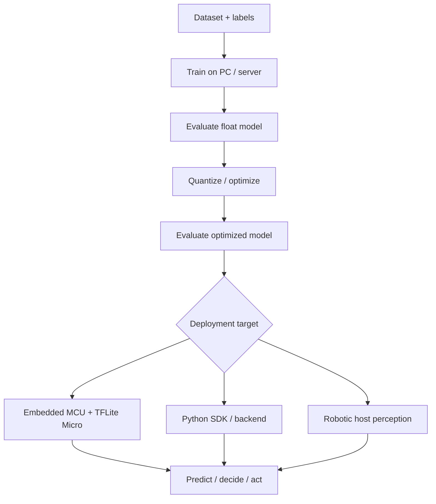

# 07 — Inference, Model Quantization, and Deployment

[Foundations](README.md) | [Previous: Evaluation](06-model-evaluation.md) | [Next: Worked examples](08-worked-examples.md)

## Training and inference run in different environments

**Training** typically uses many examples, gradients and parameter updates, often on a computer. **Inference** feeds a new example into the fixed trained model and obtains an output. Deployment means integrating more than a file: the model, preprocessing, interpreter/runtime, labels, thresholds, monitoring and actions must all work together.



## Where can inference run?

| Target | Strengths | Constraints |
|---|---|---|
| Microcontroller | Local operation, low power, no network required for decisions | Limited SRAM, Flash, supported operators and compute |
| Host computer | Flexible numerical libraries, fast iteration, monitoring | Depends on host availability and OS scheduling |
| Cloud service | Centralized model management and scaling | Network latency, privacy, connectivity and service availability |
| Hybrid | Combine edge sensing with remote analytics | More data contracts, failure modes and integration work |

For this course, ND01 emphasizes the eventual MCU target; ND02 exposes inference as software APIs; ND03 uses live IMU telemetry and a host-side classifier to drive a simulated FSM.

## Model quantization is not the ADC

Post-training quantization maps trained float values into lower-precision ranges, often signed INT8 codes. A simplified affine quantizer is:

```text
q = clamp(round(real_value / scale) + zero_point)
real_value ≈ scale * (q - zero_point)
```

Quantization parameters may be defined per tensor or per channel depending on the representation and operator. A **representative calibration dataset** helps estimate realistic activation ranges. Using only quiet recordings for calibration may poorly represent loud keyword events.

A nominal INT8 weight uses 8 bits instead of 32 bits in float32, but file size and runtime RAM do **not** necessarily shrink by exactly fourfold. Metadata, operator buffers, alignment and runtime implementation matter.

## MCU memory: where the bytes live

Important categories include:
- **Flash/ROM-like storage:** immutable model weights, FlatBuffer metadata, firmware instructions.
- **SRAM / internal RAM:** input/output tensors, activations, scratch buffers, stacks, DMA buffers and queues.
- **PSRAM:** optional external RAM on supported boards; access properties and DMA/operator support must be checked.

The **tensor arena** in TFLite Micro is a statically allocated buffer used for model tensors and scratch. It is not the same as the size of the `.tflite` file.

### Worked memory budget

A 1-second mono 16-bit audio ring buffer at 16 kHz is about **31.25 KiB**. Suppose a model file is **19 KiB** and its tensor arena is **64 KiB**: you cannot add all three and call that “SRAM required,” because model weights may remain in Flash. You must also account for stacks, queues, DSP working memory and memory reserved by the system.

## Real-time decisions

A data path introduces several delays:
1. Sensor and analog/digital filtering.
2. Buffer accumulation, framing and windowing.
3. Feature computation.
4. Model invocation.
5. Temporal smoothing or confidence gating.
6. Scheduling, communication and actuation.

```text
response delay ≠ neural network invoke time only
```

The detector must meet the *deadline relevant to its task*, not an arbitrary benchmark. Buffered audio capture should not block while inference is running.

## Preprocessing parity and model contract

Keep all the following identical or explicitly compatible between training and inference:
- Sensor channel ordering and sign conventions.
- Units and sampling rate.
- Window size, hop and padding.
- Filters and resampling.
- Feature extraction constants (FFT, mel filters, log offset, scaling).
- Quantization and input tensor conventions.
- Output label ordering and postprocessing.

A model that worked with one audio gain or sensor scale may fail silently if these inputs change.

## Update strategies

A new model can be integrated into firmware at build time, stored as a separate validated model artifact if the runtime architecture supports dynamic loading, or loaded by a host service. Do **not** infer from a `.tflite` file alone that an MCU supports model hot-swapping without reflashing: this is a deliberate firmware architecture choice.

For production updates, verify model compatibility, integrity, versioning and rollback. Secure boot and flash encryption protect different threat models.

## Questions

1. Why does an INT8 model's file size not equal the tensor arena size?
2. How can a model's test accuracy fall after changing microphone gain?
3. Why is the latency of a 1-second window classifier not just its inference compute time?
4. What must be tested after quantization?
5. Which conditions would make a host-based classifier preferable to on-device inference?

[Next: Worked examples](08-worked-examples.md)
