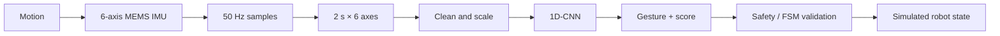

# 08 — Worked Examples, Synthesis, and Glossary

[Foundations](README.md) | [Previous: Deployment](07-inference-and-deployment.md)

## Example A: Voice command recognition

**Goal:** recognize `red`, `green`, `blue`, `off` or reject irrelevant audio.

### Step-by-step reasoning

1. Sound travels as pressure variations. The microphone converts it to an electrical signal.
2. The audio codec / converter samples it. The computer or MCU receives PCM.
3. For 1 second at 16 kHz, there are 16,000 mono samples.
4. With 480-sample frames and 320-sample hops, there are 49 complete analysis frames.
5. Each frame is transformed into 40 log-mel frequency-band features, yielding a 49×40 tensor.
6. The trained classifier predicts scores for the command words and negative classes.
7. A decision rule rejects low-confidence, silence or unknown predictions and suppresses duplicate triggers.
8. The application changes its display, sends a command, or controls a safe indicator.

**Consider:** another laptop microphone or the ESP32-S3 board microphone may have different gain and frequency response. What must be tested before claiming the same performance?

**Practical follow-up:** [ND01 Week 08 audio CLI](../../../nd1/docs/week08/labs/README.md), then [ND02 Week 08 application](../../../nd2/docs/week08/labs/README.md).

## Example B: IMU gesture recognition

**Goal:** recognize `idle`, `shake`, `circle` and `lift`.

### Step-by-step reasoning

1. The accelerometer senses specific force along three axes; the gyroscope senses angular velocity along three axes.
2. The digital IMU performs internal conversion and delivers six numerical channels.
3. At 50 samples/s, a 2-second window contains 100 rows with six channel values per row.
4. Time alignment, validation and fixed physical scaling produce a reproducible model input.
5. A 1D-CNN learns time-dependent patterns characteristic of the four gestures.
6. The classifier supplies a label and score, but the robot must check validity of state transitions.
7. A gesture can request a *simulated* patrol or transport state. In physical machines, a certified/deterministic safety architecture must not rely solely on an ML prediction.

**Consider:** when the operator changes orientation, gravity appears on different accelerometer axes. How would you design more robust training data?

**Practical follow-up:** [ND03 Week 08 IMU labs](../../../nd3/docs/week08/labs/README.md).

## System design exercise

Choose a real application (voice-controlled LED, smart vibration monitor, robot pick-up detector, environmental alarm). Write a one-page technical explanation with:
- Measurand and sensor.
- Where ADC or digital conversion happens.
- Sample rate and data format.
- Signal quality checks.
- Feature representation.
- Learning task and model.
- Validation method.
- Inference target.
- Confidence/rejection rules.
- Response time and fallback behavior.

## Conceptual questions with short answers

1. **Is an FFT a neural network?** No. It is a deterministic numerical transform.
2. **Does an IMU always need an external ADC?** No. Many IMUs expose already-digitized samples.
3. **Is a high softmax score proof of correctness?** No. Validate calibration and out-of-distribution behavior.
4. **Are training and inference the same computation?** No. Training changes weights; inference normally uses fixed weights.
5. **Are ADC quantization and neural-network quantization identical?** No. They operate on different quantities at different stages.
6. **Can all detection be done on an MCU?** Only if required operators, memory, timing, energy and input preprocessing fit its constraints.
7. **Does a model replace robot safety logic?** No. Deterministic state and safety checks are still required.

## Glossary

| Term | Definition |
|---|---|
| ADC | Analog-to-digital converter |
| PCM | Pulse-code modulation; discrete numerical audio samples |
| Sampling rate | Number of sensor samples per second |
| Nyquist frequency | Half the sample rate |
| Aliasing | High-frequency input appearing as a different sampled frequency |
| FFT | Fast implementation of the discrete Fourier transform |
| RMS | Root mean square, commonly used as a magnitude measure |
| Spectrogram | Time-frequency representation of successive frames |
| Log-mel | Logarithm of mel-filtered spectral energy |
| Feature | Useful numerical representation supplied to a model |
| Label | Ground-truth target assigned to a training example |
| Training | Optimization of model parameters |
| Inference | Prediction with trained parameters |
| DS-CNN | Depthwise-separable convolutional neural network |
| 1D-CNN | Convolutional network operating along one sequence dimension |
| INT8 | Signed eight-bit integer representation |
| Tensor arena | Runtime tensor/scratch memory allocated to an embedded inference engine |
| Domain shift | Difference between training conditions and real deployment conditions |
| FSM | Finite-state machine: explicit states and allowed transitions |

[Back to Week 07 foundations](README.md)
