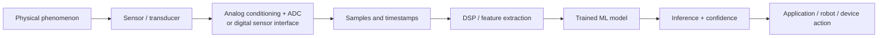

# Week 07 — Foundations of Sensors, Signals, and Edge AI

A concept-first Markdown textbook shared by **ND01 — Embedded & Hardware**, **ND02 — Application Developers**, and **ND03 — Automation & Robotics**. Week 07 teaches the theory; **Week 08** applies it in the existing labs. There are no slide numbers, time blocks, or required durations.

## Central learning question

**How do physical phenomena become useful decisions in an AI-enabled system?**

## Read the foundations in order

1. [Sensors, transducers, and physical signals](01-sensors-and-signals.md) — what is actually measured.
2. [Analog-to-digital conversion and sampling](02-adc-and-sampling.md) — how real signals become numbers.
3. [Digital signal processing and feature extraction](03-dsp-and-feature-extraction.md) — transforming raw samples into useful representations.
4. [Machine learning fundamentals](04-machine-learning-fundamentals.md) — training a model instead of writing fixed classification rules.
5. [Dataset design and reproducibility](05-dataset-design.md) — obtaining trustworthy, labelled examples.
6. [Model evaluation and generalization](06-model-evaluation.md) — accuracy, confusion matrices, false triggers and domain shift.
7. [Inference, quantization, and deployment](07-inference-and-deployment.md) — running trained models on different compute targets.
8. [Worked examples and glossary](08-worked-examples.md) — audio keywords and IMU gestures from start to finish.

## Continue in your learning track

| Track | Week 07 theory | Week 08 practical |
|---|---|---|
| ND01 — Embedded & Hardware | [Microphone, DSP and TinyML firmware](../../../nd1/docs/week07/README.md) | [ND01 labs](../../../nd1/docs/week08/labs/README.md) |
| ND02 — Application Developers | [SDKs, services and real-time applications](../../../nd2/docs/week07/README.md) | [ND02 labs](../../../nd2/docs/week08/labs/README.md) |
| ND03 — Automation & Robotics | [IMU perception and robot decisions](../../../nd3/docs/week07/README.md) | [ND03 labs](../../../nd3/docs/week08/labs/README.md) |

## Expected understanding

After these chapters, learners should be able to:
- Locate sensing, conversion, preprocessing, training and inference in a real system.
- Distinguish analog ADC quantization from INT8 neural-network quantization.
- Calculate sample counts, basic memory usage and sampling intervals.
- Explain the meaning of features, labels, model confidence and test performance.
- Describe when a system should refuse uncertain predictions.
- Explain why changing sensor configuration or preprocessing may invalidate a trained model.

## Consistency rule

**Sensor units + sample rate + channel order + window definition + feature computation + normalization + label order are part of the effective model contract.** The live system must use the same definitions as the training system.

## Further reading

- [SciPy signal processing](https://docs.scipy.org/doc/scipy/reference/signal.html)
- [LiteRT for Microcontrollers](https://ai.google.dev/edge/litert/microcontrollers/overview)
- [TensorFlow ML basics](https://www.tensorflow.org/learn)

[KMUTT ND69 index](../../../README.md)
